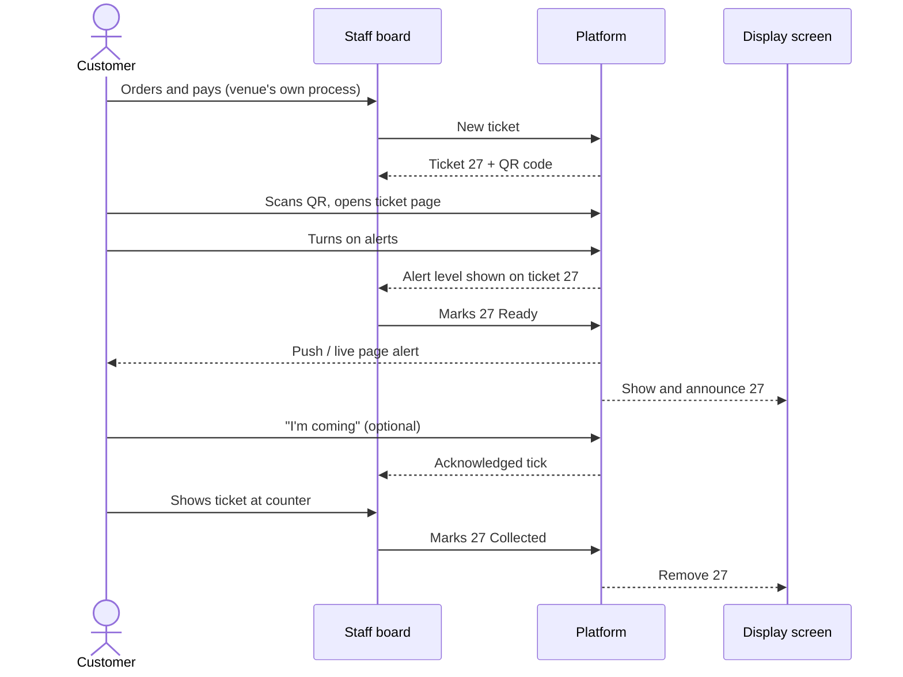

# Digital Order Pager — Business Requirements Document (BRD)

| Item | Value |
| --- | --- |
| Document | Business Requirements Document |
| Product | Digital Order Pager (working name) |
| Version | 0.1 — Draft for review |
| Date | 2026-10-22 |
| Source | [Digital-Order-Pager-Concept.md](Digital-Order-Pager-Concept.md) |
| Status | Awaiting stakeholder review and sign-off |

---

## Table of contents

1. [Purpose of this document](#1-purpose-of-this-document)
2. [Executive summary](#2-executive-summary)
3. [Business problem and opportunity](#3-business-problem-and-opportunity)
4. [Business objectives and success measures](#4-business-objectives-and-success-measures)
5. [Scope](#5-scope)
6. [Stakeholders and user roles](#6-stakeholders-and-user-roles)
7. [Current and future business process](#7-current-and-future-business-process)
8. [Functional requirements](#8-functional-requirements)
9. [Business rules](#9-business-rules)
10. [Data requirements](#10-data-requirements)
11. [Non-functional requirements](#11-non-functional-requirements)
12. [Reporting requirements](#12-reporting-requirements)
13. [Exception handling requirements](#13-exception-handling-requirements)
14. [Assumptions, constraints and dependencies](#14-assumptions-constraints-and-dependencies)
15. [Risks and mitigations](#15-risks-and-mitigations)
16. [Release plan](#16-release-plan)
17. [Concept review findings](#17-concept-review-findings)
18. [Decisions log](#18-decisions-log)
19. [Traceability matrix](#19-traceability-matrix)
20. [Glossary](#20-glossary)
21. [Approval](#21-approval)

---

## 1. Purpose of this document

This document states **what the business needs** from the Digital Order Pager platform, so that product, design, engineering, QA and commercial teams build and test the same thing. It turns the concept document into numbered, testable requirements.

It does not prescribe technology. Technology suggestions in the concept document are guidance only; the binding statements are the requirements in sections 8 to 13.

### How to read the requirements

- **ID:** unique and permanent (e.g. `FR-TKT-03`). Removed requirements keep their ID, marked *withdrawn*.
- **Priority (MoSCoW):** **M** = Must have, **S** = Should have, **C** = Could have, **W** = Won't have in this release.
- **Release:** **MVP**, **R1.1**, **R2** or **Later** (section 16).
- **Acceptance:** the condition QA uses to accept the requirement.

---

## 2. Executive summary

Restaurants and cafés need a reliable way to tell customers that an order is ready. Calling out numbers fails in noisy venues, and physical pagers are costly to buy and maintain.

The Digital Order Pager is a **multi-tenant, browser-based SaaS platform** that turns the customer's own phone into the pager:

- Staff create a ticket when the order is taken. The customer scans that ticket's QR code and follows the order live in the browser, with no app, account or phone number.
- When staff tap **Ready**, the customer's phone alerts them, and an in-venue display shows and announces the number as a backup.
- Each restaurant is an isolated **tenant** that manages its own venues, staff, settings and subscription.
- The platform company runs all tenants from a **super admin console**.

The business earns a flat monthly, quarterly or yearly subscription per venue. Customers use the service for free.

---

## 3. Business problem and opportunity

### 3.1 Problems today

| # | Problem | Who is affected | Business impact |
| --- | --- | --- | --- |
| P1 | Numbers called aloud are missed in noisy venues | Customers, staff | Cold food, crowding at the counter, repeated calling |
| P2 | Physical pagers cost several hundred euros, get lost, break and need charging | Restaurant owners | Capital cost, replacement cost, staff time |
| P3 | SMS paging needs phone numbers and costs per message | Owners, customers | Running cost, privacy concerns, slower ordering |
| P4 | Staff cannot tell whether a customer has been reached | Staff | Uncollected orders, waste, complaints |
| P5 | Owners have no data on preparation and pickup times | Owners | No basis for staffing or process decisions |

### 3.2 Opportunity

- Almost every customer carries a smartphone with a camera and a browser.
- Modern browsers support push notifications, live connections and screen wake lock.
- Venues already own phones, tablets, PCs and TVs that can run the staff board and display.
- A software subscription replaces up-front hardware with a low, predictable monthly cost.

---

## 4. Business objectives and success measures

| ID | Objective | Measure | Target | When measured |
| --- | --- | --- | --- | --- |
| BO-1 | Customers are reliably told their order is ready | Share of tickets at alert level Push or Live page when marked Ready | ≥ 70% | MVP pilot exit |
| BO-2 | Orders are collected quickly | Median time from Ready to Collected | < 2 minutes | MVP pilot exit |
| BO-3 | Restaurants start without help | Median time from sign-up to first real ticket | < 10 minutes | R1.1 |
| BO-4 | Restaurants pay for the product | Share of pilot venues willing to pay after the pilot | ≥ 60% | MVP pilot exit |
| BO-5 | Trials become paying tenants | Trial-to-paid conversion | ≥ 25% | 3 months after launch |
| BO-6 | Restaurants stay | Monthly tenant churn | < 3% | Ongoing after launch |
| BO-7 | Staff work faster | Taps needed to mark an order Ready from the board | 1 | MVP |
| BO-8 | Customers are satisfied | Average customer rating | ≥ 4.3 of 5 | R1.1 onward |
| BO-9 | Tenant data stays separate | Cross-tenant data exposure incidents | 0 | Ongoing |
| BO-10 | The platform is run safely and lawfully | Uptime during opening hours; data-protection requests answered in time; platform actions audited | ≥ 99.9%; 100% within 30 days; 100% audited | Ongoing |

Targets BO-4 to BO-6 were confirmed in the decisions log (section 18, OI-05).

---

## 5. Scope

### 5.1 In scope

| Area | Included |
| --- | --- |
| Platform | Multi-tenant platform, tenant lifecycle, super admin console, platform users and roles, audit log |
| Tenant (restaurant) | Sign-up, venues, counters, branding, messages, numbering, team, staff device access, settings, billing, reports |
| Ordering flow | Ticket creation, ticket QR codes, customer ticket page, status changes, collection |
| Alerts | Alert activation, Web Push, live page alerts, repeat alerts, acknowledgement |
| Venue screens | Staff board, kitchen mode, display screen with spoken announcements |
| Integration | REST API, signed webhooks, ready-made POS connectors |
| Commercial | Free trial, plans, billing periods, coupons, complimentary tenants |
| Compliance | Privacy, data retention, data export and deletion per tenant, accessibility |

### 5.2 Out of scope

| Item | Reason |
| --- | --- |
| Taking orders or payments from customers | The venue keeps its own ordering and payment process |
| Native iOS or Android customer apps | Customers will not install an app to wait a few minutes |
| SMS alerts | Needs phone numbers and has per-message cost (possible paid add-on later) |
| Kitchen display system (item-level preparation) | The product works at order level, not item level |
| "It's your turn" queues (banks, clinics, waiting lists) | Different workflow; later module |
| Long-lived tickets (repair shops, dry cleaners) | Needs different expiry and alert rules; later |
| Bluetooth or Wi-Fi presence detection | Too dependent on phone settings and venue hardware |

---

## 6. Stakeholders and user roles

### 6.1 Stakeholders

| Stakeholder | Interest |
| --- | --- |
| Platform company (business owner) | Revenue, growth, low running cost, reputation |
| Platform team (super admins, support, finance) | Easy tenant management, safe support access, clear billing data |
| Restaurant owners (tenants) | Fewer missed orders, lower cost than pagers, data on operations |
| Restaurant managers | Simple setup, control over staff access and settings |
| Restaurant staff | Fast, reliable board that works in a busy shift |
| Restaurant customers | Know when the order is ready without staying at the counter |
| POS vendors and integrators | Simple, stable API and webhooks |
| Legal and compliance | GDPR and local law compliance, data processing agreements |

### 6.2 User roles and permissions

| Role | Level | Main permissions | Cannot |
| --- | --- | --- | --- |
| Super admin | Platform | Everything on the platform: tenants, plans, prices, platform settings, platform users, emergency access | — |
| Support agent | Platform | View tenants, add notes, request support access, act inside a tenant during approved access | Change plans, prices, platform settings or platform users |
| Finance | Platform | View subscriptions, invoices, revenue reports | Change any tenant or platform data |
| Owner | Tenant | Everything in their tenant, including billing, team, ownership transfer and tenant deletion | See other tenants |
| Manager | Tenant | Venues, settings, staff access, displays, tickets (through the staff board), reports, ratings, support-access approval, inviting other managers | Billing, tenant deletion, data export, slug change, removing members or changing roles, ownership transfer, API keys, webhooks, POS connections, see other tenants |
| Staff device | Venue | Staff board of one venue: create tickets, change statuses | Admin area, settings, reports |
| Display device | Venue | Read-only display of one venue (or counter) | Any change |
| Customer | Public | Their own tickets only | Anything else |
| POS integration (API key) | Venue | Tickets of one venue through the API | Other venues or tenants, settings |

---

## 7. Current and future business process

### 7.1 Current process (without the product)

1. Customer orders and pays at the counter.
2. Staff give a number on a receipt, or a physical pager, or write the customer's name.
3. Customer waits near the counter to avoid missing the call.
4. Kitchen finishes the order.
5. Staff call the number or name aloud, possibly several times, or trigger the pager.
6. Customer collects the order. Staff collect and recharge the pager.

### 7.2 Future process (with the product)

### 7.3 Platform onboarding process

1. A restaurant signs up on the website, **or** a super admin creates the tenant and invites the owner.
2. The tenant starts in Trial (14 days).
3. The owner completes the setup checklist and runs a test ticket.
4. The owner subscribes before the trial ends; the tenant becomes Active.

---

## 8. Functional requirements

### 8.1 Platform and tenancy (TEN)

| ID | Requirement | Priority | Release | Acceptance |
| --- | --- | --- | --- | --- |
| FR-TEN-01 | The system shall treat each restaurant business as a separate tenant with its own users, venues, settings, data and subscription. | M | MVP | Two test tenants can be created and configured independently. |
| FR-TEN-02 | Every tenant record (venue, counter, ticket, event, device, setting, rating, API key, webhook) shall belong to exactly one tenant. | M | MVP | Database review: no tenant-owned record lacks a tenant reference. |
| FR-TEN-03 | A tenant user, staff device, display, API key or customer shall never read or change another tenant's data. | M | MVP | Automated cross-tenant tests on every release return no data from another tenant. |
| FR-TEN-04 | Each tenant shall have a unique slug used in its admin, staff and venue links. Reserved words (admin, api, www, support) shall be refused. | M | MVP | Creating a duplicate or reserved slug is refused with a clear message. |
| FR-TEN-05 | Ticket links shall work from the ticket token alone, so renaming a tenant slug does not break printed QR codes. | M | MVP | After a slug change, existing ticket QR codes still open their tickets. |
| FR-TEN-06 | The system shall support the tenant statuses Trial, Active, Past due, Suspended, Expired trial, Cancelled and Deleted, with the transitions in rule BR-16 and the access levels in rule BR-23. | M | MVP | Each transition in BR-16 can be triggered; each status gives exactly the access in BR-23. |
| FR-TEN-07 | A tenant shall be able to hold several venues; venue count is limited by plan. | S | R2 | A Multi-site tenant can add venues; a Standard tenant cannot exceed its limit. |
| FR-TEN-08 | A tenant owner shall be able to export all tenant data (settings, tickets, events, ratings) as a downloadable file. | M | MVP | Export contains all tenant data and no other tenant's data. |
| FR-TEN-09 | Custom domains per tenant. | C | Later | — |
| FR-TEN-10 | A Multi-site tenant's owner and managers shall switch between venues in one admin area and see reports combined across venues. | S | R2 | Combined report equals the sum of the venue reports. |

### 8.2 Super admin console (SA)

| ID | Requirement | Priority | Release | Acceptance |
| --- | --- | --- | --- | --- |
| FR-SA-01 | The platform shall provide a super admin console on a separate address, usable only by platform users. | M | MVP | Tenant users cannot sign in to the console. |
| FR-SA-02 | Platform users shall sign in with mandatory two-factor authentication. | M | MVP | Sign-in without a second factor is impossible. |
| FR-SA-03 | Super admins shall be able to invite platform users, assign roles (super admin, support agent, finance) and remove access. | M | MVP | Each role sees only its permitted actions (section 6.2). |
| FR-SA-04 | The console shall list and search all tenants by name, slug, owner email, plan and status, showing venues, tickets this month and last activity, and show each tenant's venues, staff devices and displays (read-only). | M | MVP | Search returns the expected tenant within 2 seconds; tenant profile lists its venues, devices and displays. |
| FR-SA-05 | Super admins shall be able to create a tenant, choose its plan and trial length, and send the owner an invitation email. | M | MVP | The invited owner can set a password and reach the setup checklist. |
| FR-SA-06 | Super admins shall be able to suspend and reactivate a tenant, with a mandatory reason; the owner is emailed the reason. | M | MVP | Suspension blocks new tickets; email received with the reason. |
| FR-SA-07 | Super admins shall be able to extend a trial, change a plan, apply a coupon, grant free months and mark a tenant as complimentary (rule BR-25). | M | MVP (extend, complimentary) / R1.1 (coupon, free months, change plan between Standard and Pro) | Changes appear on the tenant's billing page. |
| FR-SA-08 | Super admins shall be able to transfer a tenant's ownership after identity checks when the owner is unreachable. | S | R1.1 | New owner has owner rights; old owner loses them; action audited. |
| FR-SA-09 | Super admins shall be able to cancel and delete a tenant; deletion follows rule BR-17. | M | MVP | Deleted tenant cannot sign in; data erased within 30 days; the action is in the audit log; the owner is emailed. |
| FR-SA-10 | Super admins shall manage plans, prices, billing periods, discounts, coupons and plan limits. | M | R1.1 | A new plan can be created and offered to tenants without a code change. |
| FR-SA-11 | Super admins shall turn features on or off per plan or per tenant (feature flags). | S | R1.1 | A flag enabled for one tenant shows the feature only to that tenant. |
| FR-SA-12 | Super admins shall manage platform settings: defaults for new tenants, chime library, supported languages and their announcement voice, email template texts and versioned legal documents; and shall see (not edit) the Web Push key status. In MVP, push keys, email templates and the first legal document versions are configured by the platform team at deployment. | M | MVP (defaults, chimes, languages) / R1.1 (template texts, legal document publishing, push key status) | A changed default applies to tenants created afterwards; a published legal version is shown to new sign-ups. |
| FR-SA-13 | Super admins shall be able to show an announcement banner in all or selected tenant admin areas. | C | R1.1 | Banner shows in targeted tenants only. |
| FR-SA-14 | The console shall record every platform-user action in an audit log (who, when, which tenant, before and after values). The log cannot be edited. | M | MVP | Each console action creates an audit entry; entries cannot be changed. |
| FR-SA-15 | Support agents shall be able to add internal notes to a tenant, not visible to the tenant. | S | R1.1 | Notes visible in console only. |
| FR-SA-16 | Super admins shall be able to sign out all staff devices of a venue in an incident. | S | R1.1 | All devices of that venue must sign in again. |

### 8.3 Support access (SUP)

| ID | Requirement | Priority | Release | Acceptance |
| --- | --- | --- | --- | --- |
| FR-SUP-01 | Platform users shall not access a tenant's admin area by default. | M | MVP | Console offers no direct entry into tenant admin without approved access. |
| FR-SUP-02 | A support agent shall request support access with a reason; the owner or a manager approves it in the tenant admin area, or generates a one-time support code in the admin area and reads it to the agent, who enters it in the console. | M | R1.1 | Access begins only after approval or a valid code. |
| FR-SUP-03 | Support access shall expire after a set time (default 2 hours) and can be ended by either side. | M | R1.1 | Access ends at expiry or on ending; further actions refused. |
| FR-SUP-04 | During support access, the tenant admin area shall show a visible banner "Platform support is viewing this account". | M | R1.1 | Banner visible to all tenant users during the session. |
| FR-SUP-05 | Every action during support access shall be recorded in both the platform audit log and the tenant's own log. | M | R1.1 | Actions appear in both logs. |
| FR-SUP-06 | A super admin may open emergency access without approval only with a recorded reason; the owner is notified immediately. | S | R1.1 | Owner receives a notification email within 1 minute. |
| FR-SUP-07 | Platform users shall access tenant data only for support, security, billing or legal purposes; every console view of tenant data and every support action records its purpose in the audit log. | M | MVP (audit) / R1.1 (support) | Audit entries carry a purpose. |

### 8.4 Tenant administration and setup (ADM)

| ID | Requirement | Priority | Release | Acceptance |
| --- | --- | --- | --- | --- |
| FR-ADM-01 | A restaurant shall be able to sign up with email and password or Google sign-in, confirm its email, and get a tenant in Trial. | M | MVP (email) / R1.1 (Google) | New tenant created with the signer as owner. |
| FR-ADM-02 | The admin area shall show a setup checklist covering the steps in the concept document (section 10), ending with a test ticket. | M | MVP | Checklist items tick automatically when completed. |
| FR-ADM-03 | Owners and managers shall set venue name, address, time zone and customer languages. | M | MVP | Times and announcements use the venue's time zone and language. |
| FR-ADM-04 | Owners and managers shall upload a logo and choose a brand colour; the customer page and display use them. | M | MVP | Logo and colour appear on customer page and display. |
| FR-ADM-05 | Owners and managers shall edit customer messages: welcome, collection instruction, cancellation message, post-collection message, website/menu link. | M | MVP | Messages appear in the matching customer page states. |
| FR-ADM-06 | Owners and managers shall set the ticket flow: start status (Received or Preparing), default wait estimate or none, check code (mandatory, optional, off) and claim method. | M | MVP (start status, wait) / R1.1 (check code, claim) | Settings change behaviour of new tickets. |
| FR-ADM-07 | Owners and managers shall set numbering: prefix per counter, range, reset time and skip list. | M | MVP (range, reset) / R1.1 (prefix, skip list) | New numbers follow the settings (rules BR-01 to BR-04). |
| FR-ADM-08 | Owners and managers shall set alert repeats (timings, maximum) and choose a chime from the platform library. | S | MVP | New Ready alerts follow the settings. |
| FR-ADM-09 | Owners and managers shall set the auto-close time for open tickets. | M | MVP | Open tickets expire at that time (rule BR-07). |
| FR-ADM-10 | Owners and managers shall add counters (e.g. Food, Drinks). | S | R1.1 | Tickets can be assigned to a counter; displays can filter by counter. |
| FR-ADM-11 | Owners shall invite managers, remove members and transfer ownership. | M | MVP | Invited manager gets manager rights only. |
| FR-ADM-12 | The admin area shall generate printable QR poster kits (A4 counter poster, table tent, door sticker) as PDFs. | S | MVP | PDFs download and scan correctly. |
| FR-ADM-13 | The admin area shall show the tenant's own activity log, including support-access sessions. | S | R1.1 | Log lists status changes, setting changes and support actions. |
| FR-ADM-14 | Owners and managers shall approve or refuse support-access requests. | M | R1.1 | See FR-SUP-02. |
| FR-ADM-15 | The owner shall be able to request deletion of the tenant, after re-entering the password, being offered a data export, and a 7-day window in which the request can be cancelled. | M | MVP | After 7 days the tenant becomes Deleted (BR-17); cancelling within 7 days restores it. |
| FR-ADM-16 | At sign-up the owner shall accept the current terms, privacy policy and data processing agreement; the accepted versions are recorded, and new versions must be accepted at the next sign-in. | M | MVP | Acceptance record exists for each tenant with document versions. |
| FR-ADM-17 | Owners and managers shall create, edit and archive venues within their plan limit; archiving stops new tickets and removes the venue's devices and displays. | M | MVP (edit) / R2 (create more, archive) | Archived venue cannot create tickets. |
| FR-ADM-18 | Tenant users shall sign in, sign out, reset a forgotten password, change email and password, and optionally enrol two-factor authentication. | M | MVP | Each action works and is logged. |
| FR-ADM-19 | The platform shall email tenant owners about: email verification, invitations, trial ending (3 days before) and ended, payment failure and reminders, suspension and reactivation, cancellation, deletion requested and completed, support access, staff PIN locks and disabled webhooks. | M | MVP (support R1.1, webhooks R2) | Each event sends its email in the owner's language. |
| FR-ADM-20 | A tenant user shall be able to delete their own user account unless they are the only owner of a tenant. | S | R1.1 | Account and personal data removed; memberships removed. |

### 8.5 Staff and device access (ACC)

| ID | Requirement | Priority | Release | Acceptance |
| --- | --- | --- | --- | --- |
| FR-ACC-01 | Each venue shall have a staff link and a 4-to-6-digit PIN; both are needed to open the staff board. | M | MVP | Link without PIN does not open the board. |
| FR-ACC-02 | Signed-in staff devices shall be listed in admin with a name, last-seen time and a Remove action. | M | MVP | Removing a device signs it out within 1 minute. |
| FR-ACC-03 | Resetting the staff link shall sign out all devices of that venue. | M | MVP | All devices must sign in again with the new link. |
| FR-ACC-04 | Changing the PIN (done in the admin area) shall sign out all staff devices of that venue. | M | MVP | All devices must sign in again with the new PIN. |
| FR-ACC-05 | A staff device session shall last 30 days of use, then ask for the PIN again. | S | MVP | Session ends after 30 days. |
| FR-ACC-06 | After 5 wrong PIN attempts, the device shall be locked for 10 minutes; the owner is notified after repeated locks. | M | MVP | Sixth attempt refused for 10 minutes. |
| FR-ACC-07 | Named staff accounts with personal PINs, so the event log shows the person. | S | R2 | Event log shows staff member names. |

### 8.6 Tickets and numbering (TKT)

| ID | Requirement | Priority | Release | Acceptance |
| --- | --- | --- | --- | --- |
| FR-TKT-01 | Staff shall create a ticket with one tap on **New ticket**; the system assigns the next number. | M | MVP | Ticket created in under 1 second with the next valid number. |
| FR-TKT-02 | Staff may add and later edit an optional note and receipt/external reference on a ticket; these are never shown to the customer. A receipt number already used by another open ticket of the venue is refused with an option to open that ticket. | M | MVP | Note visible on board only; duplicate open receipt number refused. |
| FR-TKT-03 | Tickets shall move only through the transitions in rule BR-05. | M | MVP | Invalid transitions are refused. |
| FR-TKT-04 | Every status change shall record a timestamp and an event (who or which device, when, from, to). | M | MVP | Event log shows each change. |
| FR-TKT-05 | Each ticket shall have a random access token of at least 128 bits used in its customer link. | M | MVP | Token cannot be derived from number or sequence. |
| FR-TKT-06 | Each ticket shall have a 4-character check code shown on the customer page when Ready. | S | R1.1 | Code visible on Ready screen and on staff card. |
| FR-TKT-07 | Each ticket shall have a 4-character claim code for the venue QR fallback, shown under the number on the new-ticket QR screen and returned by the API for printing on receipts. | S | R1.1 | Claim succeeds only with the right code. |
| FR-TKT-08 | Staff shall adjust a ticket's wait estimate by +5 / −5 minutes. | S | MVP | Customer page updates within 1 second. |
| FR-TKT-09 | Merging or splitting tickets. | W | — | Not offered: one order = one ticket. |
| FR-TKT-10 | When a venue chooses calculated wait estimates, the estimate shall be the median ready time of the last 20 tickets at that counter in the last 2 hours, shown as a range; with fewer than 5 such tickets the default is used. | S | R2 | Estimate matches the rule on test data. |

### 8.7 Order association and QR codes (QR)

| ID | Requirement | Priority | Release | Acceptance |
| --- | --- | --- | --- | --- |
| FR-QR-01 | On ticket creation, the staff board shall show a large QR code for that ticket until it is scanned or dismissed. | M | MVP | Scanning opens exactly that ticket. |
| FR-QR-02 | Staff shall be able to show a ticket's QR code again from the card menu. | M | MVP | QR re-displays. |
| FR-QR-03 | The API shall return a QR image link for tickets created by a POS, for printing on receipts. | M | R2 | QR printed on receipt opens the ticket. |
| FR-QR-04 | Each venue shall have a venue QR that opens the venue page; it shall never create a ticket. | M | MVP | Venue QR never creates tickets. |
| FR-QR-05 | The venue page shall list the phone's open tickets at that venue first; when there are none (and before claiming exists), it tells the customer to ask staff for their ticket QR. | S | MVP | Returning customer sees their tickets; others see the "ask staff" message. |
| FR-QR-06 | The venue page shall let a customer claim a ticket with number + claim code, or request staff approval if the venue uses staff-approved claims. | S | R1.1 | Claim without valid code or approval is refused. |
| FR-QR-07 | Re-scanning a ticket QR shall open the same ticket, never create a new one. | M | MVP | Same ticket opens each time. |
| FR-QR-08 | One phone shall be able to follow several tickets, including tickets from different tenants. | M | MVP | Each ticket shows as a card with its own branding. |
| FR-QR-09 | Several phones shall be able to follow the same ticket; all are alerted. | S | MVP | All joined phones receive the alert. |
| FR-QR-10 | Rotating display QR code (changes every 30 seconds). | C | Later | Old codes stop working after expiry. |

### 8.8 Customer ticket page (CUS)

| ID | Requirement | Priority | Release | Acceptance |
| --- | --- | --- | --- | --- |
| FR-CUS-01 | The customer page shall open in the phone's browser with no install, account, form or personal data. | M | MVP | Page usable straight after scanning. |
| FR-CUS-02 | The page shall always show the venue's name, logo and colour, the ticket number (at least one third of the screen width), status in words and colour, alert state, and collection instructions. | M | MVP | Visual review on 3 phone sizes. |
| FR-CUS-03 | The page shall show a distinct screen for each status as listed in the concept document (section 6). | M | MVP | Each status shows its defined screen. |
| FR-CUS-04 | The page shall update within 1 second of a status change while connected. | M | MVP | Measured over 100 changes, 95% under 1 second. |
| FR-CUS-05 | The page shall show the wait estimate; past the estimate it shall say "Taking a little longer than usual". | S | MVP | No negative times shown. |
| FR-CUS-06 | On Ready, the page shall show a full-screen, high-contrast message with an **I'm coming** button. | M | MVP | Button records acknowledgement. |
| FR-CUS-07 | After an undo of Ready, the page shall show "Sorry — not ready yet" for 10 seconds, then the Preparing screen. | M | MVP | Message appears within 1 second of undo. |
| FR-CUS-08 | When the connection drops, the page shall show "Reconnecting…", keep the last status, and refresh on reconnect. | M | MVP | Status correct within 5 seconds of reconnect. |
| FR-CUS-09 | The page shall open in the phone's language when the tenant supports it, with a language switch. | S | R1.1 | Page shows in a supported language. |
| FR-CUS-10 | After Collected, the page shall offer a 1–5 star rating and an optional comment (asked when 3 stars or fewer). | S | R1.1 | Rating stored against the ticket. |
| FR-CUS-11 | A closed ticket opened later shall show its final status and a link to the venue page, never a live number. | M | MVP | No closed ticket appears active. |

### 8.9 Alerts and notifications (ALR)

| ID | Requirement | Priority | Release | Acceptance |
| --- | --- | --- | --- | --- |
| FR-ALR-01 | The page shall offer a **Turn on alerts** button that plays a test chime and asks "Did you hear that?" (with a volume and silent-mode tip on "No"), asks for notification permission where supported, and requests screen wake lock. | M | MVP | Works on the supported browsers (NFR-COM-01). |
| FR-ALR-02 | On iPhone Safari, the page shall show a short guide to add the page to the Home Screen, with a "Skip, I'll keep this page open" option. | M | MVP | Guide shown only on iPhone Safari. |
| FR-ALR-03 | When a ticket becomes Ready, the system shall send Web Push to every push subscription on the ticket. | M | MVP | Push received on a locked Android phone and an iPhone Home Screen web app. |
| FR-ALR-04 | When a ticket becomes Ready and the page is open, the page shall play a loud chime, vibrate where supported and flash the screen, looping until acknowledged or 60 seconds pass. | M | MVP | Verified on supported browsers. |
| FR-ALR-05 | The system shall keep an alert level per ticket: Push, Live page, Page closed or None, and an Acknowledged flag (rule BR-10). | M | MVP | Board shows the correct icon within 60 seconds of a change. |
| FR-ALR-06 | The page shall send a heartbeat every 20 seconds; a page silent for over 60 seconds becomes Page closed. | M | MVP | Closing the page changes the level within 60 seconds. |
| FR-ALR-07 | Unacknowledged, uncollected Ready tickets shall be re-alerted on the venue's repeat schedule (default +2 and +5 minutes, maximum 3 automatic alerts). | M | MVP | Alerts sent at the configured times. |
| FR-ALR-08 | All automatic repeats shall stop on Acknowledged, Collected, Cancelled, Expired or undo of Ready. | M | MVP | No alert sent after these events. |
| FR-ALR-09 | Staff shall send an extra alert with **Alert again**; it does not count toward the maximum. | M | MVP | Alert sent and display re-announces. |
| FR-ALR-10 | Push title shall be "{Venue}: order {number} is ready" and the body the collection instruction; tapping it opens the ticket page. | M | MVP | Content verified on Android and iPhone. |
| FR-ALR-11 | The system shall never claim that a customer heard an alert; it reports only pushes accepted, pages reached and acknowledgements. | M | MVP | Wording review of board and reports. |

### 8.10 Staff board (STF)

| ID | Requirement | Priority | Release | Acceptance |
| --- | --- | --- | --- | --- |
| FR-STF-01 | The board shall show tickets as cards in Preparing and Ready columns (Received optional), oldest first, under a top bar with venue/counter name, New ticket, search, connection status and today's counts. | M | MVP | Layout review. |
| FR-STF-02 | Each card shall show number, alert-level icon, age, note or receipt number, and its main action. | M | MVP | All elements visible. |
| FR-STF-03 | Marking a ticket Ready shall take one tap and show a 10-second Undo bar. | M | MVP | Undo restores Preparing. |
| FR-STF-04 | Staff shall move a Ready ticket back to Preparing at any time from the card menu. | M | MVP | Status returns to Preparing; repeats stop. |
| FR-STF-05 | Marking Collected shall take one tap; the ticket moves to a Recent list kept for 30 minutes. | M | MVP | Collected ticket visible in Recent for 30 minutes. |
| FR-STF-06 | Staff shall reopen a Collected ticket from Recent, returning it to Ready. | M | MVP | Ticket returns to Ready. |
| FR-STF-07 | Staff shall cancel a ticket with confirmation and a reason. | M | MVP | Ticket Cancelled; customer sees the cancellation message. |
| FR-STF-08 | Tickets past their wait estimate shall turn amber; Ready tickets still uncollected 60 seconds after the last automatic alert shall turn red with the label "Not collected — call out". | S | MVP | Colours and label change at the right times. |
| FR-STF-09 | The board shall offer search by number or receipt. | S | MVP | Search finds the ticket. |
| FR-STF-10 | On phones, columns shall become tabs with counts. | M | MVP | Usable at 360 px width. |
| FR-STF-11 | A kitchen mode shall show only large cards and the Ready action. | S | R1.1 | Mode selectable per device. |
| FR-STF-12 | On a PC, typing a number then Enter shall mark it Ready; number then C shall mark it Collected. | C | R1.1 | Shortcuts work. |
| FR-STF-13 | All devices of a venue shall see the same board live; with simultaneous actions, the first wins and others see who acted. | M | MVP | Conflict message names the device. |
| FR-STF-14 | When offline, the board shall show a red Offline bar and disable actions; taps are not queued. | M | MVP | No action accepted while offline. |
| FR-STF-15 | The board shall approve or refuse staff-approved claims. | S | R1.1 | Approval links the phone to the ticket. |
| FR-STF-16 | The board may play a sound when a POS creates a ticket. | C | R2 | Sound plays on API-created tickets. |
| FR-STF-17 | Owners and managers (and platform support during an approved session) shall be able to open the staff board of any of their venues from the admin area with their own sign-in, without the staff PIN. | M | MVP | Actions are recorded with the user, not a device. |

### 8.11 Display screen and announcements (DSP)

| ID | Requirement | Priority | Release | Acceptance |
| --- | --- | --- | --- | --- |
| FR-DSP-01 | Managers shall create a display and pair any browser to it with a short pairing code, without a login on the display device. | M | MVP | Paired display shows the venue. |
| FR-DSP-02 | The display shall show Ready numbers (large, newest first, newest highlighted for 10 seconds) and optionally Preparing numbers. | M | MVP | Layout review on a 43-inch screen. |
| FR-DSP-03 | The display shall be readable from 8–10 metres on a 43-inch screen. | M | MVP | Test from 10 metres. |
| FR-DSP-04 | On Ready, the display shall play a chime and speak "Order {number} is ready" in the venue language; several numbers are combined in one announcement. Volume is set on the display device itself. | M | MVP | Announcements never overlap. |
| FR-DSP-05 | The display shall repeat announcements on the alert repeat schedule and on Alert again. | S | MVP | Repeats heard. |
| FR-DSP-06 | The display shall show a venue QR code, logo and message line. | S | MVP | QR opens the venue page. |
| FR-DSP-07 | The display shall support filtering by counter, quiet hours, a second announcement language, and a promo slot that never covers the Ready list. | S | R1.1 | Each option works. |
| FR-DSP-08 | The display shall show "Tap to enable sound" once after start, and "Reconnecting" when offline while keeping the last list. | M | MVP | Behaviour verified. |
| FR-DSP-09 | A number shall leave the Ready list on Collected, Cancelled or Expired, and move back to Preparing on undo. | M | MVP | Updates within 1 second. |
| FR-DSP-10 | Managers shall list, rename, unpair and remove displays, and see each display's last-seen time and whether its sound is enabled. | M | MVP | Removed display stops showing the board within 1 minute. |

### 8.12 Integrations (INT)

| ID | Requirement | Priority | Release | Acceptance |
| --- | --- | --- | --- | --- |
| FR-INT-01 | Owners shall create, name and revoke API keys per venue; a key is shown once and belongs to one tenant and one venue. | M | R2 | Revoked key is refused immediately. |
| FR-INT-02 | The API shall allow creating a ticket (with external reference, counter, note, wait, status) and return number, ticket link, QR image link and claim code. | M | R2 | Contract test passes. |
| FR-INT-03 | The API shall allow reading a ticket by ID or external reference, listing active tickets, changing status, and sending an extra alert. | M | R2 | Contract test passes. |
| FR-INT-04 | Every API write shall accept an idempotency key; repeating a request shall not create duplicates. | M | R2 | Repeated call returns the first result. |
| FR-INT-05 | Creating a ticket with an external reference that has an open ticket shall return that ticket. | M | R2 | No duplicate tickets per external reference. |
| FR-INT-06 | API calls shall be rate-limited per key with clear error codes. | M | R2 | Excess calls receive a rate-limit error. |
| FR-INT-07 | Owners shall register webhook URLs and choose events (created, ready, acknowledged, collected, cancelled, expired). | M | R2 | Events delivered to the URL. |
| FR-INT-08 | Webhooks shall be signed (HMAC) and retried with back-off for up to 24 hours. | M | R2 | Receiver can verify signature; failed calls retried. |
| FR-INT-09 | The platform shall offer ready-made connectors for the 2–3 most used POS systems in the launch market. | S | R2 | "Connect" flow works without developer work. |
| FR-INT-10 | Standalone use without integration shall always remain available. | M | MVP | All core flows work with no integration. |

### 8.13 Reports and feedback (RPT)

| ID | Requirement | Priority | Release | Acceptance |
| --- | --- | --- | --- | --- |
| FR-RPT-01 | The tenant admin shall show a Today screen: live counts, current median preparation time, longest-waiting tickets. | M | MVP | Figures match the event log. |
| FR-RPT-02 | The tenant admin shall show trends for the metrics in section 12, with comparison to the previous period. | S | R1.1 | Figures match the event log. |
| FR-RPT-03 | The tenant admin shall show a heatmap of tickets by hour and weekday. | S | R1.1 | Heatmap matches data. |
| FR-RPT-04 | Reports shall filter by venue, counter and date range and export to CSV. | S | R1.1 (filters) / R2 (CSV, Pro) | Export matches screen. |
| FR-RPT-05 | Owners shall receive a weekly email summary, which they can turn off. | C | R1.1 | Email received weekly. |
| FR-RPT-06 | Tenant reports shall include only that tenant's data. | M | MVP | Cross-tenant test. |
| FR-RPT-07 | The super admin console shall show platform reports (section 12.2). | S | R1.1 | Figures match billing and event data. |
| FR-RPT-08 | Ratings and comments shall appear in the tenant admin with ticket number and time; the tenant can delete comments. | S | R1.1 | Deleted comment no longer shown. |
| FR-RPT-09 | A review-site link may be shown after rating; it shall be shown to every rating customer, not only high ratings. | C | R1.1 | Link shown regardless of rating. |
| FR-RPT-10 | For the pilot, the tenant admin shall show, for a chosen date range, alert reach, acknowledgement rate, median and 90th-percentile preparation and pickup times and uncollected tickets; the console shows the same figures per pilot tenant. | M | MVP | Figures match the event log; BO-1 and BO-2 can be read directly. |

### 8.14 Subscription and billing (BIL)

| ID | Requirement | Priority | Release | Acceptance |
| --- | --- | --- | --- | --- |
| FR-BIL-01 | New tenants shall get a 14-day free trial with no card, limited to 200 tickets per day. | M | MVP | 201st ticket of the day refused with an upgrade message. |
| FR-BIL-02 | Tenants shall subscribe per venue to Standard, Pro or Multi-site plans, with the features and limits in section 8.15. | M | MVP (Standard) / R1.1 (Pro) / R2 (Multi-site, Pro integrations) | Each plan gives exactly the entitlements in 8.15 for the current release. |
| FR-BIL-03 | Tenants shall choose monthly, quarterly or yearly billing; longer periods may be discounted. | M | MVP | Invoices match the chosen period. |
| FR-BIL-04 | Subscriptions shall renew automatically; cancelling stops the next renewal and access continues to the end of the paid period. | M | MVP | Access ends at period end. |
| FR-BIL-05 | Upgrades shall apply at once with pro-rating; downgrades at the next renewal. | S | R2 | Amounts correct. |
| FR-BIL-06 | Failed payments shall be retried for 7 days with emails, then rule BR-16 applies. | M | MVP | Tenant moves to Past due, then Suspended. |
| FR-BIL-07 | Invoices shall include the correct VAT or sales tax for the tenant's country and be downloadable. | M | MVP | Tax correct for test countries. |
| FR-BIL-08 | The customer page shall show no ads and at most a small "Powered by" line, removable on Pro. | M | MVP (no ads, line) / R1.1 (removal on Pro) | Visual review. |
| FR-BIL-09 | Owners shall update the payment method, see and download invoices, and cancel or resume renewal themselves. | M | MVP | Each action works without platform help. |
| FR-BIL-10 | A downgrade or plan change shall be refused while the tenant uses more than the target plan allows (venues, counters, languages, API keys); the owner is told what to remove first. | M | R1.1 | Refusal lists the excess items. |

### 8.15 Plan entitlements by release

| Entitlement | Trial | Standard | Pro | Multi-site |
| --- | --- | --- | --- | --- |
| Available from | MVP | MVP | R1.1 | R2 |
| Venues | 1 | 1 | 1 | 2 or more (per-venue price, 15% off from the 3rd venue) |
| Tickets and alerts | 200 per day | Unlimited | Unlimited | Unlimited |
| Staff devices and displays | Unlimited | Unlimited | Unlimited | Unlimited |
| Customer languages | As Pro | 1 (MVP), 2 (from R1.1) | Up to 10 | Up to 10 |
| Counters with prefixes | As Pro | 1 counter | Up to 10 (R1.1) | Up to 10 |
| Ratings, trends, heatmap | As Pro | From R1.1 | From R1.1 | From R1.1 |
| Remove "Powered by" | No | No | Yes (R1.1) | Yes |
| API, webhooks, POS connectors, named staff, CSV export | No | No | From R2 | Yes |
| Combined reports across venues | — | — | — | Yes (R2) |

The trial gives the Pro features available in the current release (except API keys), limited to 1 venue and 200 tickets per day.

---

## 9. Business rules

| ID | Rule |
| --- | --- |
| BR-01 | Ticket numbers are sequential per venue, or per counter when prefixes are used. |
| BR-02 | Numbering restarts daily at the venue's reset time (default 04:00 local). |
| BR-03 | Numbers run within the venue's range (default 1–999) and wrap to the start; a number still held by an open ticket is skipped. Two open tickets in one venue never share a number. |
| BR-04 | Numbers on the venue's skip list are never issued. |
| BR-05 | Allowed status transitions: Received → Preparing; Received → Ready (skips Preparing, e.g. a POS marking a quick order ready); Preparing → Ready; Ready → Preparing (undo); Ready → Collected; Collected → Ready (reopen, within 30 minutes); any open status → Cancelled; any open status → Expired. No other transitions are allowed. |
| BR-06 | Open statuses are Received, Preparing and Ready. Closed statuses are Collected, Cancelled and Expired. Closed tickets receive no alerts and leave the board and display. |
| BR-07 | All open tickets become Expired at the venue's auto-close time (default: same as the numbering reset time). |
| BR-08 | If the auto-close time is set later than the reset time, tickets still open at reset keep their numbers and the new sequence skips them. |
| BR-09 | Only staff devices, managers, owners, approved support sessions and the venue's API keys may change ticket status. Customers never change status; they may only follow, acknowledge, rate and claim. |
| BR-10 | Alert level is the best level among all phones following the ticket, in this order: Push > Live page > Page closed > None. Acknowledged is a separate flag. |
| BR-11 | Automatic alerts per Ready period are at most the venue's maximum (default 3, including the first). Manual "Alert again" does not count. |
| BR-12 | A ticket's note and external reference are never shown to customers. |
| BR-13 | The venue QR never creates tickets. Only staff, the API and ticket QR codes link a phone to a ticket. |
| BR-14 | A phone may join a ticket only through the ticket QR or link, a valid claim code, or staff approval. |
| BR-15 | When check codes are mandatory, staff must confirm the code before marking Collected on the staff board. Collection reported by a POS through the API is exempt, because the POS confirms the handover. |
| BR-16 | Tenant status changes (complete list; nothing else is allowed): **Trial** → Active (first payment, or marked complimentary) · Trial → Expired trial (at trial end, including any extension). **Active** → Past due (first failed renewal payment) · Active → Cancelled (end of paid period after cancellation). **Past due** → Active (payment) · Past due → Suspended for non-payment (when the grace period ends, see BR-29). **Suspended for non-payment** → Active (payment) · → Cancelled (30 days after suspension without payment). **Trial, Active or Past due** → Suspended by platform (super admin, with reason). **Suspended by platform** → the status it had before (super admin only; payment alone never lifts it). **Expired trial or Cancelled** → Active (subscribes). **Any status except Deleted** → Deleted (owner request after the 7-day window in FR-ADM-15, or super admin delete) · Expired trial or Cancelled → Deleted (automatically after 90 days). |
| BR-17 | Deleted tenants' data is erased within 30 days; backups containing it expire under the normal backup cycle (30 days). |
| BR-18 | While a tenant is Suspended, no new tickets can be created, but existing open tickets can still be marked Ready and Collected so customers are not stranded. |
| BR-19 | Platform users can act inside a tenant only through approved support access, or emergency access with a recorded reason. |
| BR-20 | Every tenant has exactly one owner at all times. |
| BR-21 | Trial tenants may create at most 200 tickets per day. |
| BR-22 | A Collected ticket can be reopened only within 30 minutes of collection. |
| BR-23 | Access by tenant status — see the table below. |
| BR-24 | No refunds for partial billing periods, except where local consumer law requires (OI-04). |
| BR-25 | A complimentary tenant is Active without payment. When complimentary is turned off, the tenant has 14 days to subscribe; after that it becomes Expired trial. |
| BR-26 | If a venue's auto-close time is earlier than its reset time, open tickets expire at auto-close and numbering continues until the reset time. |
| BR-27 | Changes to a venue's reset time or auto-close time take effect from the next occurrence, never in the middle of a business day. |
| BR-28 | Archived venues cannot create tickets; counters are archived, never deleted, while they have tickets. |
| BR-29 | Payment grace: from the first failed renewal payment, the tenant stays Past due for the retry period plus the grace period (7 + 7 = 14 days, decided in OI-09), then becomes Suspended for non-payment. Later failed retries do not extend this date. |

**BR-23 Access by tenant status**

| Status | Admin area | Staff board | New tickets | Display | Customer pages | Integration API |
| --- | --- | --- | --- | --- | --- | --- |
| Trial | Full | Full | Yes, up to 200 per day | Yes | Yes | No |
| Active | Full | Full | Yes | Yes | Yes | Per plan |
| Past due | Full, with payment warning | Full | Yes | Yes | Yes | Per plan |
| Suspended (either cause) | Billing, export and team only | Open tickets can still be marked Ready, Collected or Cancelled; nothing else | No | Yes, for open tickets | Yes | Read only |
| Expired trial, Cancelled | Billing, export and team only | Off ("Subscription required") | No | Off | Closed tickets only | Off |
| Deleted | None | None | No | Off | "No longer available" | Off |

---

## 10. Data requirements

### 10.1 Main data entities

| Entity | Key attributes | Owner |
| --- | --- | --- |
| Platform user | Name, email, role, two-factor status, last sign-in | Platform |
| Plan | Name, price per period, limits, features | Platform |
| Tenant | Name, slug, status, plan, billing details, owner, created date, trial end | Platform / tenant |
| Tenant member | User, tenant, role (owner, manager) | Tenant |
| Venue | Tenant, name, address, time zone, languages, branding, messages, settings | Tenant |
| Counter | Venue, name, prefix | Tenant |
| Staff device | Venue, name, session, last seen | Tenant |
| Display | Venue, name, counter filter, settings, last seen | Tenant |
| Ticket | Tenant, venue, counter, number, token, check code, claim code, status, timestamps, note, external reference, wait estimate, alert level, acknowledged time, alerts sent | Tenant |
| Ticket event | Ticket, from, to, actor (device, user, API key, system, support session), time | Tenant |
| Customer follower | Ticket, browser token, language, link to push subscription, last heartbeat | Tenant |
| Push subscription | Browser push address and keys | Platform (one per phone browser, shared by that phone's tickets at any restaurant; never exposed to tenants) |
| Staff member | Venue, name, personal PIN (R2) | Tenant |
| Rating | Ticket, stars, comment | Tenant |
| API key | Tenant, venue, name, hash, created, revoked | Tenant |
| Webhook | Tenant, venue, URL, events, secret, delivery log | Tenant |
| Subscription and invoice | Tenant, plan, period, status, amounts, tax | Platform / tenant |
| Audit entry | Actor, tenant, action, before, after, time | Platform |
| Support session | Tenant, agent, reason, approved by, start, end | Platform / tenant |

### 10.2 Data retention

| Data | Kept for |
| --- | --- |
| Push subscriptions | Deleted when no ticket using them is open or still within its 30-minute reopen window |
| Ticket records, events, star ratings | 90 days, then deleted; only aggregated counts remain in reports |
| Rating comments | Deleted after 90 days (or earlier by the tenant) |
| Technical logs (IP address, browser type) | 14 days |
| Audit log and support sessions | 2 years (OI-04) |
| Invoices and billing records | As required by tax law in each country |
| Cancelled or expired-trial tenants | 90 days, then deleted |
| Backups | 30 days |

### 10.3 Personal data

- **Customers:** no name, email, phone number or payment data is collected. Stored data is limited to a browser token, push subscription, ticket timestamps, alert level and optional rating comment.
- **Tenant users and platform users:** name, email, sign-in data.
- Each tenant is the data controller for its customers; the platform is the processor under a data processing agreement accepted at sign-up.

---

## 11. Non-functional requirements

| ID | Category | Requirement | Release |
| --- | --- | --- | --- |
| NFR-PER-01 | Performance | A status change reaches open staff boards, displays and customer pages within 1 second (95th percentile). | MVP |
| NFR-PER-02 | Performance | Web Push is handed to the push service within 2 seconds of Ready (95th percentile). | MVP |
| NFR-PER-03 | Performance | Customer page loads in under 2 seconds on a 4G connection. | MVP |
| NFR-PER-04 | Performance | Staff board actions respond in under 500 ms (95th percentile). | MVP |
| NFR-AVL-01 | Availability | 99.9% uptime during venue opening hours, measured monthly. | MVP |
| NFR-AVL-02 | Availability | A public status page shows incidents and maintenance. | R1.1 |
| NFR-AVL-03 | Availability | Pages reconnect automatically and re-fetch state after any connection drop. | MVP |
| NFR-SCL-01 | Scalability | Supports at least 1,000 venues with 500 tickets per venue per day, up to 40 open tickets per venue at peak and up to 3 connected phones per ticket, without degrading NFR-PER targets. | R1.1 |
| NFR-SCL-02 | Scalability | Rate limits and job quotas per tenant prevent one tenant from slowing others. | MVP |
| NFR-SEC-01 | Security | Tenant isolation enforced in several independent layers (tenant-scoped data access, tenant included in database keys, automated cross-tenant tests), with the tenant taken only from the authenticated session. | MVP |
| NFR-SEC-02 | Security | Automated cross-tenant access tests run on every release. | MVP |
| NFR-SEC-03 | Security | HTTPS everywhere with HSTS; data encrypted at rest, including backups. | MVP |
| NFR-SEC-04 | Security | Two-factor sign-in mandatory for platform users; optional for tenant users, mandatory for multi-venue tenants. | MVP / R2 |
| NFR-SEC-05 | Security | API keys stored hashed; webhook secrets never shown after creation. | R2 |
| NFR-SEC-06 | Security | Uploaded logos re-encoded and size-limited; venue texts length-limited; links shown as plain domains. | MVP |
| NFR-SEC-07 | Security | Independent penetration test before general launch. | R1.1 |
| NFR-PRV-01 | Privacy | Compliant with GDPR (EU/UK) and the data protection law of each launch country. | MVP |
| NFR-PRV-02 | Privacy | No advertising or tracking scripts on customer pages. | MVP |
| NFR-PRV-03 | Privacy | Privacy notice linked from every customer page. | MVP |
| NFR-PRV-04 | Privacy | Per-tenant data export and erasure on request. | MVP |
| NFR-ACS-01 | Accessibility | Customer page, staff board and admin meet WCAG 2.2 AA. | MVP |
| NFR-ACS-02 | Accessibility | Status never shown by colour alone; Ready announced to screen readers. | MVP |
| NFR-ACS-03 | Accessibility | Customer page works with large system font sizes. | MVP |
| NFR-COM-01 | Compatibility | Customer page supports current and previous major versions of Safari (iOS 16.4+), Chrome, Edge, Samsung Internet and Firefox on Android, and opens correctly from in-app browsers (Instagram, WhatsApp). | MVP |
| NFR-COM-02 | Compatibility | Staff board supports current Chrome, Edge, Safari and Firefox on phones, tablets and PCs. | MVP |
| NFR-COM-03 | Compatibility | Display runs on smart-TV browsers, Android TV sticks and Android tablets in current Chrome. | MVP |
| NFR-LOC-01 | Localisation | Customer page and display support multiple languages, chosen per venue; all texts are translatable. | MVP (structure) / R1.1 (2nd language) |
| NFR-LOC-02 | Localisation | Dates, times and currencies follow the venue's time zone and locale. | MVP |
| NFR-USA-01 | Usability | Main staff actions are one tap, with touch targets of at least 48 px. | MVP |
| NFR-USA-02 | Usability | A new restaurant reaches its first ticket in under 10 minutes without help. | R1.1 |
| NFR-REC-01 | Recoverability | Daily backups kept 30 days; point-in-time recovery for the last 7 days; at most 5 minutes of data lost and service back within 1 hour after a server or data-centre failure; service back within 8 hours after the loss of a whole cloud region. | MVP |
| NFR-OPS-01 | Operability | Planned maintenance shows a clear maintenance message on all apps; an outage page is shown even when the back end is down. | MVP |
| NFR-OBS-01 | Operability | Monitoring and alerting for errors, latency, push failures and queue delays, with on-call during peak hours. | MVP |
| NFR-AUD-01 | Auditability | Audit log entries cannot be edited or deleted by any user. | MVP |

---

## 12. Reporting requirements

### 12.1 Tenant reports

| Metric | Definition | Release |
| --- | --- | --- |
| Tickets issued | Tickets created, by hour, day, venue, counter | MVP |
| Preparation time | Created (or Preparing) → Ready; median and 90th percentile | MVP |
| Pickup time | Ready → Collected; median and 90th percentile | MVP |
| Total wait | Created → Collected | R1.1 |
| Alert reach | Share of tickets at Push / Live page / Page closed / None when marked Ready | MVP |
| Acknowledgement rate | Share of Ready tickets acknowledged | R1.1 |
| Repeat rate | Share of tickets needing one or more repeat alerts | R1.1 |
| Uncollected | Tickets expired without being collected | MVP |
| Undo rate | Ready undone per 100 tickets | R1.1 |
| Cancellations | Count and reasons | R1.1 |
| Rating | Average, distribution, recent comments | R1.1 |

Preparation time is only a true preparation measure when tickets are created at ordering; reports shall say so.

### 12.2 Platform reports (super admin console)

| Metric | Definition | Release |
| --- | --- | --- |
| Tenants by status and plan | Count of tenants in each status and plan | R1.1 |
| New sign-ups | Tenants created per day / week / month | R1.1 |
| Trial conversion | Trials that became Active, by sign-up cohort | R1.1 |
| Churn | Tenants cancelled per month ÷ Active at start of month | R1.1 |
| Monthly recurring revenue | Sum of active subscriptions normalised to one month | R1.1 |
| Platform usage | Tickets and alerts per day across all tenants | R1.1 |
| Alert reach by phone type | Alert levels split by operating system and browser | R1.1 |
| Error and delivery health | Push failures, webhook failures, API error rates | MVP (monitoring) / R1.1 (report) |

---

## 13. Exception handling requirements

| ID | Situation | Required system behaviour | Release |
| --- | --- | --- | --- |
| EX-01 | Customer never scans or never turns on alerts | Alert level None shown; display and announcements still cover the ticket | MVP |
| EX-02 | iPhone user doesn't add to Home Screen | Level Live page while open, Page closed after leaving | MVP |
| EX-03 | Phone on silent or battery dies | Push shows per phone settings; level drops to Page closed after 60 s | MVP |
| EX-04 | Ready tapped by mistake | Undo within 10 s, or Back to preparing later; repeats stop; customer informed | MVP |
| EX-05 | Order handed to the wrong person | Reopen from Recent within 30 minutes; check code prevents most cases | MVP / R1.1 |
| EX-06 | Customer never collects | Repeats, then red on board, then Expired at auto-close | MVP |
| EX-07 | Order cancelled or refunded | Cancelled with reason; alerts stop; customer sees message | MVP |
| EX-08 | Two staff act on the same ticket | First action wins; second device told who acted | MVP |
| EX-09 | Staff device offline | Actions disabled with a red bar; no queued taps | MVP |
| EX-10 | Display offline | Keeps last list, shows Reconnecting, refreshes on reconnect | MVP |
| EX-11 | Whole service down | Clear outage message on all pages; status page updated | MVP / R1.1 |
| EX-12 | POS sends unknown external reference | API returns "not found"; logged for the tenant | R2 |
| EX-13 | Payment fails | Past due with banner, retries for 7 days, then grace, then Suspended | MVP |
| EX-14 | Tenant suspended by super admin | No new tickets; open tickets can finish; owner emailed with reason | MVP |
| EX-15 | Tenant owner unreachable | Super admin transfers ownership after identity checks | R1.1 |
| EX-16 | Tenant requests deletion | Export offered; tenant Deleted; data erased within 30 days | MVP |
| EX-17 | Customer follows tickets from two tenants | Both shown, each with its own branding; neither tenant sees the other | MVP |
| EX-18 | Time zone or reset time changed | Applies from the next reset (BR-27) | MVP |
| EX-19 | Auto-close time earlier than reset time | Open tickets expire at auto-close; numbering continues until reset (BR-26) | MVP |
| EX-20 | Staff type a receipt number already used by an open ticket | Refused; staff can open the existing ticket (FR-TKT-02) | MVP |
| EX-21 | Plan downgrade while over the target plan's limits | Refused with the list of items to remove (FR-BIL-10) | R1.1 |

---

## 14. Assumptions, constraints and dependencies

### 14.1 Assumptions

- A-01: Most customers have a smartphone with a camera, a browser and mobile data or venue Wi-Fi.
- A-02: Venues have at least one device with a browser for the staff board and a stable internet connection.
- A-03: Venues create the ticket at the time of ordering, so preparation-time figures are meaningful.
- A-04: Restaurants accept a per-venue subscription priced below the total cost of owning physical pagers.
- A-05: Customers will tap one button to turn on alerts when told it lets them leave the counter.

### 14.2 Constraints

- C-01: Browsers allow sound only after a user tap; this cannot be bypassed.
- C-02: iPhone web push works only for pages added to the Home Screen on iOS 16.4 or later. In a Safari tab, alerts work only while the page is open and the screen is on.
- C-03: Vibration is not available to web pages on iPhone.
- C-04: Push delivery depends on Google, Apple and Mozilla push services and is outside the platform's control.
- C-05: The product must work without any POS integration.
- C-06: No personal data may be required from customers.

### 14.3 Dependencies

- D-01: Web Push services (Google, Apple, Mozilla).
- D-02: A billing provider for subscriptions, invoices and tax (e.g. Stripe Billing or Paddle).
- D-03: Email delivery service for sign-up, invitations, notifications and summaries.
- D-04: Cloud hosting in the launch region (AWS UAE region, OI-04).
- D-05: POS vendors' APIs for ready-made connectors (R2).
- D-06: Legal advice per launch market (privacy, consumer law, terms).

---

## 15. Risks and mitigations

| ID | Risk | Likelihood | Impact | Mitigation |
| --- | --- | --- | --- | --- |
| R-01 | iPhone users miss alerts because they don't add to Home Screen | High | High | Clear guide, Live page fallback, alert levels on board, display and announcements always on |
| R-02 | Customers don't turn on alerts | Medium | High | One-tap activation, staff prompt at handover of QR, board shows None |
| R-03 | Data leaks between tenants | Low | Very high | Isolation in several layers (NFR-SEC-01), cross-tenant tests on every release, penetration test |
| R-04 | Misuse of platform access | Low | High | Two-factor sign-in, least privilege, approved support access, audit log |
| R-05 | Service outage during a busy shift | Low | High | 99.9% target, monitoring, status page, clear fallback to calling numbers |
| R-06 | Restaurants find setup too hard | Medium | Medium | Setup checklist, QR poster kit, test ticket, onboarding emails |
| R-07 | Low willingness to pay | Medium | High | Pilot with price interviews before final pricing |
| R-08 | Push vendors change browser rules | Medium | Medium | Monitor browser releases; keep live page and display fallbacks |
| R-09 | Legal position on cookies and consent differs by market | Medium | Medium | Legal review per market before launch |
| R-10 | Staff mark wrong tickets in rush hours | Medium | Medium | Undo, reopen, check codes, large touch targets |

---

## 16. Release plan

| Release | Goal | Main content |
| --- | --- | --- |
| **MVP** | Pilot with 5–10 venues | Multi-tenant foundation; tenant statuses and access rules (BR-16, BR-23); super admin console basics (tenant list and profile with venues and devices, create and invite, suspend/reactivate, cancel and delete, trial extension, complimentary, platform users, audit log, platform defaults, chimes, languages); sign-up with legal acceptance, email sign-in and password reset; setup checklist; venue editing; team (owner and managers); staff link + PIN and owner/manager access to the board; tickets, ticket QR, venue page; customer page; alert activation, Web Push, live page alerts, repeats, acknowledgement; staff board with undo, cancel, reopen, notes; display with speech and display management; daily reset and auto-close; Today report and pilot metrics; tenant data export and deletion; owner emails; Standard plan billing with self-service payment method and invoices |
| **R1.1** | General launch | Pro plan (counters and prefixes, more languages, remove "Powered by"); support access with approval and support codes; plan, price, coupon and free-month management; plan changes between Standard and Pro with downgrade checks; feature flags; announcements; console notes, ownership transfer and venue device sign-out; editable email texts and legal document publishing; platform reports; claim codes and staff-approved claims; check codes; kitchen mode and keyboard shortcuts; ratings; trends and heatmap; second customer language; display options (counter filter, quiet hours, second language, promo); weekly summary; activity log; Google sign-in; user account deletion; status page; penetration test |
| **R2** | Integrated and larger venues | API and webhooks; POS connectors; Multi-site plan with several venues per tenant and combined reports; named staff accounts; calculated wait estimates; CSV export; venue archiving; mandatory two-factor sign-in for multi-venue tenants; sound on POS-created tickets |
| **Later** | Expansion | Apple sign-in; custom domains; dedicated databases for large chains; "your turn" queue module; SMS add-on; rotating display QR; white-label |

**MVP exit criteria:** BO-1, BO-2 and BO-4 met in the pilot.

---

## 17. Concept review findings

The concept document was reviewed while writing this BRD. These points were unclear or inconsistent; this BRD resolves them as shown. Please confirm the resolutions during review.

| # | Finding in the concept | Resolution in this BRD |
| --- | --- | --- |
| F-01 | Section 15 says open tickets keep their numbers at the daily reset, while the decision record says open tickets close at the daily reset. | Two separate settings: auto-close time (default = reset time) and reset time. Open tickets expire at auto-close; if auto-close is later than reset, open tickets keep their numbers (BR-07, BR-08). |
| F-02 | The ticket field "Alert level" lists push / sound / none, but section 7 uses Push, Live page, Page closed, None and Acknowledged. | Four levels plus a separate Acknowledged flag (BR-10). |
| F-03 | The customer Ready screen shows a check code, but check codes are planned for version 1.1. | Check code is R1.1 (FR-TKT-06); the MVP Ready screen shows the number only. |
| F-04 | The display QR leads to the venue page, but claiming by code is planned for 1.1. | MVP venue page lists the phone's own open tickets and tells others to ask staff; claiming arrives in R1.1 (FR-QR-05, FR-QR-06). |
| F-05 | "Maximum 3 automatic alerts" does not say whether the first alert counts. | The first alert counts (BR-11). |
| F-06 | The time between failed payment and suspension can be read as 7 days in total or as 7 days of retries plus 7 days of grace. | 7 + 7 = 14 days (BR-29), decided in OI-09. |
| F-07 | Reopening a Collected ticket had no time limit, but the Recent list keeps tickets for 30 minutes. | Reopen allowed within 30 minutes (BR-22). |
| F-08 | The concept says a suspended tenant's staff board is read-only, which would strand customers whose orders are already being prepared. | Changed deliberately: for both suspension causes, open tickets can still be marked Ready, Collected or Cancelled (BR-18, BR-23); confirmed in OI-12. |
| F-09 | Ratings appear on the customer page in section 6 but are planned for version 1.1. | Ratings are R1.1 (FR-CUS-10). |
| F-10 | Success targets for conversion, churn and willingness to pay were not set. | Targets added and confirmed (BO-4 to BO-6, OI-05). |
| F-11 | The concept marks an uncollected ticket after the last repeat as amber in one place and red in two others; amber is also used for a passed wait estimate. | Red, with the label "Not collected — call out", 60 s after the last automatic alert (FR-STF-08). |
| F-12 | The concept's POS flow marks a ticket Ready directly, but the status rules did not allow Received → Ready. | Received → Ready allowed (BR-05). |
| F-13 | Plan contents in the concept (ratings and 2 languages in Standard, counters in Pro) did not match the release plan. | Plan entitlements per release defined (section 8.15); Pro launches in R1.1. |
| F-14 | The suspended state had no exit for a tenant that never pays, and admin suspension could be lifted by paying. | Billing suspension becomes Cancelled after 30 days; platform suspension is lifted only by a super admin (BR-16). |
| F-15 | Export, erasure and legal acceptance were needed by MVP features but planned for later. | Moved to MVP (FR-TEN-08, NFR-PRV-04, FR-ADM-16). |

---

## 18. Decisions log

All open issues are closed. Each decision below is binding for the build unless the business owner changes it; a change is recorded here with its date. "Verify in Phase 0" lists facts that must be checked before work depends on them — they do not reopen the decision unless the check fails.

| ID | Decision | Reason | Verify in Phase 0 |
| --- | --- | --- | --- |
| OI-01 | **Launch market: Saudi Arabia**, then other Gulf countries. **Customer languages: Arabic (primary, right-to-left) and English.** Default venue time zone `Asia/Riyadh`. | The repository's commits use UTC+03:00, which points to the team being in the Gulf region; Saudi Arabia is the largest restaurant and café market in that time zone, and its leading POS (Foodics) has a public API. | Confirm the launch country with the founders; if it is not Saudi Arabia, only OI-01, OI-02 (currency), OI-07 and the hosting region change. |
| OI-02 | **Prices per venue: Standard SAR 99/month, Pro SAR 179/month. Multi-site: Pro price minus 15% per venue from the 3rd venue.** Quarterly billing −10%, yearly −20%. Pilot venues use the product free during the pilot (complimentary), then get 50% off for their first 6 months. Prices include no VAT; VAT is added on the invoice. | Close to the concept's working assumption (≈ €25 / €45), well below the cost of a physical pager kit, simple to explain. | Price interviews with the pilot venues; adjust before R1.1 if more than half find it too expensive. |
| OI-03 | **Product name "Tanbeeh"** (Arabic for "alert"); platform domain `tanbeeh.app` (with `tanbeeh.com` / `tanbeeh.sa` if available). | Short, says what the product does in the launch market's language, easy to spell in English. | Domain availability and trademark search in Saudi Arabia; fallback names: "Nadi" (call), "ReadyPing". |
| OI-04 | **Legal positions:** no cookie banner on the customer page (only strictly necessary storage); no refunds for partial periods except where law requires; audit log kept 2 years; each tenant is controller, the platform is processor; personal data hosted in the AWS UAE region with cross-border safeguards under Saudi PDPL. | Minimal data by design; standard SaaS terms. | Saudi counsel confirms PDPL transfer basis, cookie position and consumer-law refund rules before the pilot; if hosting inside Saudi Arabia is required, move to an in-Kingdom region. |
| OI-05 | **Targets confirmed:** BO-4 ≥ 60% of pilot venues willing to pay, BO-5 ≥ 25% trial conversion, BO-6 < 3% monthly churn. | Typical for small-business SaaS; achievable and meaningful. | — |
| OI-06 | **Real-device test plan:** the Phase 0 alert test uses the matrix in TRD appendix 30.7 (current and previous iPhone and Android models, silent mode, battery saver, Instagram/WhatsApp/TikTok in-app browsers), then repeats every release. | Alert reliability is the biggest product risk. | The test itself is Phase 0's main task. |
| OI-07 | **POS connectors (R2): Foodics first;** the second is the POS most used by the pilot venues. | Foodics is the most widely used restaurant POS in Saudi Arabia and has a public API. | Foodics partner/API access terms. |
| OI-08 | **One login per person**, with a separate membership per tenant (concept section 3; TRD TR-TEN-13). | Staff who work for two restaurants keep one account. | — |
| OI-09 | **Payment grace: 7 days of retries plus 7 days of grace (14 days in total)** before suspension for non-payment (BR-29). | Small businesses often pay late for card or bank reasons; 14 days avoids cutting off a paying customer by mistake. | — |
| OI-10 | **A Standard tenant has 1 venue.** A second venue requires the Multi-site plan, which is available from 2 venues (volume discount from the 3rd). | Keeps Standard simple and gives chains a clear upgrade path. | — |
| OI-11 | **Manager restrictions confirmed as in section 6.2.** | Team, data export, integrations and money stay with the owner. | — |
| OI-12 | **F-08 confirmed:** a suspended tenant can still finish open orders (Ready, Collected, Cancel). | Customers who already paid must not be stranded. | — |
| OI-13 | **Sign-in options:** email and password (MVP), Google sign-in (R1.1); Apple sign-in moved to Later. | Apple sign-in is only required for native iOS apps, which this product does not have; it adds setup cost for little benefit. | — |
## 19. Traceability matrix

Every requirement, rule and exception in this document appears in at least one row below (checked when the document changes).

| Objective | Requirements, rules and exceptions that deliver it |
| --- | --- |
| BO-1 Reliable alerts | FR-ALR-01 – FR-ALR-11, FR-CUS-04, FR-CUS-06, FR-CUS-08, FR-DSP-02 – FR-DSP-06, FR-DSP-08, FR-DSP-09, FR-QR-01 – FR-QR-10, FR-TKT-05, FR-TKT-07, FR-RPT-10, BR-10, BR-11, BR-13, BR-14, EX-01 – EX-03, EX-17, NFR-PER-01 – NFR-PER-03, NFR-COM-01, NFR-COM-03 |
| BO-2 Fast collection | FR-ALR-07, FR-ALR-09, FR-STF-03 – FR-STF-08, FR-TKT-06, FR-TKT-08, FR-TKT-10, FR-CUS-05, FR-DSP-07, FR-RPT-10, BR-15, BR-22, EX-04 – EX-07 |
| BO-3 Self-service setup | FR-ADM-01 – FR-ADM-12, FR-ADM-17, FR-ADM-18, FR-ACC-01 – FR-ACC-06, FR-DSP-01, FR-DSP-10, NFR-USA-02, NFR-LOC-01, NFR-LOC-02 |
| BO-4, BO-5 Paying tenants | FR-BIL-01 – FR-BIL-10, FR-SA-05, FR-SA-07, FR-SA-10, FR-SA-11, FR-TEN-06, FR-TEN-07, FR-TEN-10, FR-ADM-19, FR-RPT-07, BR-16, BR-21, BR-23 – BR-25, BR-29, EX-13, EX-21 |
| BO-6 Restaurants stay | FR-RPT-01 – FR-RPT-05, FR-RPT-08, FR-RPT-09, FR-INT-01 – FR-INT-10, FR-ADM-13, FR-ACC-07, FR-STF-16, EX-12, NFR-AVL-01 – NFR-AVL-03, NFR-OPS-01, EX-11 |
| BO-7 Fast staff work | FR-STF-01 – FR-STF-15, FR-STF-17, FR-TKT-01 – FR-TKT-04, FR-TKT-09, BR-01 – BR-09, BR-12, BR-26 – BR-28, EX-08 – EX-10, EX-18 – EX-20, NFR-PER-04, NFR-USA-01, NFR-COM-02 |
| BO-8 Satisfied customers | FR-CUS-01 – FR-CUS-11, FR-RPT-08, FR-RPT-09, NFR-ACS-01 – NFR-ACS-03, NFR-PRV-02, NFR-PRV-03 |
| BO-9 Tenant isolation | FR-TEN-01 – FR-TEN-05, FR-RPT-06, FR-SA-01 – FR-SA-03, FR-SA-14, FR-SUP-01 – FR-SUP-07, BR-19, BR-20, NFR-SEC-01 – NFR-SEC-07, NFR-AUD-01 |
| BO-10 Safe and lawful operation | FR-TEN-08, FR-TEN-09, FR-SA-04, FR-SA-06, FR-SA-08, FR-SA-09, FR-SA-12, FR-SA-13, FR-SA-15, FR-SA-16, FR-ADM-14 – FR-ADM-16, FR-ADM-20, BR-17, BR-18, EX-14 – EX-16, NFR-PRV-01, NFR-PRV-04, NFR-SCL-01, NFR-SCL-02, NFR-REC-01, NFR-OBS-01 |

---

## 20. Glossary

| Term | Meaning |
| --- | --- |
| Platform | The whole service, run by the platform company |
| Platform team / platform user | People working for the platform company: super admins, support agents, finance |
| Super admin | Platform user with full control over all tenants and platform settings |
| Super admin console | The separate web interface used by platform users |
| Tenant | One restaurant business using the platform, with its own isolated data and subscription |
| Venue | One physical location of a tenant |
| Counter | A pickup point within a venue, optionally with its own number prefix |
| Ticket | One order, with a number, a customer page and a status |
| Ticket QR | QR code that opens one specific ticket |
| Venue QR | QR code that opens the venue page; never creates tickets |
| Claim code | 4-character code that lets a phone join a ticket through the venue QR |
| Check code | 4-character code shown on the Ready screen to confirm the right person collects |
| Alert level | How the system can reach a ticket's customer: Push, Live page, Page closed or None |
| Web Push | Browser push notifications delivered through Google, Apple or Mozilla |
| Live page alert | Sound, vibration and flashing on an open ticket page |
| Acknowledgement | Customer tapped "I'm coming" |
| Staff board | Venue screen where staff create and update tickets |
| Display | Venue screen showing ready numbers to customers, with spoken announcements |
| Support access | Approved, time-limited access by a platform user to a tenant's admin area |
| POS | Point-of-sale (cashier) system |
| Webhook | A message the platform sends to another system when an event happens |
| MoSCoW | Priority scale: Must, Should, Could, Won't |

---

## 21. Approval

| Role | Name | Decision | Date |
| --- | --- | --- | --- |
| Business owner | | | |
| Product owner | | | |
| Engineering lead | | | |
| QA lead | | | |
| Legal / compliance | | | |
