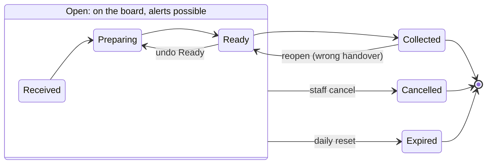
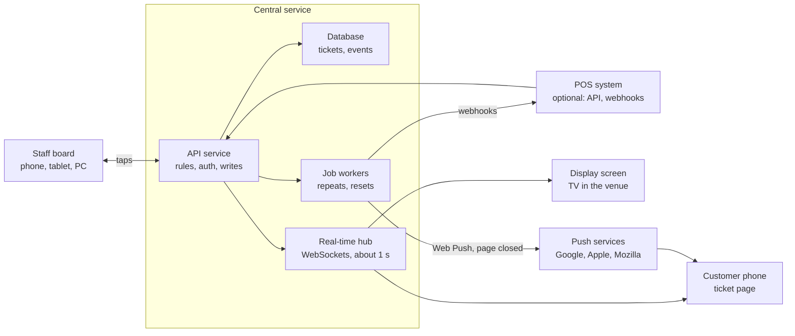

# Digital Order Pager — Complete Concept

Oct 22, 2026 · @ZinGlow

## 1. Overview

The product turns a customer's own phone into an order pager, using only a web browser. Staff create a ticket when an order is taken, the customer scans a QR code to open that ticket, and when staff tap **Ready** the phone alerts the customer and an in-venue screen shows and announces the number.

### The problem

- **Calling out names or numbers** fails in noisy venues, and customers crowd the counter so they don't miss it.
- **Physical pagers** cost money up front, get lost or broken, need charging, and must be handed out, collected and cleaned.
- **SMS paging** needs a phone number, costs money per message, and raises privacy concerns.

### Value for each side

| Who | What they get |
| --- | --- |
| Business | No pager hardware, a clear board of pending, ready and collected orders, fewer counter crowds, data on preparation and collection times |
| Staff | One tap to notify, a visible record of who has alerts on, fallback announcements without shouting |
| Customer | No app, no account, no phone number; can sit down or step away, and sees the order status live |

### Guiding principles

1. **Zero friction for the customer.** Scan, tap once, wait. No install, sign-up or personal data.
2. **Never rely on a single alert channel.** Phone alert, display screen and spoken announcement back each other up.
3. **Staff always know the truth.** The board shows which customers can actually be reached, so nobody is silently missed.
4. **Ready and Collected are different facts.** The system tracks both.
5. **Works with what the venue already owns.** Any phone, tablet, computer or TV with a browser.

## 2. Users and interfaces

Four web interfaces share one live set of ticket data, so a change made in one appears in all the others within about a second.

| Interface | Used by | Device | Main jobs |
| --- | --- | --- | --- |
| Customer ticket page | The customer | Their own phone | See number and status, turn on alerts, get the Ready alert, say "I'm coming" |
| Staff board | Cashiers, kitchen, runners | Phone, tablet or PC at the counter or kitchen | Create tickets, move them through statuses, undo, cancel, see who has alerts |
| Admin area | Owner or manager | Any browser | Branding, messages, staff access, numbering rules, reports, billing |
| Display screen | Customers in the venue | TV, monitor or tablet on a wall | Show preparing and ready numbers, speak ready numbers, show a QR code |

A fifth, invisible interface is the **integration API**, used by cashier (POS) systems to create and update tickets automatically (section 11).

### Roles

- **Owner:** everything, including billing and deleting the venue. One per account, can be transferred.
- **Manager:** everything except billing and account deletion.
- **Staff device:** uses the staff board only. In the first version this is a device signed in with the venue's staff link and PIN, not a named person.
- **Customer:** anonymous, identified only by a random token held by their browser.

## 3. Core model: venues, tickets, statuses

Everything revolves around one object, the **ticket**: one order, one number, one customer page, moving through a fixed set of statuses.

### Hierarchy

- **Account** (the paying business) owns one or more **venues** (locations).
- A **venue** has its own settings, numbering, staff link, QR codes, display screens and subscription.
- A venue can have several **counters** (e.g. "Drinks" and "Food"), each with an optional number prefix.
- A **ticket** belongs to one venue and one counter.

### Ticket statuses

| Status | Meaning | Set by | Customer sees |
| --- | --- | --- | --- |
| Received | Ticket exists and is tied to an order | Staff or POS on creation | "Order received" |
| Preparing | Work has started | Staff, POS, or automatically on creation (venue setting) | "Preparing" + wait estimate |
| Ready | Order is waiting at the collection point | Staff or POS | Full-screen "Your order is ready" + alert |
| Collected | Handed to the customer | Staff | "Enjoy your order" + optional rating |
| Cancelled | Order will not be fulfilled | Staff or POS | "This order was cancelled" + venue message |
| Expired | Closed automatically, never collected | System at end of day | "This ticket has closed" |

Collected, Cancelled and Expired are **closed** statuses: no further alerts, and the ticket leaves the active board. Many venues skip Received and create tickets straight into Preparing; this is a venue setting.

Any open ticket can be cancelled by staff or expired at the daily reset; Ready can be undone, and a Collected ticket can be reopened if it went to the wrong person.

### Ticket fields

| Field | Example | Notes |
| --- | --- | --- |
| Display number | A27 | What people see and hear |
| Internal ID | random UUID | Never shown |
| Access token | 22 random characters | In the ticket's URL; the only way to open the customer page |
| Counter | Food | Optional |
| External reference | POS invoice 1042 | Optional, from staff or integration |
| Note | "2 burgers, no onion" | Optional, staff only, never shown to customer |
| Status + timestamps | ready\_at 12:41:07 | One timestamp per status change |
| Alert level | push / sound / none | Updated live by the customer page |
| Acknowledged at | 12:41:30 | When customer tapped "I'm coming" |
| Alerts sent | 2 | Count of Ready alerts and repeats |
| Wait estimate | 8 min | Shown to the customer |
| Rating | 4 of 5 + comment | Optional, after collection |

Every status change is also written to an **event log** (who, which device, when, from what, to what). This drives undo, reports and dispute checks.

### Numbering

- Numbers run sequentially per venue, or per counter when prefixes are used (A1, A2… / B1, B2…).
- They reset daily at a venue-set time, default 04:00 local, so late-night venues don't reset mid-shift.
- Range is configurable, default 1 to 999, wrapping to 1. A number still active is skipped, so two open tickets never share a number.
- Optionally skip numbers that are easy to mishear in the local language (e.g. 13/30, 14/40, 15/50 in English).

## 4. The journey, step by step

A typical counter order takes nine steps, and the customer only acts in three of them: scan, tap "Turn on alerts", and collect.

### Standard flow (standalone, no POS connection)

1. **Customer orders and pays** the usual way.
2. **Cashier taps "New ticket"** on the staff board. The system assigns the next number (say **27**) and shows a large QR code for that ticket on the cashier's screen, or on a small customer-facing tablet. Optionally the cashier types the receipt number or a short note.
3. **Customer scans the QR code** with the phone camera. Ticket 27 opens in the browser. Nothing to install, no form.
4. **Customer taps "Turn on alerts".** The page plays a short test sound, asks for notification permission, and on iPhone suggests adding to the Home Screen (section 7). The staff board shows a bell icon next to 27.
5. **Customer waits** anywhere in range of the venue's mobile signal or Wi-Fi. The page shows "Preparing" and the wait estimate.
6. **Kitchen finishes and staff tap Ready** on ticket 27.
7. **Within about a second:** the phone rings and vibrates (where supported) and shows a full-screen "Your order is ready"; the display screen moves 27 to the Ready column; the speaker says "Order twenty-seven is ready".
8. **Customer taps "I'm coming"** (optional). Staff see a tick next to 27. If nobody acknowledges, the alert repeats on schedule.
9. **Customer shows the ticket screen at the counter.** Staff hand over the order and tap Collected. The ticket leaves the board and display, and the customer page offers a quick rating.

### If the customer can't scan (no phone, no battery, no data)

Staff tap "New ticket" as usual and say or print the number. The ticket runs exactly the same; it just shows "no alert" on the board, so its number will be called through the display and speaker.

### Integrated flow (with a cashier system)

1. Cashier rings up the order in the POS. The POS calls the API and gets back ticket 27 and its QR link.
2. The QR code is printed on the receipt, or shown on the POS's customer screen.
3. Steps 3 to 5 as above.
4. When the kitchen marks invoice 1042 done in the POS or kitchen system, the POS tells the service, and ticket 27 becomes Ready. Staff can still tap Ready by hand.
5. Collection is confirmed either in the POS or on the staff board; both stay in sync.

## 5. Linking a ticket to the real order

The ticket is created by staff (or the POS) at the moment of ordering, and the customer scans a QR code that belongs to that one ticket, so the link between order, number and phone is made without any matching step.

A single general QR code on the counter cannot tell the system which order belongs to which phone. That is why the default flow reverses it: **the order makes the ticket, the ticket makes the QR code.**

### The three QR types

| QR type | Where it appears | What scanning it does | Use |
| --- | --- | --- | --- |
| Ticket QR | Cashier screen, customer-facing tablet, printed receipt | Opens that exact ticket | Default for every order |
| Venue QR (printed poster) | Counter, tables, door | Opens the venue page: "Enter your ticket number" or "Ask staff for a ticket" | Fallback when a customer missed the ticket QR |
| Display QR | On the TV | Same as venue QR | Same fallback, larger |

### Venue QR fallback: claiming a number

If a customer has a number (spoken or on a receipt) but not the ticket page, they scan the venue QR and type the number plus a **4-character claim code** printed under it on the receipt or shown on the cashier screen (e.g. 27 · K7PX). The claim code stops anyone from typing someone else's number and receiving their alert. Without a code, the claim is refused.

If the venue doesn't print receipts, the venue can turn on "staff-approved claims": the customer types 27, and the staff board shows "Phone wants to join 27 — Approve?".

### The rotating QR code

A QR that changes every 30 seconds is **not needed** with ticket QRs, because each ticket QR only ever opens one ticket. It is kept as an optional venue setting for the display screen, where it stops people from using an old photo of the screen to join from home.

### Scanning again and multiple orders

- The customer's browser keeps a list of its tickets (local storage, by access token). Scanning the venue QR on that phone shows "Your open tickets: 27" first.
- Re-scanning the same ticket QR opens the same ticket. It never creates a new one.
- One phone can hold several active tickets (e.g. a parent ordering for two tables). The page shows them as cards; any card that becomes Ready triggers the alert.
- Several phones can join the same ticket (a group waiting together). All of them are alerted, and the staff board shows the best alert level among them.
- A closed ticket opened later shows its final status and a link to the venue page, never a live number.
- If the customer clears the browser or changes phone, the ticket can be reopened only through its QR, its link, or the claim code.

## 6. The customer ticket page

The customer page is one mobile web page that changes its whole look with each status, so the customer can tell where the order stands from across a room.

### What is always on the page

- Venue name and logo, in the venue's brand colour.
- The ticket number, very large (at least a third of the screen width).
- Current status in words and as a coloured band.
- The alert state: "Alerts on" with a bell, or a button to turn them on.
- Collection instructions set by the venue (e.g. "Collect from the pickup shelf on the left").
- Language switch; the page opens in the phone's language when the venue supports it.

### Screen by status

| Status | Main message | Extra content |
| --- | --- | --- |
| Received / Preparing | "Order 27 · Preparing" | Wait estimate, "Turn on alerts" button until done, venue message or promo, "Keep this page open" hint |
| Ready | Full-screen, high-contrast "Your order is ready — please collect 27 from the counter" | Big "I'm coming" button, sound and vibration loop until tapped or 60 s pass |
| Ready, acknowledged | "See you at the counter" | Ticket number + 4-character check code to show staff |
| Collected | "Enjoy your order" | 1–5 star rating + optional comment, link to venue website or menu |
| Cancelled | "This order was cancelled" | Venue's cancellation message, e.g. "Please speak to staff" |
| Expired | "This ticket has closed" | Link to the venue page |
| Not ready after undo | "Sorry — not ready yet" for 10 s, then back to Preparing | Brief explanation so the customer doesn't walk up |
| Connection lost | Grey bar "Reconnecting…" | Last known status stays visible; refreshes on reconnect |

### Wait estimate

- **First version:** the venue sets a default (e.g. "about 10 minutes") and staff can override per ticket with +5 / −5 buttons.
- **Later:** the system calculates the median Ready time of the last 20 tickets at that counter in the last 2 hours, shown as a range ("8–12 min").
- If the estimate passes without Ready, the page says "Taking a little longer than usual" instead of a negative time.
- The venue can switch the estimate off entirely.

### Acknowledgement

The "I'm coming" button gives staff proof that the customer saw the alert, which an alert being *sent* does not. It also stops repeat alerts for that ticket.

### Check code at collection

The Ready screen shows a 4-character code next to the number. When busy, staff can ask for it before handing over the order, so someone who only overheard "27" cannot claim it. The venue can make this mandatory, optional, or off.

### Accessibility

- Text and colour contrast meet WCAG 2.2 AA; status never relies on colour alone.
- Works with screen readers (VoiceOver, TalkBack); Ready is announced as an alert.
- Supports large system font sizes without breaking the layout.
- Vibration and flashing screen as non-sound signals for customers who are deaf or hard of hearing.

## 7. Alerts and notifications

Alerts use two browser mechanisms, push notifications and sound on an open page, and the staff board always shows which one each ticket can actually receive. Neither works everywhere, so the display screen and spoken announcement are a required backup, not an extra.

### The two mechanisms

**1. Web Push notification.** The server sends a notification through the phone's browser vendor (Google, Apple, Mozilla). It shows on the lock screen with the phone's notification sound and vibration, even when the page is closed.

**2. Live page alert.** While the ticket page is open and connected, it receives the Ready message instantly and plays a loud sound, vibrates where allowed, and flashes the screen. Browsers only allow sound after the user has tapped the page once, which is why the "Turn on alerts" button exists.

### What works where

| Phone + browser | Push with page closed / screen locked | Sound with page open, screen on | Vibration |
| --- | --- | --- | --- |
| Android · Chrome, Edge, Samsung Internet, Firefox | Yes, after permission | Yes | Yes |
| iPhone · Safari tab | No | Yes | No |
| iPhone · added to Home Screen (iOS 16.4 or later) | Yes, after permission | Yes | Only through the notification |
| iPhone · Chrome or other in-app browsers | No | Yes | No |
| Any phone on silent / Do Not Disturb | Notification shows silently, per phone settings | Sound may be muted | Per phone settings |

The key consequence: **an iPhone user who doesn't add the page to the Home Screen only gets an alert while the page is open and the screen is on.** The product must say this plainly, not promise locked-screen alerts to everyone.

### The activation flow ("Turn on alerts")

1. Customer taps **Turn on alerts**. The page plays a short chime (this unlocks sound) and asks: "Did you hear that?"
2. **Android:** the browser asks for notification permission. On "Allow", alert level = Push.
3. **iPhone in Safari:** a short animated guide shows Share → Add to Home Screen → open from the icon → Allow notifications. A "Skip, I'll keep this page open" link sets alert level = Live page.
4. The page asks the phone to keep the screen awake (Screen Wake Lock) while the ticket is open, and suggests turning the volume up.
5. If permission is refused or anything fails, alert level = Live page, or None if the page is later closed.

### Alert levels shown to staff

| Level | Icon | Means | Staff action at Ready |
| --- | --- | --- | --- |
| Push | Bell | Will be alerted even if page is closed | Nothing extra |
| Live page | Speaker | Page is open and connected right now; alert only while it stays open | Nothing extra; watch for acknowledgement |
| Page closed | Speaker, crossed | Was live, has disconnected for over 60 s | Rely on display + call out |
| None | Warning | Never activated, or no phone | Call the number out |
| Acknowledged | Tick | Customer tapped "I'm coming" | Wait for collection |

The page sends a small heartbeat every 20 seconds, so the board knows within a minute whether a page is still open.

### Repeat alerts

- Ready triggers alert #1 at once.
- If not acknowledged or collected: repeat at +2 min and +5 min (venue-adjustable), then stop. Maximum 3 automatic alerts.
- After the last repeat, the ticket turns amber on the board: "Not collected — call out".
- Staff can tap **Alert again** at any time; manual alerts don't count toward the maximum.
- All repeats stop immediately on Acknowledged, Collected, Cancelled, Expired or an undo of Ready.

### Alert content

- Push title: "{Venue}: order 27 is ready". Body: the venue's collection instruction.
- Tapping the notification opens the ticket page.
- Sound on the live page: a distinctive 3-second chime, looped until acknowledged or 60 seconds pass. The venue can pick from a few chimes but not upload its own (to avoid abuse and very loud files).

### What the system can never guarantee

It cannot know whether the customer **heard** an alert. It knows only that a push was accepted by the browser vendor, that an open page received the message, and whether the customer tapped "I'm coming". Reports and staff screens use exactly these words.

## 8. The staff board

The staff board is a single screen of large ticket cards in columns, built so the usual action, marking an order Ready, is one tap even with wet or gloved hands.

### Layout

- **Top bar:** venue and counter name, a big **New ticket** button, a search box (by number or receipt), connection status, and today's counts.
- **Columns:** Preparing · Ready · (optional) Received. Collected tickets go to a collapsible "Recent" list for the last 30 minutes, so mistakes can be fixed.
- **Cards:** number in large type, alert-level icon (section 7), age ("6 min"), note or receipt number, and the main action button.
- **Sorting:** oldest first in each column. Tickets past their wait estimate turn amber; Ready tickets uncollected after the last repeat turn red.
- **Phone layout:** columns become tabs with counts (Preparing 8 · Ready 3).

### Actions on a ticket

| Action | Where | What happens |
| --- | --- | --- |
| New ticket | Top bar | Next number created; its QR shows full-screen until scanned or dismissed |
| Show QR again | Card menu | Re-displays that ticket's QR (customer missed it) |
| Start preparing | Received card | Moves to Preparing |
| Ready | Preparing card, one tap | Alert, display and announcement fire; 10-second **Undo** bar appears |
| Undo Ready | Undo bar, or "Back to preparing" in the card menu any time | Returns to Preparing, stops repeats, customer sees "Sorry — not ready yet" |
| Alert again | Ready card | Sends an extra alert and re-announces on the display |
| Collected | Ready card, one tap | Closes the ticket; it goes to Recent |
| Reopen | Recent list | Brings a Collected ticket back to Ready (handed to the wrong person, etc.) |
| Adjust wait | Card menu | +5 / −5 min on that ticket's estimate |
| Edit note / receipt no. | Card menu | Staff-only details |
| Cancel | Card menu, with confirm | Choose a reason; customer sees the cancellation message; alerts stop |
| Merge / split | Not offered | One order = one ticket; keeps the model simple |

### Shortcuts for speed

- Keyboard on a PC: type the number + Enter to mark Ready; type + C to mark Collected.
- A "Kitchen mode" with only the Ready button and huge cards, for a tablet near the pass.
- Optional sound on the staff device when a POS creates a new ticket.

### Several staff devices at once

All devices of a venue see the same board live. If two people tap the same ticket at the same moment, the first change wins and the second device shows "Already marked Ready by Counter iPad". Each action records which device made it.

### When the staff device loses connection

The board shows a red "Offline" bar and disables actions, rather than letting staff tap buttons that do nothing. Taps are not queued, because a delayed Ready alert is worse than a visible error. Staff fall back to calling numbers until the bar turns green.

## 9. Display screen and announcements

The display is a full-screen web page opened on any TV, monitor or tablet, and it is the backup that reaches every customer, including those with no alerts.

### Setup

- In the admin area, the manager creates a display and gets a short pairing code (e.g. 4821).
- On the TV's browser, a smart-TV stick, or a cheap Android tablet, open the display address and type the code. No login on the TV.
- The display can be limited to one counter, or show all.
- If the screen loses connection it shows "Reconnecting" in a corner and keeps the last list, then refreshes automatically.

### Layout

- **Ready** column on the right, large numbers, newest at the top, the newest one highlighted for 10 seconds.
- **Preparing** column on the left in smaller type (can be hidden).
- Venue logo and a message line (e.g. "Show your ticket at the counter").
- A QR code in a corner leading to the venue page (section 5), optionally rotating.
- Optional promo slot (a still image or short text) that never covers the Ready list.
- Dark background by default, readable from 8–10 metres on a 43-inch screen.

### Spoken announcements

- On Ready, the display speaks: chime, then "Order twenty-seven is ready", using the device's built-in text-to-speech in the venue's language. A venue can add a second language.
- Announcements are queued, never overlapping; with several Ready at once: "Orders twenty-seven, thirty-one and thirty-two are ready".
- Repeat announcements follow the same schedule as repeat alerts (section 7). Alert again also re-announces.
- Volume and on/off are set on the display device. A "quiet hours" setting turns speech off at chosen times.
- Because browsers block sound until someone taps the page, the display shows "Tap to enable sound" once after it starts.

### Removal

A number leaves the Ready list when collected, cancelled or expired. If Ready is undone, it moves back to Preparing on screen at once.

## 10. Business setup and administration

A venue should go from sign-up to its first real ticket in under 10 minutes, guided by a setup checklist in the admin area.

### Setup checklist

- [ ] Create the account (email + password, or Google/Apple sign-in), confirm email.
- [ ] Start the free trial (14 days, no card needed) or pick a plan.
- [ ] Enter venue name, address, time zone and language(s).
- [ ] Upload logo, choose brand colour.
- [ ] Write the collection instruction and an optional welcome message.
- [ ] Choose ticket flow: start in Received or Preparing; default wait estimate.
- [ ] Set numbering: prefix, range, daily reset time, skipped numbers.
- [ ] Add counters if needed (Food, Drinks).
- [ ] Create the staff link and PIN, open it on the counter device.
- [ ] Print the QR poster kit (A4 counter poster, table tents, door sticker) from ready-made PDFs.
- [ ] Pair a display screen (optional).
- [ ] Run a test ticket: create, scan with your own phone, turn on alerts, Ready, Collected.

### Settings reference

| Area | Settings |
| --- | --- |
| Branding | Logo, colour, venue name, customer languages |
| Customer messages | Welcome, collection instruction, cancellation message, post-collection message, link to website/menu |
| Ticket flow | Start status, wait estimate default or off, check code mandatory/optional/off, claim method |
| Numbering | Prefix per counter, range, reset time, skip list |
| Alerts | Repeat timings, max repeats, chime choice |
| Display | Columns shown, announcement language(s), quiet hours, promo, rotating QR |
| Expiry | Auto-close time for open tickets |
| Staff access | Staff link, PIN, connected devices list, revoke |
| Integrations | API keys, webhooks, POS connectors |
| Billing | Plan, payment method, invoices, cancel renewal |

### Staff access

The staff board is opened with a **staff link plus a 4-to-6-digit PIN**. The link alone is useless, so a photo of it on a noticeboard isn't enough to get in.

- Each device that signs in is listed in admin with its name ("Counter iPad"), last seen time, and a **Remove** button.
- **Reset link** invalidates the old link and signs out every device at once (e.g. when an employee leaves).
- Changing the PIN signs out all devices except the one making the change.
- A device stays signed in for 30 days of use, then asks for the PIN again.
- Later tier: named staff accounts with personal PINs, so the event log shows the person, not just the device.

## 11. Integrations

Cashier and kitchen systems connect through a small REST API (they call us) and webhooks (we call them), and the same ticket can be changed from either side.

### API (the POS calls the service)

Authenticated with a per-venue API key, sent in a header over HTTPS. Keys can be created, named and revoked in admin.

| Request | Purpose | Key fields |
| --- | --- | --- |
| `POST /tickets` | Create a ticket | `external_ref` (invoice 1042), `counter`, `note`, `wait_minutes`, `status` → returns `number`, `ticket_url`, `qr_png_url`, `claim_code` |
| `GET /tickets/{id}` or `?external_ref=1042` | Read status | → status, alert level, timestamps |
| `POST /tickets/{id}/status` | Change status | `ready`, `collected`, `cancelled`, `preparing` (undo) |
| `POST /tickets/{id}/alert` | Alert again | — |
| `GET /tickets?status=ready` | List active tickets | Paging |

Rules:

- Every write accepts an `Idempotency-Key`, so a POS retrying after a timeout never creates two tickets.
- Creating with an `external_ref` that already has an open ticket returns that ticket instead of a new one.
- Rate limit per key (e.g. 10 requests/second), with clear error codes.

### Webhooks (the service calls the POS)

The venue registers a URL and chooses events: `ticket.created`, `ticket.ready`, `ticket.acknowledged`, `ticket.collected`, `ticket.cancelled`, `ticket.expired`. Each call is signed (HMAC with a shared secret) so the receiver can verify it came from the service, and failed deliveries are retried with back-off for up to 24 hours.

### Ready-made connectors

An API alone needs a developer on the venue's side, which small cafés don't have. The commercial plan is to build plug-in connectors for the 2–3 POS systems most used in the target market, so setup is "click Connect, sign in to your POS". Which systems depends on the launch country and is still open.

### No integration at all

Standalone use (section 4) is always available and is the default. Integration is an option, never a requirement.

## 12. Technical architecture

One central service holds all ticket data and pushes every change over live connections to the open pages, while a separate notification worker sends Web Push for phones whose page is closed.

The real-time hub updates every open page (displays, customer pages, and staff boards); the job workers send Web Push to phones whose page is closed, schedule repeats, and call the POS by webhook.

### Components

| Component | Job | Suggested technology (one sound option) |
| --- | --- | --- |
| Web front-ends | Customer page, staff board, display, admin | One TypeScript web app (e.g. React or Svelte), installable as a PWA with a service worker for push and Home Screen |
| API service | All reads and writes, rules, auth | Node.js or Go, stateless, behind a load balancer |
| Real-time hub | Sends status changes to open pages within \~1 s | WebSockets, with Server-Sent Events as a fallback; Redis pub/sub between servers |
| Database | Venues, tickets, events, settings, devices | PostgreSQL |
| Job queue + workers | Push sending, repeat alerts, webhooks, daily reset and expiry | Redis-based or managed queue |
| Push gateway | Delivers notifications to phones | Standard Web Push (VAPID) to Google, Apple and Mozilla push services; no paid SMS |
| Billing | Subscriptions, invoices, taxes | Stripe Billing or Paddle |
| Hosting | Run everything, region near customers | A managed cloud in-region (e.g. EU for European venues) |

### How a Ready tap travels

1. Staff tap Ready → the board sends `POST status=ready` to the API.
2. API checks the device and PIN session, writes the new status and an event row in one database transaction.
3. API publishes "ticket 27 changed" to the real-time hub, and puts a "send alert" job on the queue.
4. The hub pushes the change to every open page for that venue: staff boards, displays, and the customer's ticket page.
5. The worker sends Web Push to each push subscription on the ticket, and schedules repeat jobs at +2 and +5 min.
6. Repeat jobs check the status first and do nothing if the ticket is no longer Ready.

Target: under 1 second from tap to open-page update; push delivery depends on Google/Apple, usually a few seconds.

### Reliability

- Every page reconnects on its own after a drop and re-fetches the current state, so it never shows stale data for long.
- Status changes are only ever made by the server; pages display what the server says.
- Target uptime 99.9% during venue opening hours, with status page and alerting for the team running the service.
- Daily backups, kept 30 days; ticket data recoverable to any point in the last 7 days.
- Load to plan for: e.g. 1,000 venues × 500 tickets/day peak, each ticket with \~3 open connections. This is modest for the stack above.

### Not chosen

- **Native apps:** would solve some iPhone alert limits, but customers won't install an app to wait 10 minutes.
- **SMS:** reliable but needs phone numbers and costs per message. Could be a paid add-on later.
- **Bluetooth or Wi-Fi presence:** too dependent on phone settings and venue hardware.

## 13. Security, privacy and abuse prevention

The service collects almost no personal data from customers, but it still holds device identifiers, push addresses and business data, so it needs proper security and a clear privacy policy.

### Security

| Threat | Protection |
| --- | --- |
| Someone guesses another ticket's URL | Ticket URLs carry a 128-bit random token, never the number or a sequence |
| Someone claims another person's number | Claim code or staff approval required (section 5); check code at collection |
| Fake tickets spammed from the venue QR | The venue QR cannot create tickets; only staff, POS and ticket QRs do |
| Staff link leaked | Link + PIN; device list; one-click reset |
| Brute-forcing the PIN | 5 wrong tries → 10-minute lock for that device; owner notified after repeated locks |
| API key leaked | Keys are scoped per venue, revocable, shown once on creation |
| Forged webhooks | HMAC signature on every call |
| Account takeover of the owner | Optional two-factor sign-in, required for accounts with several venues |
| Data in transit | HTTPS everywhere, HSTS |
| Data at rest | Encrypted database and backups |

### Privacy

What is stored about a customer:

- A random device token in the browser's local storage (to find their tickets again).
- A push subscription address, if they allowed notifications.
- Ticket timestamps, alert level, optional rating and comment.
- Technical logs (IP address, browser type) kept for security, 14 days.

No name, phone number, email or payment data, and no advertising trackers on the customer page.

Rules:

- **Retention:** push subscriptions deleted when the ticket closes; ticket records anonymised after 90 days (kept only as counts for reports).
- **Legal role:** the business is the data controller for its customers; the service is the processor, with a data processing agreement in the terms.
- **Compliance:** GDPR (EU/UK) and the equivalent law in each launch country; a privacy notice linked from every customer page.
- **Consent:** the local-storage token and push subscription are strictly necessary for the service the customer asked for, so no cookie banner is needed on the customer page. This should be confirmed by a lawyer for each market.
- **Comments:** free-text ratings may contain personal data; the business can delete them, and they are deleted automatically with the ticket after 90 days.

### Abuse of the platform

- Venue messages and promo text are length-limited and links are shown as plain domains, to reduce phishing via a venue page.
- Uploaded logos are re-encoded server-side and size-limited.
- Accounts on trial are limited (e.g. 200 tickets/day) to stop the free tier from being used for spam push notifications.

## 14. Exceptions and edge cases

Every exception has a defined behaviour, and in every case the display screen and calling the number out remain the last-resort fallback.

| Situation | What the system does | What staff do |
| --- | --- | --- |
| Customer never scans | Ticket shows alert level None | Call the number; display shows it |
| Customer scans but skips "Turn on alerts" | Level stays None; page still updates live while open | Same as above |
| iPhone user won't add to Home Screen | Level Live page while open; Page closed if they leave | Watch the icon; call out if crossed |
| Phone on silent | Push shows silently; page flashes and vibrates where possible | Watch for the acknowledgement tick |
| Battery dies / no signal | Level drops to Page closed after 60 s | Call out; customer can show number or claim code |
| Customer closes the page | Push still works if allowed; otherwise Page closed | As above |
| Customer comes back later | Reopening from history or ticket QR shows current status | — |
| Ready tapped by mistake | 10 s Undo, or Back to preparing any time; repeats stop; customer sees "not ready yet" | Tap Undo |
| Order handed to the wrong person | Reopen from Recent list puts it back to Ready | Check code at collection prevents most cases |
| Customer never collects | Repeats at +2, +5 min; then red on board; auto-expires at end of day | Call out; decide on the food per venue policy |
| Order cancelled or refunded | Cancelled status, venue message shown, alerts stop | Cancel with a reason |
| Customer has two orders | Two tickets, two cards on the same phone | — |
| Group with several phones | All joined phones are alerted | — |
| Same number twice on screen | Can't happen: active numbers are skipped on wrap | — |
| Two staff tap the same ticket | First action wins; the other sees who did it | — |
| Staff device offline | Red bar, actions disabled | Use another device or call out |
| Display offline | Shows Reconnecting, keeps last list | Call out until back |
| Whole service down | Customer and staff pages show a clear outage message | Fall back to calling numbers; status page shows progress |
| POS sends Ready for unknown invoice | API returns not found; logged for admin | — |
| Daily reset while tickets are open | Open tickets keep their numbers; new numbering starts after them | — |
| Venue changes time zone or reset time | Applies from the next reset | — |
| Subscription lapses | 7-day grace period with warnings, then staff board read-only; customer pages of open tickets keep working | Renew in admin |

## 15. Statistics, reports and feedback

Reports measure only events the system actually records, and each metric says exactly which two events it runs between.

### Metrics

| Metric | Defined as | Why it matters |
| --- | --- | --- |
| Tickets issued | Tickets created, by hour / day / counter | Busy periods, staffing |
| Preparation time | Created (or Preparing) → Ready, median and 90th percentile | Kitchen speed; only true preparation time if tickets are created at ordering |
| Pickup time | Ready → Collected, median and 90th percentile | How fast customers respond; tests whether alerts work |
| Total wait | Created → Collected | Customer experience |
| Alert reach | Share of tickets at Push / Live page / None when Ready | How many customers can actually be reached |
| Acknowledgement rate | Share of Ready tickets with "I'm coming" | Proof alerts are seen |
| Repeat rate | Share of tickets needing 1+ repeat alerts | Slow pickups, missed alerts |
| Uncollected | Tickets expired without Collected | Waste, no-shows |
| Undo rate | Ready undone per 100 tickets | Staff mistakes, training |
| Cancellations | Count and reasons | Operations issues |
| Rating | Average stars, distribution, recent comments | Satisfaction |

### How reports are shown

- **Today** screen: live counts, current median preparation time, tickets waiting longest.
- **Trends:** daily and weekly charts for the metrics above, with comparison to the previous period.
- **Heatmap:** tickets by hour × weekday, to plan staffing.
- Filters by counter and date range; CSV export.
- Weekly email summary to the owner (can be turned off).

### Customer feedback

- After Collected, the page asks "How was your order?" with 1–5 stars, and an optional comment if 3 or fewer.
- Comments appear in admin with ticket number and time, never the customer's identity (there is none).
- The venue can add a link to its Google or TripAdvisor page, shown to every customer after rating. It is never shown only to happy customers: review sites such as Google forbid this "review gating".

## 16. Subscription and commercial model

The business pays a flat subscription per venue and customers never pay; the subscription covers unlimited tickets, alerts, staff devices and display screens at that venue.

### Plans

| Plan | For | Includes |
| --- | --- | --- |
| Free trial | Any new venue | Everything, 14 days, no card, capped at 200 tickets/day |
| Standard | One location | Unlimited tickets and alerts, unlimited staff devices and displays, reports, ratings, 2 customer languages |
| Pro | Busier or integrated venues | Standard + API and webhooks, POS connectors, multiple counters, named staff accounts, extra languages, CSV export |
| Multi-site | Chains | Pro for every venue, central admin across venues, combined reports, volume discount |

Prices are not set yet. As a working assumption to test with customers: Standard about €25/month, Pro about €45/month, compared with physical pager kits that cost several hundred euros up front plus replacements.

### Billing

- Pay monthly, every 3 months, or yearly. Same features; longer periods get a discount (e.g. 10% quarterly, 20% yearly).
- Card payments and invoices handled by a billing provider, with VAT/sales tax applied per country.
- Renews automatically. Cancelling stops the next renewal; access continues to the end of the paid period.
- Upgrades take effect at once (pro-rated); downgrades apply at the next renewal.
- Failed payment: retry over 7 days with emails; then the grace rules in section 14.
- Refunds: none for partial periods, except where local consumer law requires (to be checked per market).

### What the customer never sees

No ads, no upsell from the service itself, no service branding larger than a small "Powered by" line (removable on Pro).

## 17. Other business types

The same ticket engine fits other waiting situations, but they split into two models: **"your item is ready"** (food, repairs) and **"it's your turn"** (queues), and the second needs a few extra features.

| Business | Model | What triggers the alert | Extra needs |
| --- | --- | --- | --- |
| Café, food court, takeaway | Item ready | Order prepared | None (core product) |
| Pharmacy | Item ready | Prescription filled | Privacy: number only, never medicine name |
| Repair / tailor / dry cleaner | Item ready | Item done, often days later | Long-lived tickets, push only (page won't stay open), no daily reset |
| Service counter (bank, government office) | Your turn | Next desk free | "Call next" button, desk number in alert ("27 to desk 4"), queue position shown |
| Clinic reception | Your turn | Patient called | Strict privacy, no names on display |
| Restaurant waiting list | Your turn | Table free | Party size, "5 people ahead of you" |

The first version targets **item-ready** venues only. "Your turn" features are a later module.

## 18. MVP scope, roadmap and decisions

The first version is a standalone, single-venue product built around ticket QR codes, live page alerts plus Web Push, a staff board and a display screen; everything else waits until real venues have used it.

### Phases

1. **MVP (pilot with 5–10 venues):** staff-created tickets with ticket QR, customer page with all statuses, alert activation, Web Push + live page alerts, repeat alerts, "I'm coming", staff board with undo/cancel/reopen, alert-level icons, display with speech, daily reset and expiry, staff link + PIN, setup checklist and QR poster kit, basic Today report, Standard plan billing.
   - Exit criteria: over 70% of tickets reach Push or Live page; median pickup time under 2 minutes; pilot venues willing to pay.
2. **Version 1.1:** venue QR with claim codes, multiple counters and prefixes, trends and heatmap reports, ratings, check code at collection, second language.
3. **Version 2:** API and webhooks, first POS connectors, Pro and Multi-site plans, named staff accounts, calculated wait estimates.
4. **Later:** "your turn" queue module, optional SMS add-on, rotating display QR, white-label.

### Decision record

| Question | Decision | Reason |
| --- | --- | --- |
| How is a ticket linked to the order? | Staff/POS create the ticket; customer scans that ticket's QR | Removes matching errors and fraud |
| Rotating 30 s QR? | Not in MVP; optional on display later | Not needed with ticket QRs |
| Numbering | Sequential per venue/counter, daily reset at 04:00 by default, active numbers skipped | Short, callable, no duplicates |
| Several tickets per phone? | Yes, shown as cards | Group and family orders |
| Several phones per ticket? | Yes, all alerted | Groups waiting together |
| Re-scan behaviour | Same ticket QR reopens same ticket; venue QR shows the phone's open tickets | Predictable, no duplicates |
| Ticket expiry | Open tickets close at the daily reset; Ready but uncollected flagged after last repeat | Keeps board clean |
| Wait estimate | Manual default + per-ticket adjust in MVP; calculated later | Honest until data exists |
| Alert mechanism | Web Push + live page sound; display and speech always on | No single channel works on all phones |
| iPhone limitation | Encourage Home Screen install, never require it; show level to staff | Friction vs reliability |
| Repeat alerts | +2 and +5 min, max 3 automatic, then flag | Persistent but not annoying |
| Proof the customer saw it | "I'm coming" button | Sent is not seen |
| Collection confirmation | Staff tap Collected; optional check code | Prevents wrong handovers |
| Undo Ready | 10 s undo bar + back to preparing any time; customer told | Mistakes happen |
| Staff access | Link + PIN per venue, device list, reset; named accounts later | Simple for small venues |
| Offline staff device | Block actions, show red bar; no queued taps | Late alerts are worse than none |
| Subscription scope | One subscription per venue; multi-site plan | Clear pricing |
| Integration | REST API + signed webhooks; ready connectors for top local POS | API alone sells little |
| Customer data | No personal data; tokens and push addresses deleted on close; records anonymised after 90 days | Privacy by design |
| Target venues first | Item-ready venues (cafés, food courts, takeaways) | Core fit; queues later |

### Still open

- [ ] Launch country and language(s), which decide the POS connectors and legal checks.
- [ ] Final prices, after pilot interviews.
- [ ] Product name and brand.
- [ ] Legal review of the privacy position (no cookie banner) and refund rules per market.
- [ ] Test on real phones: current iPhone and Android models, silent mode, battery saver, in-app browsers (Instagram, WhatsApp) that open QR links.
