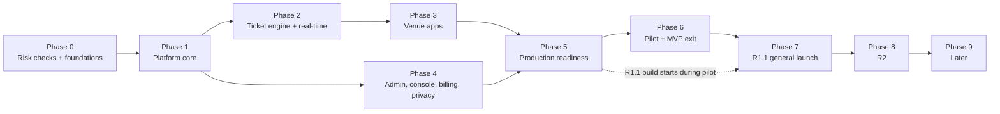

# Digital Order Pager — Implementation Plan

| Item | Value |
| --- | --- |
| Document | Implementation plan |
| Product | Digital Order Pager ("Tanbeeh", working name) |
| Version | 0.2 — Coverage gaps closed; code layout set to `frontend/` + `backend/` |
| Date | 2026-10-22 |
| Inputs | [Business-Requirements-Document.md](Business-Requirements-Document.md) (BRD v0.1), [Technical-Requirements-Document.md](Technical-Requirements-Document.md) (TRD v0.1), [Digital-Order-Pager-Concept.md](Digital-Order-Pager-Concept.md) |
| Status | Awaiting review by product, engineering and QA |

---

## Table of contents

1. [Purpose and how to read this plan](#1-purpose-and-how-to-read-this-plan)
2. [Plan at a glance](#2-plan-at-a-glance)
3. [Team and working assumptions](#3-team-and-working-assumptions)
4. [Phase 0 — Risk checks and foundations](#4-phase-0--risk-checks-and-foundations)
5. [Phase 1 — Platform core: tenancy, data and sign-in](#5-phase-1--platform-core-tenancy-data-and-sign-in)
6. [Phase 2 — Ticket engine, real-time and alerts back end](#6-phase-2--ticket-engine-real-time-and-alerts-back-end)
7. [Phase 3 — Venue apps: customer page, staff board, display](#7-phase-3--venue-apps-customer-page-staff-board-display)
8. [Phase 4 — Tenant admin, super admin console, billing and privacy](#8-phase-4--tenant-admin-super-admin-console-billing-and-privacy)
9. [Phase 5 — Production readiness and pilot launch](#9-phase-5--production-readiness-and-pilot-launch)
10. [Phase 6 — Pilot and MVP exit](#10-phase-6--pilot-and-mvp-exit)
11. [Phase 7 — Release 1.1: general launch](#11-phase-7--release-11-general-launch)
12. [Phase 8 — Release 2: integrated and larger venues](#12-phase-8--release-2-integrated-and-larger-venues)
13. [Phase 9 — Later](#13-phase-9--later)
14. [Cross-cutting practices](#14-cross-cutting-practices)
15. [Plan risks](#15-plan-risks)
16. [Points to resolve in the source documents](#16-points-to-resolve-in-the-source-documents)
17. [Exception scenarios acceptance](#17-exception-scenarios-acceptance)
18. [Code layout](#18-code-layout)
19. [Build status](#19-build-status-2026-10-22)

---

## 1. Purpose and how to read this plan

This plan turns the BRD (what to build) and the TRD (how to build it) into an ordered sequence of phases, each with a goal, scope, deliverables and an exit gate. It adds no new requirements; every item points back to a BRD or TRD ID.

- **Phases 0–6** deliver the **MVP** and the pilot (BRD section 16).
- **Phase 7** delivers **R1.1** (general launch), **Phase 8** delivers **R2**, **Phase 9** lists **Later** items.
- **Exit gates** are binding: a phase is finished only when every gate item is met. Work from the next phase may start earlier when its dependencies are met, but the gate is still checked.
- Durations are **estimates for the team in section 3**. They are re-planned at the end of Phase 0, once the risk checks are done.

---

## 2. Plan at a glance

| Phase | Name | Weeks (estimate) | Release | Main outcome |
| --- | --- | --- | --- | --- |
| 0 | Risk checks and foundations | 1–3 | — | Alert behaviour on real phones proven; region, billing provider and legal position decided; repository, CI and dev environment running |
| 1 | Platform core | 3–7 | MVP | Multi-tenant data layer with 4 isolation layers, sign-in, roles, tenant lifecycle, event and job backbone |
| 2 | Ticket engine and real-time | 6–10 | MVP | Tickets, numbering, statuses, live updates, Web Push and repeat alerts working through the API |
| 3 | Venue apps | 8–15 | MVP | Customer page, staff board and display usable end to end |
| 4 | Admin, console, billing, privacy | 10–16 | MVP | Self sign-up to paid Standard plan; console basics; export and deletion; pilot reports |
| 5 | Production readiness | 16–19 | MVP | Production environment, monitoring, on-call, security checks, pilot venues onboarded |
| 6 | Pilot and MVP exit | 19–27 | MVP | 5–10 venues live; BO-1, BO-2, BO-4 measured; go / no-go for general launch |
| 7 | Release 1.1 | 21–33 | R1.1 | Pro plan, support access, claim and check codes, ratings, trends, load and penetration tests; general launch |
| 8 | Release 2 | 34–48 | R2 | Integration API, webhooks, Foodics connector, Multi-site plan, named staff |
| 9 | Later | — | Later | Backlog, scheduled from market feedback |

Phases overlap where their dependencies allow:



---

## 3. Team and working assumptions

| Role | Count | Main focus |
| --- | --- | --- |
| Tech lead (back end) | 1 | Architecture, tenant isolation, code review of `packages/db` and `packages/auth` (TR-CI-01) |
| Back-end engineers | 2 | API, real-time, jobs, billing |
| Front-end engineers | 2 | Customer PWA, staff board, display, admin, console |
| DevOps / platform engineer | 0.5–1 | VPS and Docker Compose, CI/CD, backups, observability |
| QA engineer | 1 | Test automation, real-device matrix, accessibility |
| Product designer | 1 (0.5 after Phase 3) | Arabic RTL + English UX, design tokens |
| Product owner | 1 | Scope, pilot venues, acceptance |

Assumptions:

- Two-week sprints; each phase ends with a demo and a gate review.
- Stack, structure and conventions exactly as in the TRD (Node.js 22, Express 5, MySQL 8.4, Kysely, Socket.IO, BullMQ, React 19 + Vite 6), except hosting: production runs on the owner's VPS with Docker Compose instead of AWS (ADR 0007).
- Arabic (right-to-left) and English from the first screen built (BRD OI-01, TR-L10N-01); no screen is "translated later".
- Legal counsel, the billing entity and pilot venues are owned by the business side and run in parallel with engineering.

---

## 4. Phase 0 — Risk checks and foundations

**Weeks 1–3. Goal:** remove the unknowns that could change the design before code depends on them, and give the team a working repository, CI and dev environment.

### 4.1 Risk checks ("Verify in Phase 0" items)

| # | Check | Source | Owner | Output |
| --- | --- | --- | --- | --- |
| 0.1 | **Real-phone alert test.** Build a throwaway prototype on a dev domain: one service worker, VAPID Web Push, `AudioContext` unlock, wake lock, per-ticket web app manifest, iOS Home Screen flow. Run the full matrix in TRD appendix 30.7, including silent mode, battery saver and Instagram / WhatsApp / TikTok in-app browsers. | BRD OI-06, R-01; TRD §11, 30.7 | QA + front end | Test report with the level reached per device; estimate of BO-1 reach for the launch market |
| 0.2 | Display device: Arabic and English voice quality on a Google TV / Android TV stick | TRD TQ-05, TD-16 | QA | Pass, or a decision on recorded number clips (TR-ALR-17) |
| 0.3 | VPS provider and server chosen in the country counsel allows (0.4); SMTP provider with DKIM / SPF / DMARC; off-site backup storage | TRD TR-INF-09, ADR 0007 | DevOps | Server reachable, sizing as in `deploy/README.md`, test email delivered, backup upload works |
| 0.4 | Saudi counsel: PDPL transfer basis and hosting location, cookie position, consumer-law refunds | BRD OI-04 | Business | Written opinion; **hosting region fixed** (UAE, or an in-Kingdom region) |
| 0.5 | Billing entity and provider: Stripe onboarding, or Moyasar / Tap behind `BillingProvider` | TRD TR-BIL-12 | Business + tech lead | Provider chosen; test account created |
| 0.6 | Domain `tanbeeh.app` registration and Saudi trademark search | BRD OI-03 | Business | Domain registered, or a fallback name chosen |
| 0.7 | Launch country confirmed | BRD OI-01 | Business | Confirmation (changes only currency, languages, POS and region if not Saudi Arabia) |
| 0.8 | Foodics partner / API terms (long lead time for R2) | BRD OI-07 | Business | Partner application submitted |
| 0.9 | Recruit 5–10 pilot venues; start price interviews | BRD OI-02, R-07 | Product owner | Signed pilot list with venue types and their POS |

### 4.2 Engineering foundations

- Monorepo as in TRD §4, split into two top-level folders, `backend/` and `frontend/` (section 18): npm workspaces, TypeScript `strict`, ESLint + Prettier, empty apps and packages in place.
- `packages/config` with Zod-validated environment variables (appendix 30.6).
- Local environment: `docker compose` with MySQL 8.4, Redis 7, Mailpit and MinIO (TRD §24.2).
- CI on GitHub Actions for pull requests: install, lint, typecheck, unit tests, integration tests with Testcontainers, CodeQL, `pnpm audit` (TRD §24.3). Branch protection and reviewer rules (TR-CI-01).
- Deployment folder `deploy/` (Docker Compose, Caddy, backups) and a **dev** server or local Compose run with its own keys (TR-INF-01, TR-INF-07, ADR 0007).
- Renovate, licence checks, container image scanning and signing (TR-STK-01, TR-STK-02, TR-SEC-11).
- Design: user flows and high-fidelity screens for the customer page, staff board and display in Arabic and English; design tokens and base components in `packages/ui` (Radix + Tailwind 4).
- Architecture decision records in `docs/` for TD-01 to TD-17.

### 4.3 Exit gate

- [ ] Alert test report reviewed. Either the BO-1 target (≥ 70% Push or Live page) looks reachable, or the business accepts the measured figure as the pilot baseline.
- [ ] Hosting region and billing provider decided and recorded in the BRD decisions log.
- [ ] A "hello world" api and front end deployed to dev through CI.
- [ ] Phase 1–5 estimates re-planned using what Phase 0 found.

---

## 5. Phase 1 — Platform core: tenancy, data and sign-in

**Weeks 3–7. Goal:** a secure multi-tenant backbone that every later feature is built on. Nothing tenant-facing ships without the four isolation layers in place.

### 5.1 Scope

| Area | Work | References |
| --- | --- | --- |
| Database | Database conventions: InnoDB, `utf8mb4`, strict SQL mode, archive instead of hard delete (TR-DB-01 – TR-DB-13). SQL migrations for every table the MVP uses (§7.3–7.8): platform tables, tenants, users, memberships, invitations, sessions, email tokens, venues, number sequences, staff access and devices, displays, tickets, ticket events, push subscriptions, followers, subscriptions, invoices, Stripe events, outbox, exports, report roll-ups, audit log, legal documents. Generated Kysely types. Expand-then-contract migration rules. Seed script with platform users, plans and three tenants (trial, active, suspended) for dev and tests (TR-TST-01). | TRD §7, TR-DB-01 – TR-DB-13, TR-CI-02, TR-TST-01; FR-TEN-01, FR-TEN-02 |
| Tenant isolation | Layer 1: immutable `TenantContext` from trusted credentials only. Layer 2: `TenantScopePlugin` covering every query shape. Layer 3: composite keys and foreign keys with `tenant_id`. Layer 4: lint rules `require-tenant-client` and `no-unscoped-raw-sql`; a cross-tenant test suite generated from the route list (blocks merging); nightly integrity job. Security events (`TENANT_MISMATCH`, PIN locks, MFA resets) logged with `security=true`. | TRD §6, TR-TEN-01 – TR-TEN-17, TR-SEC-14; FR-TEN-03, NFR-SEC-01, NFR-SEC-02 |
| API skeleton | Same-origin `/api/*` per host; Express middleware order, RFC 9457 errors with the error catalogue, request IDs, Zod validation, helmet, rate limiter, CSRF guard, health checks. | TR-API-01 – TR-API-07, TR-SEC-02 – TR-SEC-04, TR-SEC-07, appendix 30.1 |
| Sign-in | Tenant users: email and password (argon2id), host sessions with `__Host-` cookies, tenant chooser and handoff, email verification, password reset, optional TOTP. Platform users: mandatory TOTP or WebAuthn. Throttling and password rules; HSTS and HTTPS-only cookies. | NFR-SEC-03 (HTTPS part; encryption at rest in Phase 5); TRD §14.1, TR-AUTH-01 – TR-AUTH-08, TR-AUTH-11; FR-ADM-18, FR-SA-02 |
| Permissions | Single `authorize()` function; every route declares its permission; a test fails if a route has none. | TRD §14.2, TR-AUTH-09 |
| Tenant lifecycle | `TenantLifecycleService` with the state machine, status-guard middleware with a Redis cache, audit writes. A suspended tenant cannot create tickets but can still mark open tickets Ready and Collected. | TRD §8.2, TR-TEN-15, TR-TEN-16, TR-TEN-18; FR-TEN-06, BR-16, BR-18, BR-23, EX-14 |
| Sign-up | `POST /signup`, slug rules and reserved words, legal acceptance records. | FR-ADM-01, FR-ADM-16, FR-TEN-04, TR-URL-04 |
| Events and jobs | Transactional outbox and relay, Redis event bus, BullMQ queues, scheduler leader lock, dead-letter handling, per-tenant token buckets. | TR-EVT-01, TR-JOB-01 – TR-JOB-04 |
| Email | Provider abstraction (SMTP provider; Mailpit locally), MJML layout, i18n, first templates (verify email, password reset, invitations). | TR-EML-01, TR-EML-02 |
| Observability baseline | pino with redaction, OpenTelemetry tracing, Sentry. | TR-OBS-01, TR-OBS-02, TR-SEC-10 |
| Audit | Append-only `audit_log` written in the same transaction as platform-client writes. | TR-TEN-06, NFR-AUD-01 |

### 5.2 Exit gate

- [ ] Two tenants created through sign-up; the cross-tenant suite runs on every pull request and is green.
- [ ] `TenantScopePlugin` unit tests cover SELECT, INSERT, upsert, UPDATE, DELETE, every join type, sub-queries, CTEs and UNION.
- [ ] Every transition of the tenant state machine and every BR-23 access rule is covered by unit tests.
- [ ] Platform user sign-in without a second factor is impossible.
- [ ] Status-guard tests prove BR-18: a suspended tenant gets `403` on ticket creation and `200` on Ready / Collected for open tickets.
- [ ] Seed script creates the TR-TST-01 data set; schema review finds no tenant-owned table without `tenant_id` (FR-TEN-02).

---

## 6. Phase 2 — Ticket engine, real-time and alerts back end

**Weeks 6–10. Goal:** the full ticket life cycle working through the API and sockets, before any polished screen exists.

### 6.1 Scope

| Area | Work | References |
| --- | --- | --- |
| Domain package | Ticket state machine, business date, number allocation with skip and wrap, check and claim codes (generated from MVP; shown from R1.1), ticket tokens and venue codes, wait estimate (manual), alert level, trial daily limit with the Redis counter, plan limits and feature flags. Pure functions, 95% coverage. | TRD §8.1, §9; TR-CODE-01; TR-URL-01, TR-URL-02, TR-ALG-14; BR-01 – BR-13, BR-21, BR-22, BR-26, BR-27; FR-TEN-05 |
| Ticket service | Create (allocation, insert, event and outbox in one transaction); transitions with `version` and `409` conflicts; same-status idempotency; edit note / receipt / wait; cancel with reason; reopen within 30 minutes; duplicate receipt refused. | TR-TKT-01 – TR-TKT-05, TR-ALG-01 – TR-ALG-08; FR-TKT-01 – FR-TKT-05, FR-TKT-08 |
| APIs | Staff API (MVP endpoints), display API, public API (ticket, follow, alerts-enabled, push subscription, acknowledge, manifest, venue page, my-tickets). | TRD §12.3, §12.5, §12.6 |
| Real-time service | Socket.IO at `/rt/` with the Redis adapter, handshake auth, rooms derived from context only, message catalogue with the full public projection in each event (no read on fan-out), `seq` / `version` resync, connection limits. | TRD §10; TR-RT-01 – TR-RT-07, TR-EVT-02; NFR-AVL-03 |
| Presence and alert level | Heartbeats into Redis with TTL, keyspace-notification expiry plus a 30-second reconcile, level recomputed only on change. | TR-ALG-11 – TR-ALG-13; FR-ALR-05, FR-ALR-06, BR-10 |
| Web Push | VAPID keys per environment, encrypted payload, headers, handling of push service responses, `push` queue with per-tenant fairness. | TR-ALR-06 – TR-ALR-10; FR-ALR-03, FR-ALR-10, NFR-SCL-02 |
| Repeat alerts | Deterministic job IDs from the outbox relay, status-checked repeat jobs, overdue flag, reconcile job, manual "Alert again" limit. | TR-ALR-19 – TR-ALR-23, TR-JOB-05; FR-ALR-07 – FR-ALR-09, BR-11 |
| Expiry and times | Auto-close sweep; pending reset and auto-close times. | TR-ALG-10, TR-ALG-16; BR-07, BR-08, EX-18, EX-19 |
| Concurrency tests | 50 parallel creates give no duplicate numbers; version conflicts; locks held under 20 ms. | TRD §26, TR-ALG-02 |

### 6.2 Exit gate

- [ ] A scripted run through API and sockets passes: create → follow → enable alerts → Ready → push accepted by a real push service → repeats at +2 and +5 minutes → acknowledge stops repeats → Collected → reopen → expire.
- [ ] Status change reaches subscribed sockets in ≤ 1 second (p95) on the dev environment (TR-NFR-01).
- [ ] Push handed to the push service in ≤ 2 seconds (p95) after Ready, from the `push_handoff_seconds` metric (NFR-PER-02, TR-NFR-02).
- [ ] Integration tests: the venue QR never creates a ticket (BR-13); ticket links resolve from the token alone (FR-TEN-05).
- [ ] Concurrency tests and the cross-tenant suite are green for every new endpoint and socket event.

---

## 7. Phase 3 — Venue apps: customer page, staff board, display

**Weeks 8–15. Goal:** the three in-venue apps, usable in a real shift. Starts once the Phase 2 APIs are stable; the three apps are built in parallel.

### 7.0 Common front-end work

- Shared client SDK with CSRF header, request IDs and problem+json parsing; error boundaries and Sentry; forms with React Hook Form and the API's Zod schemas (TR-FE-01 – TR-FE-04, TR-FE-21).
- Venue colour theming with automatic contrast; local storage limited to the customer app's `dop.clientId` and `dop.tickets` (TR-FE-07, TR-FE-09).
- Language choice, per-locale messages with fallback, dates and times in the venue time zone (TR-L10N-02 – TR-L10N-04; NFR-LOC-01, NFR-LOC-02).
- WCAG 2.2 AA, live regions for status changes, 200% zoom, flashing limits, touch targets ≥ 48 px (TR-A11Y-01 – TR-A11Y-04, TR-FE-11, TR-FE-13; NFR-USA-01).

### 7.1 Customer app (`frontend/apps/web-customer`, `t.{domain}`)

- Ticket page with one screen per status, undo notice, reconnecting bar, closed-ticket view, suspended-tenant view (FR-CUS-01 – FR-CUS-08, FR-CUS-11; TRD §16.2).
- "Turn on alerts" flow: test chime, "Did you hear that?", notification permission, wake lock, iOS Home Screen guide, in-app browser warning, blocked-notifications help (FR-ALR-01, FR-ALR-02; TR-ALR-01 – TR-ALR-05).
- Service worker for push and `notificationclick`; per-ticket manifest; `?src=hs` re-join flow (TR-ALR-02, TR-ALR-03, TR-ALR-08, TR-FE-12).
- Live alert loop with sound, vibration and flashing for up to 60 seconds or until acknowledged, respecting reduced motion (FR-ALR-04); "Tap to hear your alert"; heartbeats only while visible or audio is running (TR-ALR-11 – TR-ALR-14).
- Venue page (your open tickets / ask staff), `/tickets` with tickets from several restaurants, privacy notice, "Powered by" line (FR-QR-04, FR-QR-05, FR-QR-07 – FR-QR-09, EX-17, FR-BIL-08).
- Budgets: ≤ 120 KB JS, LCP ≤ 2 seconds on 4G, no third-party scripts (TR-FE-05, TR-FE-10, TR-SEC-16).

### 7.2 Staff app (`frontend/apps/web-staff`)

- Staff link + PIN sign-in with lockout; device naming (FR-ACC-01, FR-ACC-05, FR-ACC-06; TR-SEC-06).
- Board: top bar, columns, cards with alert-level icons, phone tabs, Recent drawer, search (FR-STF-01, FR-STF-02, FR-STF-05, FR-STF-09, FR-STF-10).
- New-ticket QR full screen that closes when a phone follows; show QR again (FR-QR-01, FR-QR-02).
- One-tap Ready with a 10-second Undo shown after server confirmation; back to preparing; Collected; reopen; cancel with reason; adjust wait; edit note (FR-STF-03 – FR-STF-07; TR-FE-14).
- Amber and red states with text labels; conflict toast naming the device; red Offline bar with actions disabled (FR-STF-08, FR-STF-13, FR-STF-14; TR-FE-15, TR-FE-17).
- Wording never claims a customer heard an alert: only "push sent", "page open" and "acknowledged" (FR-ALR-11).
- Owners and managers open the board from admin with their own sign-in (FR-STF-17, TR-AUTH-12).

### 7.3 Display app (`frontend/apps/web-display`)

- Pairing screen and display session (FR-DSP-01; TRD §8.5).
- Ready and Preparing columns, newest highlight, venue QR, logo and message, readable from 10 m (FR-DSP-02, FR-DSP-03, FR-DSP-06, FR-DSP-09; TR-FE-18).
- Announcements with `speechSynthesis`: queue, merging, chime, repeats, "Tap to enable sound", reconnecting badge (FR-DSP-04, FR-DSP-05, FR-DSP-08; TR-ALR-15 – TR-ALR-18).
- Burn-in shift, daily reload, legacy build for older TV browsers (TR-FE-06, TR-FE-19, TR-FE-20).

### 7.4 Exit gate

- [ ] Playwright journeys 1–6 (TRD §26.1) pass on dev in Chromium, WebKit and Firefox.
- [ ] First real-device run of the full matrix (appendix 30.7) on the real apps; results close to the Phase 0 report.
- [ ] axe-core finds no violations; screen reader smoke test passes on VoiceOver and TalkBack (TR-A11Y-05).
- [ ] An in-house "mock shift" (staff, 10+ phones, one TV) runs for an hour with no blocking issue.
- [ ] Lighthouse CI (throttled 4G, mid-range Android) shows customer page LCP ≤ 2 seconds (NFR-PER-03, TR-NFR-03).
- [ ] Browser support checked against NFR-COM-01 – NFR-COM-03 for customer page, staff board and display.
- [ ] Exception scenarios for the venue apps pass (section 17).

---

## 8. Phase 4 — Tenant admin, super admin console, billing and privacy

**Weeks 10–16. Goal:** a restaurant can sign up, set up, pay and leave on its own, and the platform team can run tenants safely. Runs in parallel with Phase 3; depends only on Phase 1.

### 8.1 Tenant admin (`frontend/apps/web-admin`)

- Setup checklist that ticks itself, ending with a test ticket (FR-ADM-02).
- Venue editor: general, branding with live customer-page preview (logo uploads type-checked, re-encoded and size-limited; texts length-limited; links shown as plain domains — NFR-SEC-06, TR-SEC-05), messages per language, ticket flow (start status, wait), numbering (range, reset), alerts and chimes, auto-close (FR-ADM-03 – FR-ADM-09, FR-ADM-17 edit only; TRD §16.5).
- Staff access: copy link, rotate, change PIN, device list and removal (FR-ACC-02 – FR-ACC-04).
- Displays: create, pairing code, rename, unpair, sound status (FR-DSP-10).
- QR poster kit as PDFs (FR-ADM-12).
- Team: invite managers, remove members, transfer ownership (FR-ADM-11; BR-20).
- Today screen and pilot report (FR-RPT-01, FR-RPT-06, FR-RPT-10; TR-RPT-01, TR-RPT-08).
- Account, password and optional two-factor sign-in; banner area (FR-ADM-18; TR-FE-22).

### 8.2 Super admin console (`frontend/apps/web-console`), MVP scope

- Sign-in with mandatory MFA; production environment bar; typed confirmation and fresh MFA for destructive actions (FR-SA-01, FR-SA-02; TR-FE-23, TR-FE-24).
- Tenant list, search and profile with venues, devices and displays; "purpose" prompt stored in the audit log (FR-SA-04, FR-SUP-01, FR-SUP-07 audit part; TR-FE-25).
- Create tenant and invite owner; suspend / reactivate with reason; cancel; delete; extend trial; complimentary (FR-SA-05, FR-SA-06, FR-SA-07 MVP part, FR-SA-09; BR-25).
- Platform users and roles; audit log explorer; platform defaults, chimes, languages; pilot report per tenant; billing view (FR-SA-03, FR-SA-12 MVP part, FR-SA-14).

### 8.3 Billing (Standard plan)

- Plans seeded by script (Trial, Standard); prices in SAR with VAT (BRD OI-02; TR-BIL-01, TR-BIL-10).
- App-managed trial with the 200 tickets/day limit; Checkout; Customer Portal; cancel and resume (FR-BIL-01, FR-BIL-03, FR-BIL-04, FR-BIL-07, FR-BIL-09; TR-BIL-02, TR-BIL-03).
- Provider webhook handler with idempotent event storage; grace check (7 + 7 days) and the 30-day move from suspended to cancelled; trial check (FR-BIL-06; BR-29; TR-BIL-06 – TR-BIL-08).
- If Phase 0 chose Moyasar or Tap, the same behaviour is built behind `BillingProvider` (TR-BIL-12).
- Provider test mode in every non-production environment; production keys only in production secrets (TR-BIL-11).

### 8.4 Emails, reports, privacy and sign-up site

- Every MVP email template in TRD §19, in Arabic and English (FR-ADM-19).
- Hourly and daily report roll-ups with histograms, run on the read replica with a 5-second query limit; preparation time labelled "from ticket creation" (TR-RPT-02, TR-RPT-03, TR-RPT-05, TR-RPT-07).
- Tenant export as a ZIP; deletion with password re-entry and a 7-day cancel window; resumable purge job; retention jobs; push subscription cleanup (FR-TEN-08, FR-ADM-15, BR-17; TR-PRV-03 – TR-PRV-12).
- Customer privacy notice, terms, privacy policy and DPA as written by counsel; `docs/privacy/data-inventory.md`; no personal data fields for customers (NFR-PRV-01 – NFR-PRV-04; TR-PRV-01, TR-PRV-02).
- Sign-up site `www.{domain}`: landing, pricing, sign-up with live slug check, sign-in with tenant chooser, legal pages (TRD §16.7).
- Maintenance mode and static outage page shown even when the back end is down (TR-OPS-01, TR-OPS-02; NFR-OPS-01, EX-11 MVP part).

### 8.5 Exit gate

- [ ] Playwright journeys 8 (trial, checkout, failed payment → past due → suspended → paid) and 9 (console) pass; export and deletion journey passes.
- [ ] A person outside the team signs up and reaches a first test ticket without help (early check of BO-3; formal target in R1.1).
- [ ] Every console action produces an audit entry; entries cannot be edited (NFR-AUD-01).
- [ ] Exception scenarios for billing, suspension and deletion pass (section 17).

---

## 9. Phase 5 — Production readiness and pilot launch

**Weeks 16–19. Goal:** a production environment safe to run real venues on, and pilot venues ready to go live.

### 9.1 Infrastructure and operations

- Staging and production servers set up from `deploy/` (ADR 0007, replacing the AWS topology in TRD §24.1): Caddy with on-demand TLS and the host allow-list, security headers and path routing; api, realtime and worker containers; MySQL 8.4 with binary logs; Redis 7 with AOF; MinIO for files; SMTP with DKIM / SPF / DMARC; secrets in `.env` and the data key file; full-disk encryption from the provider or LUKS, and encrypted off-site backups (NFR-SEC-03; TR-INF-02 – TR-INF-07, TR-SEC-08, TR-SEC-09, TR-SEC-13).
- Off-site backups (nightly dump, binary logs every 5 minutes, files mirror); restore rehearsals onto a spare server for a server failure (≤ 5 minutes of data lost, back within 1 hour) and loss of the provider's data centre (restore with another provider within 8 hours) (TR-INF-06, TR-INF-08, TR-NFR-06; NFR-REC-01).
- Server sized for the pilot with headroom for connections and CPU; the path to scale out (separate MySQL server, more realtime containers) written down (TR-NFR-08).
- Console host with optional IP allow-list (TR-SEC-12).
- Release pipeline: image scan, staging deploy with E2E, manual approval, production deploy, rollback rehearsal (TR-CI-02 – TR-CI-05).
- Dashboards, alert rules for errors, latency, push failures and queue delays, and the synthetic ticket journey every minute from 3 regions (NFR-OBS-01, TR-NFR-05); Better Stack on-call for peak hours; first runbooks (realtime overload, Redis / MySQL recovery, push provider outage, stuck outbox, data breach response, restore) (TR-OBS-03 – TR-OBS-07).

### 9.2 Quality and security

- OWASP ZAP baseline; internal review of tenant isolation and authentication against ASVS Level 2 (TR-SEC-01). The independent penetration test is in R1.1 (NFR-SEC-07).
- k6 smoke load at 5× pilot scale on staging, measuring staff API p95 ≤ 300 ms and p99 ≤ 500 ms (NFR-PER-04, TR-NFR-04); the full design-capacity test is in R1.1.
- Zero-downtime deploy check: no dropped API requests; sockets reconnect within 10 seconds (TR-NFR-07).
- Full real-device matrix and manual accessibility pass on the release candidate.

### 9.3 Pilot preparation

- Legal documents version 1 published; counsel sign-off from Phase 0 applied.
- Pilot tenants created from the console as **complimentary** (BRD OI-02, BR-25), owners invited.
- Per venue: onboarding session, printed QR posters, Android TV stick paired, staff briefed on alert-level icons and fallback calling.
- Pilot support channel and feedback form; weekly metrics review set up.

### 9.4 Exit gate (go-live)

- [ ] All MVP requirements accepted by QA against BRD acceptance criteria, using the traceability tables (BRD §19, TRD §27).
- [ ] MVP performance and recovery targets measured and met: NFR-PER-01 – NFR-PER-04, NFR-AVL-03, NFR-REC-01 (restore rehearsals), TR-NFR-07.
- [ ] Production synthetic journey green for 7 days on staging and 48 hours on production; uptime measurement for NFR-AVL-01 running.
- [ ] No open critical or high security findings.
- [ ] On-call rota staffed for pilot hours (TR-OBS-06).
- [ ] Each pilot venue has completed a test ticket on its own devices.

---

## 10. Phase 6 — Pilot and MVP exit

**Weeks 19–27 (about 8 weeks of live use). Goal:** prove the product works and is worth paying for.

- Run 5–10 venues on the MVP. Fix bugs in weekly releases behind feature flags where risky (TR-CI-06).
- Weekly review of the pilot report: alert reach (BO-1), median pickup time (BO-2), acknowledgement rate, uncollected tickets, undo rate.
- Real-device matrix re-run whenever iOS, Android or Chrome ships a major version (BRD R-08).
- Price interviews at weeks 4 and 8 of the pilot; record willingness to pay (BO-4, OI-02).
- Collect feature requests; re-rank R1.1 scope with the product owner.

### MVP exit criteria (BRD section 16)

| Objective | Target | If missed |
| --- | --- | --- |
| BO-1 Alert reach | ≥ 70% of tickets at Push or Live page when Ready | Improve the activation flow and iOS guide, and add a staff prompt at QR handover. Extend the pilot 4 weeks and re-measure before general launch. |
| BO-2 Pickup time | Median < 2 minutes | Review repeat timing and display placement with venues |
| BO-4 Willingness to pay | ≥ 60% of pilot venues | Revisit pricing (OI-02) before R1.1 launch |

Pilot venues move to the paid Standard (or Pro) plan with 50% off for 6 months (OI-02).

---

## 11. Phase 7 — Release 1.1: general launch

**Weeks 21–33. Goal:** everything needed to sell to any café or food court in the launch market without hand-holding. Building starts during the pilot; launch happens only after the MVP exit gate.

### 11.1 Work tracks

| Track | Scope | References |
| --- | --- | --- |
| Commercial | Pro plan and entitlements; plan, price and coupon management in the console; free months; change plan between Standard and Pro with downgrade checks and no refunds for partial periods unless the law requires (BR-24); feature flags per plan and tenant; "Powered by" removal on Pro; Google sign-in; plan downgrade refused while over limits | EX-21, FR-BIL-02, FR-BIL-08, FR-BIL-10, FR-SA-07, FR-SA-10, FR-SA-11, FR-ADM-01; TR-ALG-15, TR-ALG-17, TR-BIL-05, TR-BIL-09; appendix 30.3 |
| Platform team tools | Support access with approval or support code, banner, both logs, expiry, emergency access; actions blocked during support sessions (billing, API keys, ownership, deletion, export); console notes; ownership transfer; venue device sign-out; announcements; editable email texts; legal document publishing; push key status; platform reports (MRR, churn, conversion) | BR-19, EX-15, TR-AUTH-10, TR-RPT-06, FR-SUP-02 – FR-SUP-07, FR-SA-08, FR-SA-12, FR-SA-13, FR-SA-15, FR-SA-16, FR-RPT-07, FR-ADM-13, FR-ADM-14; TRD §8.3, §12.8, TR-EML-03 |
| Venue features | Counters and prefixes; skip list; claim codes and staff-approved claims; check codes; kitchen mode; keyboard shortcuts on PCs (TR-FE-16); ratings with review link; second customer language and language switch; display options (counter filter, quiet hours, second language, promo) | FR-ADM-06, FR-ADM-07, FR-ADM-10, FR-TKT-06, FR-TKT-07, FR-QR-06, FR-STF-11, FR-STF-12, FR-STF-15, FR-CUS-09, FR-CUS-10, FR-DSP-07, FR-RPT-08, FR-RPT-09; BR-14, BR-15; TRD §8.4 |
| Reports | Trends with previous-period comparison, heatmap, filters, weekly email summary; full tenant metric set | FR-RPT-02 – FR-RPT-05; BRD §12.1 |
| Account and tenant | Slug change with 180-day redirect (printed ticket and venue QR codes keep working); user account deletion; activity log | TR-URL-03, FR-TEN-05, FR-ADM-20, TR-PRV-11 |
| Scale and resilience | Monthly partitions; k6 load test at design capacity for 1 hour; 8-hour soak; failover tests; status page | NFR-SCL-01, NFR-AVL-02, EX-11, TR-OBS-08; TR-NFR-09, TQ-07, TRD §26 |
| Security and usability | Independent penetration test and fixes; usability test of sign-up to first ticket in under 10 minutes | NFR-SEC-07, TR-SEC-15; NFR-USA-02, BO-3 |

### 11.2 Exit gate (general launch)

- [ ] All R1.1 requirements accepted by QA against BRD acceptance criteria.
- [ ] Load, soak and resilience tests pass the TRD targets.
- [ ] Penetration test: no open critical or high findings.
- [ ] Median sign-up to first ticket < 10 minutes in usability tests (BO-3).
- [ ] Status page live; public pricing page shows Standard and Pro.

---

## 12. Phase 8 — Release 2: integrated and larger venues

**Weeks 34–48. Goal:** win busier venues and chains through POS integration and multi-venue management.

| Track | Scope | References |
| --- | --- | --- |
| Integration API | `api.{domain}/v1` endpoints, API keys (hashed, shown once; webhook secrets never shown again — NFR-SEC-05), idempotency keys, rate limits, unknown-reference logging, OpenAPI docs site, contract tests, versioning policy | FR-INT-01 – FR-INT-06, FR-QR-03, EX-12; TRD §12.9, TR-INT-01 – TR-INT-06, TR-API-08 |
| Webhooks | Endpoints and event selection, HMAC signing with secret rotation, retry schedule, auto-disable with email, SSRF protection, delivery log and redelivery | FR-INT-07, FR-INT-08; TRD §13, TR-WH-01 – TR-WH-05 |
| POS connectors | Common connector interface; Foodics first; second connector chosen from pilot data; standalone use keeps working with no integration | FR-INT-09, FR-INT-10; TR-INT-04; OI-07 |
| Multi-site | Multi-site plan; several venues per tenant; venue switcher and combined reports; venue archiving; subscription quantity per venue; upgrade proration; mandatory two-factor for multi-venue owners and managers | FR-TEN-07, FR-TEN-10, FR-ADM-17, FR-BIL-02, FR-BIL-05, BR-28, NFR-SEC-04; TR-BIL-04, TR-AUTH-11, TR-FE-26 |
| Staff and operations | Named staff accounts with personal PINs; sound on POS-created tickets | FR-ACC-07, FR-STF-16; TR-AUTH-12 |
| Smarter estimates and export | Calculated wait estimates; CSV export (Pro) | FR-TKT-10, FR-RPT-04; TR-ALG-09, TR-RPT-04 |
| Platform | Re-evaluate Aurora MySQL when the platform passes 300 venues | TQ-02, TD-17 |

**Exit gate:** journey 11 (TRD §26.1) passes; Foodics connector certified with at least two live venues; contract tests block any breaking change to `/v1`.

---

## 13. Phase 9 — Later

Scheduled from market feedback after R2, not committed:

- Apple sign-in (OI-13) · custom domains per tenant (FR-TEN-09, TQ-08) · dedicated databases for large chains · rotating display QR (FR-QR-10) · pre-recorded number audio packs (TR-ALR-17) · "It's your turn" queue module (concept section 18) · long-lived tickets for repair shops · SMS add-on · white-label.

---

## 14. Cross-cutting practices

### 14.1 Definition of done (every story)

- Code follows the TRD layering and contracts (TR-CODE-01 – TR-CODE-04); business rules only in `packages/domain`.
- Unit and integration tests written; the cross-tenant suite covers every new route and socket event (TR-TEN-08).
- Every user-visible string in Arabic and English, checked in right-to-left layout (TR-L10N-01, TR-FE-08).
- Accessible: axe-core clean; status never shown by colour alone (NFR-ACS-01 – NFR-ACS-03).
- Logs redact secrets and tokens (TR-SEC-10); new metrics and alerts added where relevant.
- Traceability: the pull request names the BRD / TRD IDs it delivers.
- Wording: no screen, email or report claims a customer heard an alert (FR-ALR-11).
- Not built: merging or splitting tickets (FR-TKT-09, "Won't").

### 14.2 Quality gates by phase

| Gate | Phase 1 | Phase 2 | Phase 3 | Phase 4 | Phase 5 | Phase 7 | Phase 8 |
| --- | --- | --- | --- | --- | --- | --- | --- |
| Cross-tenant suite (blocking) | ✓ | ✓ | ✓ | ✓ | ✓ | ✓ | ✓ |
| Concurrency tests | | ✓ | | | ✓ | ✓ | ✓ |
| Playwright E2E journeys | | | 1–6 | 8, 9, export | All MVP | 7, 10 | 11 |
| Real-device alert matrix | Phase 0 prototype | | ✓ | | ✓ | ✓ | ✓ |
| Load / soak / resilience | | | | | Smoke | Full | Re-run |
| Penetration test | | | | | Internal review | Independent | Yearly |

### 14.3 Environments and releases

- Local → Dev (every merge) → Staging (release candidates) → Production (approved tags), each on its own server or Compose project with its own keys and data (TRD §24.2, TR-INF-07, ADR 0007).
- Weekly production releases during the pilot; every two weeks after general launch.
- Risky features released to pilot tenants first using feature flags (TR-CI-06).

### 14.4 Tracking

- One epic per phase track; stories tagged with release (`MVP`, `R1.1`, `R2`) and BRD / TRD IDs.
- At each gate review, the traceability tables (BRD §19, TRD §27) are checked so that every requirement in the release is delivered and tested.

---

## 15. Plan risks

| ID | Risk | Effect on the plan | Mitigation |
| --- | --- | --- | --- |
| PR-01 | Phase 0 shows iPhone alert reach far below 70% | MVP value unclear | Decide at the Phase 0 gate: accept the measured baseline for the pilot, or spend more on the activation flow first |
| PR-02 | Counsel requires in-Kingdom hosting | Server must move country | Self-hosted on a VPS (ADR 0007): pick a provider in the allowed country; decision taken in Phase 0 before production is built |
| PR-03 | Stripe cannot onboard the billing entity | Billing work delayed | Provider decided in Phase 0; `BillingProvider` interface lets Moyasar or Tap replace Stripe (TR-BIL-12) |
| PR-04 | Tenant isolation layer takes longer than planned | Phase 1 slips, and all later phases with it | Tech lead owns it from week 1; no tenant feature merges until the plugin and test suite are green |
| PR-05 | Display voices poor in Arabic on certified devices | Weak backup channel | Phase 0 check; recorded clips as fallback (TR-ALR-17) |
| PR-06 | Too few pilot venues sign up, or they start late | Phase 6 delayed; weak exit data | Recruit in Phase 0; offer free pilot plus 50% off for 6 months (OI-02) |
| PR-07 | Foodics partner approval is slow | R2 connector slips | Applied in Phase 0; API and webhooks ship first so integrators can start without the connector |
| PR-08 | Small team lacks capacity for R1.1 build during pilot support | R1.1 slips | Reserve 20% of each sprint during the pilot for pilot fixes |

---

## 16. Points to resolve in the source documents

These differences were found while writing this plan. The plan follows the BRD in each case; please confirm.

| # | Difference | Plan follows |
| --- | --- | --- |
| 1 | TRD §26.1 journey 12 tags "Tenant export and deletion" as `[R1.1]`, but the BRD puts export and deletion in MVP (FR-TEN-08, FR-ADM-15, F-15). | MVP (Phase 4). The TRD journey tag should change to MVP. |
| 2 | BRD dependency D-04 still lists "AWS UAE region" without the in-Kingdom fallback written in OI-04 and TR-INF-01. | Region decided in Phase 0 (check 0.4). D-04 should point to OI-04. |
| 3 | BRD NFR-REC-01 asks for at most 5 minutes of data lost and service back within 1 hour after a server or data-centre failure; TRD TR-INF-08 allows 24 hours of data lost and 8 hours to recover after losing the whole region. | Both: the BRD target for server or zone failure, the TRD target for region loss. The BRD should say region loss is covered by TR-INF-08. |
| 4 | TRD §4 places all apps and packages in one tree (`apps/`, `packages/`). The team has chosen two top-level folders, `backend/` and `frontend/`. | Section 18. TRD §4 should be updated. |
| 5 | TRD §7.4 `tenant_memberships` has `ON DELETE CASCADE` on `tenant_id`, which MySQL 8.4 rejects because the stored generated column `owner_key` depends on it. | Foreign key without cascade (ADR 0002); the purge already deletes memberships first. TRD DDL should change. |
| 6 | TRD §9.2 runs `INSERT IGNORE` on `number_sequences` inside the allocation transaction; concurrent creates deadlock on MySQL 8.4. | Row created in its own statement before the transaction; deadlocks retried (ADR 0003). TRD §9.2 should change. |
| 7 | TR-EML-01 asks for MJML compiled at build. | Hand-written email-safe HTML layout with the same structure (ADR 0005). |
| 8 | TR-FE-01 lists React Router and Radix for every app; the customer app cannot meet TR-FE-05 (120 KB) with them. | Customer app uses a small router and a native dialog (ADR 0004); other apps unchanged. |
| 9 | §18 lists the `image.process-logo` job; logos are small (≤ 2 MB). | Logos are validated and re-encoded in the upload request; the job name is kept as a no-op for compatibility. |
| 10 | Pilot QR posters (FR-ADM-12) in Arabic: the PDF library cannot shape Arabic text. | PDF posters carry English text and the QR; the admin app also offers a browser-printed Arabic poster. |
| 11 | TRD §24.1 hosts everything on AWS. The owner hosts on their own VPS. | Docker Compose on one VPS: Caddy, MySQL, Redis, MinIO, off-site backups (ADR 0007). TRD §24 should describe both. |

---

## 17. Exception scenarios acceptance

Each exception in the BRD is accepted in the phase that delivers its behaviour. QA runs these as manual or Playwright scenarios at that phase's gate.

| Exception | Scenario | Release | Accepted at |
| --- | --- | --- | --- |
| EX-01 | Customer never scans or never turns on alerts | MVP | Phase 3 |
| EX-02 | iPhone user doesn't add to Home Screen | MVP | Phase 3 (real devices) |
| EX-03 | Phone on silent or battery dies | MVP | Phase 3 (real devices) |
| EX-04 | Ready tapped by mistake | MVP | Phase 3 |
| EX-05 | Order handed to the wrong person | MVP / R1.1 | Phase 3 (reopen); Phase 7 (check code) |
| EX-06 | Customer never collects | MVP | Phase 3 |
| EX-07 | Order cancelled or refunded | MVP | Phase 3 |
| EX-08 | Two staff act on the same ticket | MVP | Phase 3 |
| EX-09 | Staff device offline | MVP | Phase 3 |
| EX-10 | Display offline | MVP | Phase 3 |
| EX-11 | Whole service down | MVP / R1.1 | Phase 4 (outage page); Phase 7 (status page) |
| EX-12 | POS sends an unknown reference | R2 | Phase 8 |
| EX-13 | Payment fails | MVP | Phase 4 |
| EX-14 | Tenant suspended by super admin | MVP | Phase 1 (rules); Phase 4 (console and email) |
| EX-15 | Tenant owner unreachable | R1.1 | Phase 7 |
| EX-16 | Tenant requests deletion | MVP | Phase 4 |
| EX-17 | Venue QR scanned with no open ticket | MVP | Phase 3 |
| EX-18, EX-19 | Pending tickets reset; auto-close | MVP | Phase 2 |
| EX-20 | Receipt number already used by an open ticket | MVP | Phase 3 |
| EX-21 | Plan downgrade while over the target plan's limits | R1.1 | Phase 7 |

---

## 18. Code layout

The code is split into two top-level folders. Each is an npm workspace with its own lockfile, CI job and build; they share only the API contract.

```text
backend/
  apps/
    api/            Express API (all /api/* surfaces)
    realtime/       Socket.IO service (/rt/)
    worker/         BullMQ workers and scheduler
  packages/
    config/         Zod-validated environment
    contracts/      Zod schemas, error codes, audit actions, socket messages (source of the shared contract)
    domain/         Pure business rules: state machines, numbering, codes, alert level, limits
    db/             Kysely, migrations, TenantScopePlugin, tenant and platform clients
    auth/           Passwords, sessions, TOTP, authorize()
    jobs/           Queue names, job payload schemas, BullMQ adapter, per-tenant token bucket
    services/       Business services shared by api, realtime and worker (tickets, tenants, billing, reports, …)
frontend/
  apps/
    web-customer/   t.{domain}
    web-staff/      {slug}.{domain}/staff
    web-display/    {slug}.{domain}/display
    web-admin/      {slug}.{domain}/admin
    web-console/    admin.{domain}
    web-site/       www.{domain}
  packages/
    contracts/      Copy of backend/packages/contracts (CI fails if it drifts)
    client-sdk/     Typed fetch and socket client (TR-FE-03)
    ui/             Design tokens and Radix + Tailwind components
    i18n/           Arabic and English messages
deploy/             Production on a self-hosted VPS: Docker Compose, Caddy, MySQL, Redis, MinIO, backups (ADR 0007)
```

Rules:

- `frontend/` never imports from `backend/`. The contract package is copied by `npm run sync:contracts` in `backend/`; a CI check fails when the copy differs.
- Everything else in TRD §4 (layering, ownership of `db` and `auth`, lint rules) applies unchanged inside `backend/`.
- npm workspaces are used instead of pnpm + Turborepo, so each folder builds with the Node.js toolchain alone.
- Decisions taken during the build are recorded in `docs/adr/` and listed in section 16.

---

## 19. Build status (2026-10-22)

The code for every phase is in `backend/` and `frontend/`. Gate items that need people, real devices, the VPS or third parties are still open.

| Phase | Built and tested | Still open (needs people, devices, accounts or the VPS) |
| --- | --- | --- |
| 0 | Repository layout, CI workflows (backend, frontend, deploy), local stack, ADRs | Real-phone alert test (0.1), TV voice check (0.2), VPS, SMTP and backup storage (0.3), counsel, billing entity, domain, Foodics application, pilot recruitment (0.4–0.9) |
| 1 | Full TRD schema on MySQL 8.4; four isolation layers (plugin with unit tests, composite keys, lint rules, cross-tenant HTTP suite generated from the route list, nightly integrity job); sign-in, sessions, TOTP, RBAC, tenant lifecycle incl. BR-18; outbox and jobs; emails; audit; seed (TR-TST-01) | — |
| 2 | Ticket engine (numbering incl. 50 parallel creates, codes, transitions, version conflicts, reopen, expiry), Socket.IO with ≤ 1 s delivery measured in tests, Web Push sender, repeats with deterministic IDs and reconcile, presence | Push to a real push service (needs VAPID keys and a device) |
| 3 | Customer, staff and display apps; Playwright journeys 1 and 3 on desktop and mobile Chromium with axe-core checks; customer initial JS 109 KB | Full real-device matrix (30.7), screen-reader tests, WebKit/Firefox runs (`E2E_ALL_BROWSERS=1`), mock shift |
| 4 | Admin, console and sign-up apps; Stripe/Fake billing, webhooks, grace and trial checks; export ZIP, deletion and purge; pilot report | Stripe test-mode run of journey 8 with a real account; counsel's legal texts |
| 5 | Dockerfile (bundles verified to start); `deploy/` for a self-hosted VPS (Compose, Caddy routing verified locally, MySQL, Redis, MinIO, backups and point-in-time restore script, server setup, first-admin tool); deploy workflow to GHCR over SSH; runbooks; k6 scripts | Renting and setting up the VPS, DNS, restore rehearsals, load runs, uptime checks, on-call |
| 7 (R1.1) | Pro plan and flags, plan/price/coupon management, plan change with downgrade check, support access (code, approval, emergency, banner, both logs), notes, announcements, ownership transfer, device sign-out, legal publishing, email texts, push key status, platform reports, counters and prefixes, claims, check codes, kitchen mode, keyboard shortcuts, ratings, display promo, trends, heatmap, weekly summary, slug change, account deletion, Google sign-in, monthly partitions | Penetration test, usability test (BO-3), status page account, Google OAuth client |
| 8 (R2) | Integration API with idempotency, rate limits and OpenAPI contract test; webhooks with signing, retries, SSRF pinning and auto-disable; Foodics connector behind the common interface; multi-site with quantity sync and mandatory two-factor; named staff; calculated wait; CSV export | Foodics partner credentials and certification with live venues |
| 9 | Not started (backlog by design) | — |
