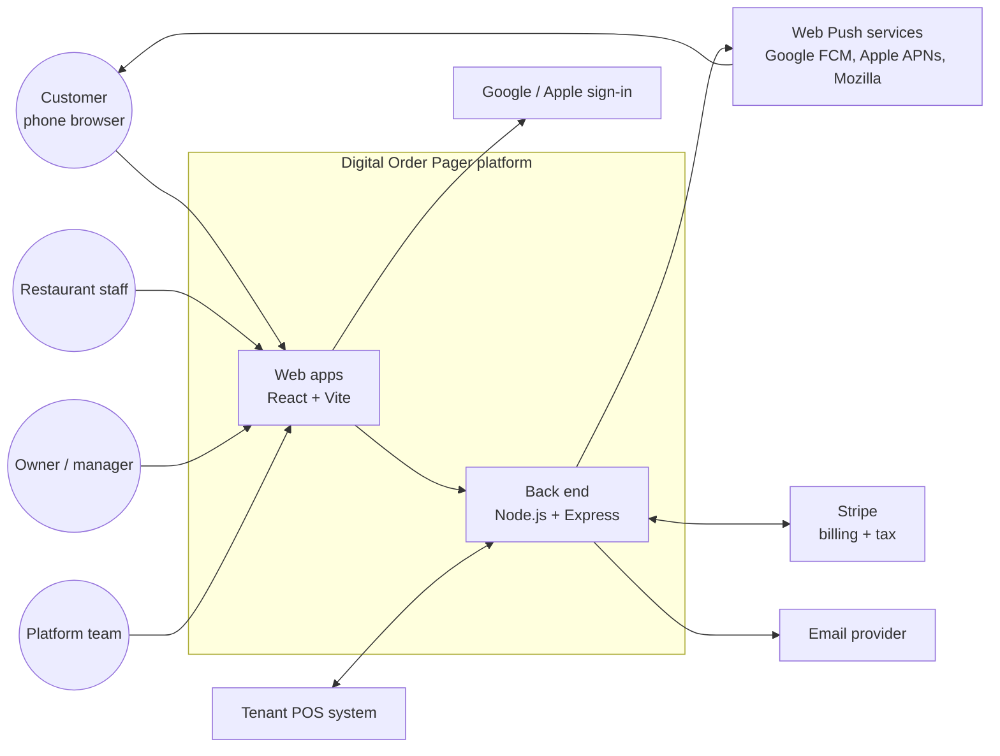
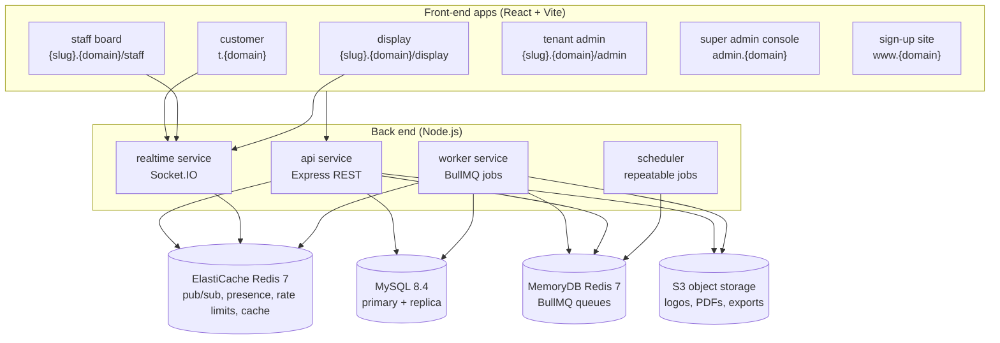
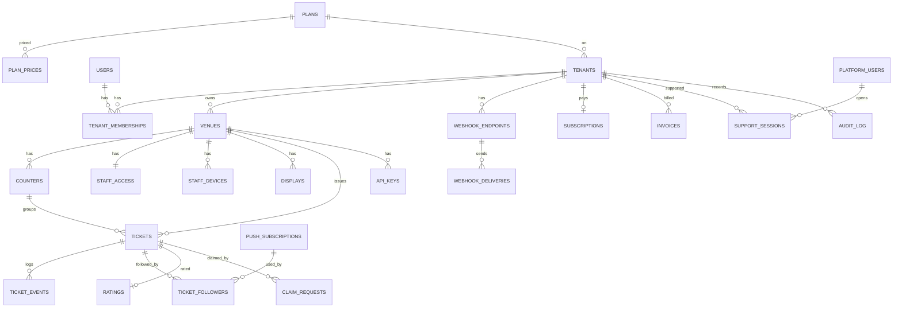
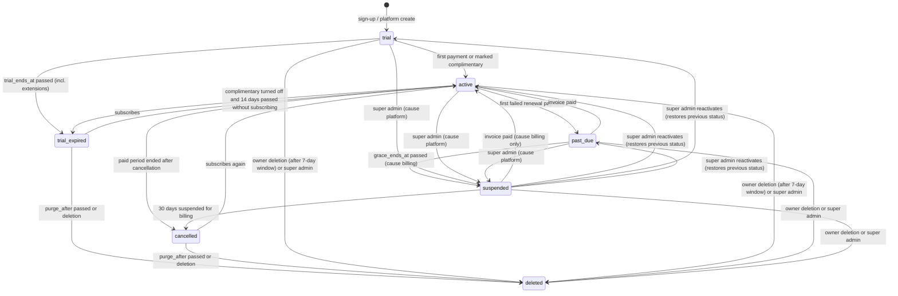
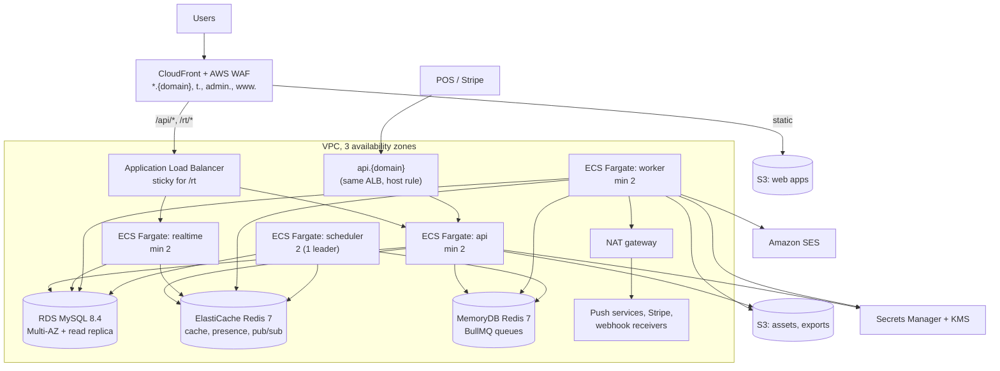

# Digital Order Pager — Technical Requirements Document (TRD)

| Item | Value |
| --- | --- |
| Document | Technical Requirements Document |
| Product | Digital Order Pager (working name) |
| Version | 0.1 — Draft for engineering review |
| Date | 2026-10-22 |
| Inputs | [Business-Requirements-Document.md](Business-Requirements-Document.md) (BRD v0.1), [Digital-Order-Pager-Concept.md](Digital-Order-Pager-Concept.md) |
| Technology baseline | Node.js + Express.js + MySQL (back end), React + Vite (front end) |
| Status | Awaiting engineering, QA and security sign-off |

---

## Table of contents

1. [Purpose, scope and conventions](#1-purpose-scope-and-conventions)
2. [System overview](#2-system-overview)
3. [Technology stack](#3-technology-stack)
4. [Repository and code structure](#4-repository-and-code-structure)
5. [Domains, hosts and URL scheme](#5-domains-hosts-and-url-scheme)
6. [Multi-tenancy design](#6-multi-tenancy-design)
7. [Data model and MySQL schema](#7-data-model-and-mysql-schema)
8. [State machines](#8-state-machines)
9. [Core algorithms](#9-core-algorithms)
10. [Real-time layer (Socket.IO)](#10-real-time-layer-socketio)
11. [Alerts and notifications](#11-alerts-and-notifications)
12. [API specification](#12-api-specification)
13. [Webhooks (outgoing)](#13-webhooks-outgoing)
14. [Authentication and authorisation](#14-authentication-and-authorisation)
15. [Security requirements](#15-security-requirements)
16. [Front-end applications](#16-front-end-applications)
17. [Billing integration (Stripe)](#17-billing-integration-stripe)
18. [Background jobs and schedules](#18-background-jobs-and-schedules)
19. [Email and owner notifications](#19-email-and-owner-notifications)
20. [Reporting and analytics](#20-reporting-and-analytics)
21. [Privacy, retention, export and deletion](#21-privacy-retention-export-and-deletion)
22. [Localisation and accessibility](#22-localisation-and-accessibility)
23. [Non-functional requirements and capacity](#23-non-functional-requirements-and-capacity)
24. [Infrastructure and deployment](#24-infrastructure-and-deployment)
25. [Observability and operations](#25-observability-and-operations)
26. [Testing strategy](#26-testing-strategy)
27. [Traceability to the BRD](#27-traceability-to-the-brd)
28. [Technical decisions record](#28-technical-decisions-record)
29. [Technical decisions closed](#29-technical-decisions-closed)
30. [Appendices](#30-appendices)

---

## 1. Purpose, scope and conventions

### 1.1 Purpose

This document defines **how** the platform described in the BRD is built: architecture, technology, data model, interfaces, algorithms, security, infrastructure and testing. Every functional requirement in the BRD (`FR-*`), business rule (`BR-*`), exception (`EX-*`) and non-functional requirement (`NFR-*`) is covered by one or more technical requirements here (section 27).

### 1.2 Scope

All releases in the BRD (MVP, R1.1, R2, Later) are specified, so the MVP architecture does not have to be redesigned later. Each technical requirement states the release in which it must be delivered.

### 1.3 Conventions

- **Technical requirement IDs:** `TR-<AREA>-<NN>`, e.g. `TR-RT-04`. IDs are permanent.
- **Keywords:** "must" = mandatory; "should" = expected unless a documented reason exists; "may" = optional.
- **Release tags:** `[MVP]`, `[R1.1]`, `[R2]`, `[Later]`. Untagged requirements are `[MVP]`.
- **Placeholders:** `{domain}` = platform domain, `tanbeeh.app` (BRD OI-03). `{slug}` = tenant slug.
- **Times** are stored in UTC; venue-local times are computed with the venue's IANA time zone.
- **Code samples** are TypeScript and illustrate intent; they are not final code.

---

## 2. System overview

### 2.1 Context



### 2.2 Logical components



| Component | Responsibility | Scaling |
| --- | --- | --- |
| `api` | All REST endpoints (public, staff, display, tenant admin, console, integration, Stripe webhook). Validates, authorises, writes MySQL, publishes events to Redis, enqueues jobs. | Stateless, horizontal |
| `realtime` | Socket.IO server: authenticates sockets, joins rooms, relays events from Redis to clients, receives heartbeats and acknowledgements. | Horizontal with Redis adapter; sticky sessions on the load balancer |
| `worker` | Executes queued jobs: Web Push sends, repeat alerts, webhooks, emails, exports, deletions, report roll-ups, image processing. | Horizontal; concurrency per queue |
| `scheduler` | Registers repeatable BullMQ jobs (auto-close sweep, retention, roll-ups, dunning checks). Exactly one active instance (leader lock in Redis). | 1 active + 1 standby |
| MySQL | System of record. | Primary (writes) + 1 read replica (reports) |
| Redis for queues (Amazon MemoryDB) | BullMQ queues and the scheduler leader lock; `maxmemory-policy noeviction` | Durable (multi-AZ transaction log), primary + replica |
| Redis for cache (Amazon ElastiCache) | Socket.IO adapter, event bus, presence and heartbeats, rate-limit counters, caches; `maxmemory-policy volatile-lru`, every key has a TTL | Primary + replica; no persistence needed (all rebuildable) |
| S3 | Tenant logos, generated QR images and poster PDFs, data exports. | Managed |

All four back-end services are built from **one Node.js code base** and started with different entry points (`node dist/api.js`, `realtime.js`, `worker.js`, `scheduler.js`).

### 2.3 Request and event flow: marking a ticket Ready

```mermaid
sequenceDiagram
    participant SB as Staff board
    participant API as api (Express)
    participant DB as MySQL
    participant R as Redis
    participant RT as realtime (Socket.IO)
    participant W as worker
    participant PS as Push service
    participant CP as Customer page
    participant D as Display
    SB->>API: POST /api/staff/v1/tickets/{id}/transitions {to:"ready", version}
    API->>DB: BEGIN; SELECT ... FOR UPDATE; UPDATE ticket; INSERT ticket_event; INSERT outbox; COMMIT
    API-->>SB: 200 ticket (version+1)
    API->>R: PUBLISH ticket.updated (from outbox relay)
    API->>R: outbox relay adds push.send + repeat jobs (delayed)
    R-->>RT: ticket.updated
    RT-->>SB: ticket.updated (room venue:{id}:staff)
    RT-->>D: ticket.updated (room venue:{id}:display)
    RT-->>CP: ticket.updated (room ticket:{id})
    W->>DB: load push subscriptions
    W->>PS: Web Push (urgency high)
    PS-->>CP: notification (if page closed)
```

---

## 3. Technology stack

### 3.1 Mandated baseline

| Layer | Technology | Version (minimum) | Notes |
| --- | --- | --- | --- |
| Runtime | Node.js | 22 LTS | TypeScript compiled to ES2022 |
| Language | TypeScript | 5.6 | `strict: true` everywhere |
| HTTP framework | Express.js | 5.1 | Native async error handling of Express 5 |
| Database | MySQL | 8.4 LTS (InnoDB) | `utf8mb4`, `utf8mb4_0900_ai_ci`, `sql_mode` strict, `time_zone='+00:00'` |
| Front end | React | 19 | Function components and hooks only |
| Front-end build | Vite | 6 | One Vite project per app, shared packages |

### 3.2 Selected libraries and services

| Concern | Choice | Reason |
| --- | --- | --- |
| Data access | **Kysely** (type-safe SQL query builder) with the `mysql2` driver; table types generated from the schema by `kysely-codegen` | Full control of MySQL features (generated columns, CHECK, partitions, row locks); a query-tree plugin enforces tenant scoping on every table in a query, including joins (section 6) |
| Migrations | Plain SQL migration files run by the Kysely migrator | Every DDL feature in section 7 is written exactly as specified; no ORM schema drift |
| Validation | Zod 3 | One schema for request validation and OpenAPI generation |
| OpenAPI | `zod-to-openapi` → OpenAPI 3.1 | Published docs for the integration API |
| Real-time | Socket.IO 4 + `@socket.io/redis-adapter` | Rooms, auto-reconnect, WebSocket with long-polling fallback |
| Queues and scheduling | BullMQ 5 on Redis 7 | Delayed jobs (repeat alerts), retries with back-off, repeatable jobs |
| Web Push | `web-push` (VAPID, RFC 8030/8291/8292) | Standard, works with FCM, APNs web push and Mozilla |
| Password and PIN hashing | `argon2` (argon2id) | OWASP recommended |
| TOTP / WebAuthn | `otplib`, `@simplewebauthn/server` + `/browser` | Platform user MFA |
| OAuth / OIDC | `openid-client` | Google and Apple sign-in |
| Logging | `pino` + `pino-http` | Structured JSON logs |
| Tracing and metrics | OpenTelemetry SDK (traces, metrics) | Vendor-neutral |
| Error tracking | Sentry (back end and front end) | Stack traces, release health |
| Security headers | `helmet` | CSP, HSTS, etc. |
| Rate limiting | `rate-limiter-flexible` (Redis store) | Shared limits across instances |
| CORS | `cors` | Explicit allow-list |
| Cookies | `cookie-parser` with signed cookies | Session cookies |
| File uploads | `multer` (memory, size-limited) + `sharp` | Logo re-encoding |
| QR codes | `qrcode` | SVG and PNG |
| PDFs | `pdf-lib` | QR poster kit |
| Email | Provider abstraction; default **Amazon SES** | Transactional email |
| Billing | **Stripe Billing**, Stripe Tax, Stripe Checkout, Customer Portal | Subscriptions, invoices, VAT |
| Object storage | Amazon S3 + CloudFront | Logos, PDFs, exports |
| Front-end routing | React Router 7 | |
| Server state | TanStack Query 5 | Caching, retries, refetch on reconnect |
| Local UI state | Zustand | Small stores (socket state, alerts) |
| Forms | React Hook Form + Zod resolver | Same schemas as back end |
| Styling | Tailwind CSS 4 + shared component library (Radix UI primitives) | Accessible primitives |
| PWA / service worker | `vite-plugin-pwa` (Workbox, `injectManifest` strategy) | Customer app push and Home Screen install |
| Internationalisation | i18next + react-i18next, ICU message format | Plurals, numbers |
| Charts (reports) | Recharts | Tenant and console reports |
| Unit tests | Vitest | Back end and front end |
| API/integration tests | Vitest + Supertest + Testcontainers (MySQL, Redis) | Real database in tests |
| End-to-end tests | Playwright | Including multi-browser runs |
| Load tests | k6 | HTTP and WebSocket scenarios |
| Monorepo | pnpm workspaces + Turborepo | Shared packages and cached builds |
| Lint and format | ESLint (typescript-eslint), Prettier | Custom lint rules (section 6.4) |
| Infrastructure as code | Terraform | AWS resources |
| CI/CD | GitHub Actions | Repository hosted on GitHub |
| Containers | Docker (distroless Node base image) | Same image for all back-end services |

`TR-STK-01` Library versions must be pinned in `pnpm-lock.yaml`; Renovate opens weekly update pull requests; security updates are applied within 7 days (critical within 48 hours).

`TR-STK-02` No library may be added to the back end without a licence check (MIT, Apache-2.0, BSD, ISC allowed; others need approval).

---

## 4. Repository and code structure

```text
digital-order-pager/
├─ apps/
│  ├─ api/                 Express app: routes, controllers, middleware
│  ├─ realtime/            Socket.IO server
│  ├─ worker/              BullMQ processors
│  ├─ scheduler/           Repeatable job registration
│  ├─ web-customer/        React + Vite PWA (t.{domain})
│  ├─ web-staff/           React + Vite (staff board, kitchen mode)
│  ├─ web-display/         React + Vite (display screen)
│  ├─ web-admin/           React + Vite (tenant admin area)
│  ├─ web-console/         React + Vite (super admin console)
│  └─ web-site/            React + Vite (sign-up, legal pages)
├─ packages/
│  ├─ domain/              Pure business logic: state machines, numbering, alert level, rules (no I/O)
│  ├─ db/                  SQL migrations, generated table types, tenant-scoped Kysely client, repositories
│  ├─ contracts/           Zod schemas, API types, socket event types, error codes
│  ├─ auth/                Sessions, hashing, MFA, OAuth helpers
│  ├─ events/              Outbox, event bus publish/subscribe helpers
│  ├─ jobs/                Queue names, job payload schemas, enqueue helpers
│  ├─ i18n/                Translation files and loaders
│  ├─ ui/                  Shared React components (accessible), theme tokens
│  ├─ client-sdk/          Typed API client and socket client for the web apps
│  └─ config/              Environment parsing (Zod), defaults
├─ infra/terraform/        AWS infrastructure
├─ tools/eslint-rules/     Custom lint rules (tenant scoping, no raw SQL)
├─ docs/                   ADRs, runbooks, OpenAPI output
└─ .github/workflows/      CI/CD pipelines
```

`TR-CODE-01` Business rules live only in `packages/domain` and are pure functions with unit tests; Express controllers and job processors call them and never re-implement rules.

`TR-CODE-02` Express apps follow the layering **route → validation middleware → controller → service → repository**. Controllers never build queries directly.

`TR-CODE-03` All request bodies, query strings, path parameters, socket payloads and job payloads are validated with Zod schemas from `packages/contracts`.

`TR-CODE-04` Every module exports typed errors that map to the error catalogue (appendix 30.1); no raw `throw new Error()` reaches the HTTP layer.

---

## 5. Domains, hosts and URL scheme

### 5.1 Hosts

| Host | Serves | Notes |
| --- | --- | --- |
| `www.{domain}` | Marketing and sign-up site, legal pages | Static on CloudFront |
| `t.{domain}` | Customer app: ticket pages, venue pages, service worker, web app manifests | **One origin for all tenants** so a phone keeps all its tickets, one service worker and one push subscription per browser |
| `{slug}.{domain}` | Tenant apps: `/admin`, `/staff`, `/display` | Wildcard DNS and TLS certificate; tenant resolved from host |
| `admin.{domain}` | Super admin console | Reserved slug; IP allow-list optional (TR-SEC-12) |
| `/api/*` on every app host | REST API for browser apps, same-origin | `/api/public/v1`, `/api/auth/v1`, `/api/staff/v1`, `/api/display/v1`, `/api/admin/v1`, `/api/console/v1` (TR-API-01) |
| `/rt/*` on every app host | Socket.IO endpoint for browser apps, same-origin | Sticky sessions |
| `api.{domain}` | Integration API and inbound webhooks only | `/v1` (POS integration), `/webhooks/stripe`, `/connectors/{provider}/webhook` |
| `cdn.{domain}` | Static assets, logos, generated images | CloudFront |
| `status.{domain}` | Public status page `[R1.1]` | Third-party hosted |

### 5.2 URL formats

| Purpose | Format | Example |
| --- | --- | --- |
| Ticket page | `https://t.{domain}/{ticketToken}` | `https://t.example.com/3kF9xQ2bT7mZp1LwR8vYcA` |
| Ticket page opened from Home Screen | `https://t.{domain}/{ticketToken}?src=hs` | |
| Ticket web app manifest | `https://t.{domain}/m/{ticketToken}.webmanifest` | |
| Venue page | `https://t.{domain}/v/{venueCode}` | `https://t.example.com/v/BH7K2M` |
| Staff board | `https://{slug}.{domain}/staff/{staffKey}` | key = 32 base62 chars |
| Display | `https://{slug}.{domain}/display` (pairing screen) | |
| Tenant admin | `https://{slug}.{domain}/admin` | |
| Tenant sign-in | `https://{slug}.{domain}/admin/sign-in` and `https://www.{domain}/sign-in` (tenant chooser) | |

`TR-URL-01` Ticket tokens are 22 characters of base62 generated from 128 bits of a CSPRNG (`crypto.randomBytes(16)`). They never encode tenant, venue, number or time.

`TR-URL-02` Venue codes are 6 characters from the same unambiguous 31-character alphabet as ticket codes (`ABCDEFGHJKMNPQRSTUVWXYZ23456789`), unique platform-wide, and do not change when the tenant slug changes.

`TR-URL-03` Changing a tenant slug creates a permanent redirect from the old host to the new one for 180 days; the old slug cannot be taken by another tenant during that time. `[R1.1]`

`TR-URL-04` Reserved slugs: `admin, api, app, www, t, rt, cdn, status, mail, support, help, docs, staging, dev, test, static, assets, auth, billing` and any slug shorter than 3 or longer than 40 characters. Allowed characters: `a–z`, `0–9`, `-` (not at start or end).

---

## 6. Multi-tenancy design

### 6.1 Model

Shared application, **shared MySQL schema**, every tenant-owned table has a `tenant_id` column. MySQL has no row-level security, so isolation is enforced by **four independent layers**; any one layer failing alone must not leak data.

| Layer | Mechanism | TR |
| --- | --- | --- |
| 1. Tenant context | Every request and job resolves a `TenantContext` from a trusted credential (session, staff device, display, API key, ticket token). Never from a request parameter. | TR-TEN-01, 02 |
| 2. Tenant-scoped data client | All tenant-table access goes through `db.forTenant(ctx)`, a Kysely plugin that walks each query tree, adds `<alias>.tenant_id = ?` for **every** tenant table in `FROM`, `JOIN`, `UPDATE`, `DELETE` and sub-queries, checks that every `INSERT` row carries the context's `tenant_id`, and rejects any query it cannot scope. | TR-TEN-03, 04 |
| 3. Database constraints | Composite keys and foreign keys include `tenant_id` (e.g. `FOREIGN KEY (tenant_id, venue_id) REFERENCES venues (tenant_id, id)`), so a row can never point to another tenant's row. | TR-TEN-05 |
| 4. Verification | Custom lint rules, automated cross-tenant tests on every build, and a nightly integrity check query. | TR-TEN-07 to 09 |

### 6.2 Tenant resolution

| Caller | Credential | Resolves to |
| --- | --- | --- |
| Tenant user (admin) | Session cookie on `{slug}.{domain}` + host slug | Membership `(user, tenant)` must exist and be active; tenant = host's tenant |
| Staff device | Device session cookie (issued after staff key + PIN) | `staff_devices.tenant_id`, `venue_id` |
| Display | Display session cookie (issued after pairing) | `displays.tenant_id`, `venue_id` |
| Customer | Ticket token in path or socket handshake | `tickets.tenant_id` via token lookup |
| Integration | `Authorization: Bearer pk_...` API key | `api_keys.tenant_id`, `venue_id` |
| Platform user | Console session cookie on `admin.{domain}` | No tenant; uses the **platform client** (section 6.3) |
| Platform user in support session | Support session token + tenant host | Tenant of the approved support session; actor recorded as platform user |
| Background job | `tenantId` in validated job payload | Re-checked against the referenced record before acting |

`TR-TEN-01` The tenant context object is immutable, created by authentication middleware, and attached to `req.ctx` (Express) or `socket.data.ctx` (Socket.IO) or the job context.

`TR-TEN-02` If the host slug and the credential's tenant differ, the request is rejected with `404 NOT_FOUND` (never confirming the resource exists, consistent with TR-TEN-08) and logged as security event `TENANT_MISMATCH`.

### 6.3 Data clients

```ts
// packages/db/src/clients.ts (illustrative)
export const db = {
  forTenant(ctx: TenantContext) { return kysely.withPlugin(new TenantScopePlugin(ctx.tenantId, TENANT_TABLES)); },
  forTicketToken(token: string)  { /* resolves ticket, then forTenant */ },
  platform(actor: PlatformActor) { return kysely.withPlugin(new PlatformAuditPlugin(actor)); }, // console routes and workers only
};
```

`TR-TEN-03` The `TenantScopePlugin` must handle `SELECT`, `INSERT`, `INSERT … ON DUPLICATE KEY UPDATE`, `UPDATE`, `DELETE`, every join type, sub-queries, CTEs and `UNION`; each tenant-table reference gets `tenant_id = ?` on its own alias. Raw `sql` fragments that reference a tenant table are rejected unless built with `scopedSql(ctx, …)`, which requires the tenant predicate. The plugin has its own unit tests covering every query shape used in the code base.

`TR-TEN-04` Direct use of the unscoped Kysely instance and of `sql.raw()` is forbidden outside `packages/db`. Raw `sql` templates inside `packages/db` on tenant tables must include `tenant_id = ${ctx.tenantId}`; the code review checklist and the lint rule `no-unscoped-raw-sql` enforce it.

`TR-TEN-05` Every tenant-owned table has `tenant_id CHAR(36) NOT NULL`, an index starting with `tenant_id`, and foreign keys to parent tables using `(tenant_id, parent_id)`.

`TR-TEN-06` The platform client may read across tenants only from the `api` console routes and workers; every write through it is recorded in `audit_log` in the same transaction.

`TR-TEN-07` Lint rule `require-tenant-client` fails the build if a module under `apps/api/src/routes/{public,staff,display,admin,v1}` imports the platform client or base client.

`TR-TEN-08` Automated cross-tenant test suite: for every endpoint and socket event, create tenants A and B, authenticate as A, attempt to read and change B's resources by ID, token, external reference and search. Every attempt must return `404` (not `403`, to avoid confirming existence). Runs on every pull request.

`TR-TEN-09` Nightly integrity job checks that no child row's `tenant_id` differs from its parent's (belt-and-braces for layer 3); any mismatch pages on-call.

`TR-TEN-10` Caches keyed by tenant data always include `tenantId` in the key (`t:{tenantId}:settings:{venueId}`).

`TR-TEN-11` Socket.IO rooms are named with IDs that already belong to one tenant (`venue:{venueId}:staff`), and a socket can join only rooms derived from its own context.

`TR-TEN-12` Per-tenant fair use: API rate limits, per-tenant job fairness (TR-JOB-04) and a maximum of 10,000 open tickets per venue.

### 6.4 Users across tenants

`TR-TEN-13` A tenant user is one global identity (`users` table, unique email) with one or more `tenant_memberships`. Signing in on `www.{domain}` shows a tenant chooser when the user has several memberships; signing in on `{slug}.{domain}` goes straight to that tenant. Sessions are issued per host, so a session on tenant A's host is not valid on tenant B's host. (BRD OI-08.)

`TR-TEN-14` Platform users are a separate table and cannot hold tenant memberships with the same account.

`TR-TEN-17` Tables without `tenant_id`, by design: platform tables (§7.3 except `tenant_*` and `support_sessions`), `users`, `user_identities`, `email_tokens` (a person may belong to several tenants), `push_subscriptions` (one per phone browser, shared by that phone's tickets at different restaurants; never exposed through any tenant API; reached only through tenant-owned `ticket_followers`), `stripe_events`, `outbox` (`tenant_id` nullable for platform events), `email_template_texts` and `platform_metrics_daily`. Every other table is tenant-owned and follows TR-TEN-05.

---

## 7. Data model and MySQL schema

### 7.1 Database conventions

`TR-DB-01` Engine InnoDB, charset `utf8mb4`, collation `utf8mb4_0900_ai_ci`, `sql_mode` includes `STRICT_TRANS_TABLES, NO_ZERO_DATE, NO_ZERO_IN_DATE, ERROR_FOR_DIVISION_BY_ZERO, ONLY_FULL_GROUP_BY`. Isolation level `READ COMMITTED` for the application connection.

`TR-DB-02` Primary keys are **UUIDv7** strings in `CHAR(36)` (time-ordered, generated in the application). High-volume append-only tables (`ticket_events`, `audit_log`, `outbox`, `webhook_deliveries`) use `BIGINT UNSIGNED AUTO_INCREMENT`.

`TR-DB-03` All timestamps are `DATETIME(3)` in UTC. The connection sets `time_zone = '+00:00'`. Venue-local values (business date, reset time) are computed in the application with the IANA zone stored on the venue.

`TR-DB-04` Every table has `created_at`; mutable tables also have `updated_at` (`ON UPDATE CURRENT_TIMESTAMP(3)`).

`TR-DB-05` Soft deletion only where stated (`archived_at`, `revoked_at`, `deleted_at`); tenant deletion is a hard delete (section 21).

`TR-DB-06` Secrets that must be shown again or used later (staff key, TOTP secrets, webhook secrets, POS credentials) are stored encrypted with AES-256-GCM using a data key from AWS KMS (envelope encryption). Values that only need checking (passwords, PINs, API key secrets, session tokens, codes) are stored as hashes only.

`TR-DB-07` Schema changes are made only through plain SQL migration files (Kysely migrator) reviewed in pull requests. Migrations must be backward compatible with the previous release (expand → migrate → contract) so rolling deploys work.

`TR-DB-08` Database accounts: `app_rw` (DML on application tables; `INSERT, SELECT` only on `audit_log`), `app_audit_maint` (`UPDATE (before_data, after_data)` and `DELETE` on `audit_log` only; used only by the `retention.audit` job, every use logged), `app_migrate` (DDL, used only by the deploy pipeline), `app_report` (read-only, on the replica), `app_admin` (break-glass, MFA-protected, every use logged).

### 7.2 Entity relationship overview



### 7.3 Platform tables

```sql
CREATE TABLE platform_users (
  id               CHAR(36)     NOT NULL PRIMARY KEY,
  email            VARCHAR(254) NOT NULL UNIQUE,
  name             VARCHAR(120) NOT NULL,
  password_hash    VARCHAR(255) NULL,                    -- argon2id; NULL until the invitation is accepted
  role             ENUM('super_admin','support','finance') NOT NULL,
  status           ENUM('invited','active','disabled') NOT NULL DEFAULT 'invited',
  totp_secret_enc  VARBINARY(512) NULL,
  mfa_enrolled_at  DATETIME(3)  NULL,
  last_sign_in_at  DATETIME(3)  NULL,
  created_at       DATETIME(3)  NOT NULL DEFAULT CURRENT_TIMESTAMP(3),
  updated_at       DATETIME(3)  NOT NULL DEFAULT CURRENT_TIMESTAMP(3) ON UPDATE CURRENT_TIMESTAMP(3)
);

CREATE TABLE platform_webauthn_credentials (
  id               CHAR(36)       NOT NULL PRIMARY KEY,
  platform_user_id CHAR(36)       NOT NULL,
  credential_id    VARBINARY(1023) NOT NULL,
  public_key       BLOB           NOT NULL,
  sign_count       INT UNSIGNED   NOT NULL DEFAULT 0,
  transports       JSON           NULL,
  name             VARCHAR(60)    NOT NULL,
  created_at       DATETIME(3)    NOT NULL DEFAULT CURRENT_TIMESTAMP(3),
  last_used_at     DATETIME(3)    NULL,
  UNIQUE KEY uq_cred (credential_id(255)),
  FOREIGN KEY (platform_user_id) REFERENCES platform_users(id) ON DELETE CASCADE
);

CREATE TABLE platform_sessions (
  id               CHAR(36)    NOT NULL PRIMARY KEY,
  platform_user_id CHAR(36)    NOT NULL,
  token_hash       CHAR(64)    NOT NULL UNIQUE,            -- SHA-256 of session token
  mfa_verified_at  DATETIME(3) NULL,
  ip               VARCHAR(45) NOT NULL,
  user_agent       VARCHAR(300) NOT NULL,
  created_at       DATETIME(3) NOT NULL DEFAULT CURRENT_TIMESTAMP(3),
  last_seen_at     DATETIME(3) NOT NULL DEFAULT CURRENT_TIMESTAMP(3),
  expires_at       DATETIME(3) NOT NULL,
  revoked_at       DATETIME(3) NULL,
  FOREIGN KEY (platform_user_id) REFERENCES platform_users(id) ON DELETE CASCADE
);

CREATE TABLE plans (
  id           CHAR(36)    NOT NULL PRIMARY KEY,
  code         VARCHAR(40) NOT NULL UNIQUE,                -- trial, standard, pro, multisite
  name         VARCHAR(80) NOT NULL,
  is_public    BOOLEAN     NOT NULL DEFAULT TRUE,
  limits       JSON        NOT NULL,                       -- appendix 30.3
  features     JSON        NOT NULL,                       -- list of feature flag keys
  sort_order   SMALLINT    NOT NULL DEFAULT 0,
  archived_at  DATETIME(3) NULL,
  created_at   DATETIME(3) NOT NULL DEFAULT CURRENT_TIMESTAMP(3),
  updated_at   DATETIME(3) NOT NULL DEFAULT CURRENT_TIMESTAMP(3) ON UPDATE CURRENT_TIMESTAMP(3)
);

CREATE TABLE plan_prices (
  id               CHAR(36)    NOT NULL PRIMARY KEY,
  plan_id          CHAR(36)    NOT NULL,
  period           ENUM('month','quarter','year') NOT NULL,
  currency         CHAR(3)     NOT NULL,
  amount_minor     INT UNSIGNED NOT NULL,                  -- per venue per period
  stripe_price_id  VARCHAR(64) NOT NULL UNIQUE,
  active           BOOLEAN     NOT NULL DEFAULT TRUE,
  created_at       DATETIME(3) NOT NULL DEFAULT CURRENT_TIMESTAMP(3),
  active_key       VARCHAR(80) AS (IF(active, CONCAT(plan_id, ':', period, ':', currency), NULL)) STORED,
  UNIQUE KEY uq_active_price (active_key),                -- one active price per plan, period and currency
  FOREIGN KEY (plan_id) REFERENCES plans(id)
);

CREATE TABLE feature_flags (
  flag_key     VARCHAR(60)  NOT NULL PRIMARY KEY,          -- e.g. api_access, pos_connectors
  description  VARCHAR(255) NOT NULL,
  default_on   BOOLEAN      NOT NULL DEFAULT FALSE,
  created_at   DATETIME(3)  NOT NULL DEFAULT CURRENT_TIMESTAMP(3)
);

CREATE TABLE tenant_feature_overrides (
  tenant_id   CHAR(36)    NOT NULL,
  flag_key    VARCHAR(60) NOT NULL,
  enabled     BOOLEAN     NOT NULL,
  set_by      CHAR(36)    NOT NULL,                        -- platform user
  set_at      DATETIME(3) NOT NULL DEFAULT CURRENT_TIMESTAMP(3),
  PRIMARY KEY (tenant_id, flag_key),
  FOREIGN KEY (tenant_id) REFERENCES tenants(id) ON DELETE CASCADE,
  FOREIGN KEY (flag_key)  REFERENCES feature_flags(flag_key)
);

CREATE TABLE platform_settings (
  setting_key  VARCHAR(80) NOT NULL PRIMARY KEY,           -- appendix 30.4
  value        JSON        NOT NULL,
  updated_by   CHAR(36)    NULL,
  updated_at   DATETIME(3) NOT NULL DEFAULT CURRENT_TIMESTAMP(3) ON UPDATE CURRENT_TIMESTAMP(3)
);

CREATE TABLE chimes (
  id           CHAR(36)    NOT NULL PRIMARY KEY,
  code         VARCHAR(40) NOT NULL UNIQUE,
  name         VARCHAR(80) NOT NULL,
  file_key     VARCHAR(255) NOT NULL,                      -- S3 key, MP3 + OGG
  duration_ms  INT UNSIGNED NOT NULL,                      -- max 3000
  loudness_lufs DECIMAL(4,1) NOT NULL,                     -- normalised to -14 LUFS
  active       BOOLEAN     NOT NULL DEFAULT TRUE
);

CREATE TABLE languages (
  code              VARCHAR(10) NOT NULL PRIMARY KEY,      -- BCP 47, e.g. en, ar, fr-CA
  name              VARCHAR(60) NOT NULL,
  direction         ENUM('ltr','rtl') NOT NULL DEFAULT 'ltr',
  customer_enabled  BOOLEAN     NOT NULL DEFAULT FALSE,
  tts_lang          VARCHAR(10) NULL                       -- BCP 47 voice tag for speech
);

CREATE TABLE legal_documents (
  id            CHAR(36)    NOT NULL PRIMARY KEY,
  kind          ENUM('terms','privacy','dpa','customer_privacy') NOT NULL,
  version       VARCHAR(20) NOT NULL,
  locale        VARCHAR(10) NOT NULL,
  content_key   VARCHAR(255) NOT NULL,                     -- S3 key of rendered HTML
  published_at  DATETIME(3) NULL,
  UNIQUE KEY uq_doc (kind, version, locale)
);

CREATE TABLE legal_acceptances (
  id            CHAR(36)    NOT NULL PRIMARY KEY,
  tenant_id     CHAR(36)    NOT NULL,
  user_id       CHAR(36)    NOT NULL,
  document_id   CHAR(36)    NOT NULL,
  accepted_at   DATETIME(3) NOT NULL DEFAULT CURRENT_TIMESTAMP(3),
  ip            VARCHAR(45) NOT NULL,
  KEY ix_tenant (tenant_id),
  FOREIGN KEY (tenant_id)   REFERENCES tenants(id) ON DELETE CASCADE,
  FOREIGN KEY (document_id) REFERENCES legal_documents(id)
);

CREATE TABLE announcements (
  id          CHAR(36)     NOT NULL PRIMARY KEY,
  message     JSON         NOT NULL,                       -- {locale: text}
  severity    ENUM('info','warning','critical') NOT NULL,
  target      JSON         NOT NULL,                       -- {"all":true} | {"tenantIds":[...]} | {"plans":[...]}
  starts_at   DATETIME(3)  NOT NULL,
  ends_at     DATETIME(3)  NOT NULL,
  created_by  CHAR(36)     NOT NULL,
  created_at  DATETIME(3)  NOT NULL DEFAULT CURRENT_TIMESTAMP(3)
);

CREATE TABLE audit_log (
  id                  BIGINT UNSIGNED NOT NULL AUTO_INCREMENT PRIMARY KEY,
  occurred_at         DATETIME(3)  NOT NULL DEFAULT CURRENT_TIMESTAMP(3),
  actor_type          ENUM('platform_user','user','staff_device','staff_member','api_key','system','support') NOT NULL,
  actor_id            CHAR(36)     NULL,
  tenant_id           CHAR(36)     NULL,                   -- NULL = platform-level action
  support_session_id  CHAR(36)     NULL,
  purpose             ENUM('support','security','billing','legal','operations') NULL,  -- FR-SUP-07, platform actors
  action              VARCHAR(80)  NOT NULL,               -- appendix 30.2
  entity_type         VARCHAR(40)  NOT NULL,
  entity_id           VARCHAR(64)  NULL,
  before_data         JSON         NULL,
  after_data          JSON         NULL,
  visible_to_tenant   BOOLEAN      NOT NULL,
  ip                  VARCHAR(45)  NULL,
  request_id          CHAR(36)     NULL,
  KEY ix_tenant_time (tenant_id, occurred_at),
  KEY ix_actor (actor_type, actor_id, occurred_at)
);  -- app_rw has INSERT, SELECT only; no FK so entries outlive deleted entities (tenant rows anonymised, section 21)

CREATE TABLE tenant_notes (
  id          CHAR(36)     NOT NULL PRIMARY KEY,
  tenant_id   CHAR(36)     NOT NULL,
  author_id   CHAR(36)     NOT NULL,
  body        TEXT         NOT NULL,
  created_at  DATETIME(3)  NOT NULL DEFAULT CURRENT_TIMESTAMP(3),
  KEY ix_tenant (tenant_id, created_at),
  FOREIGN KEY (tenant_id) REFERENCES tenants(id) ON DELETE CASCADE,
  FOREIGN KEY (author_id) REFERENCES platform_users(id)
);

CREATE TABLE support_sessions (
  id                  CHAR(36)     NOT NULL PRIMARY KEY,
  tenant_id           CHAR(36)     NOT NULL,
  platform_user_id    CHAR(36)     NOT NULL,
  reason              VARCHAR(500) NOT NULL,
  kind                ENUM('approved','emergency') NOT NULL DEFAULT 'approved',
  status              ENUM('requested','active','refused','ended','expired','cancelled') NOT NULL,
  approval_code_hash  CHAR(64)     NULL,                   -- one-time phone code
  decided_by_user_id  CHAR(36)     NULL,
  duration_minutes    SMALLINT     NOT NULL DEFAULT 120,
  requested_at        DATETIME(3)  NOT NULL DEFAULT CURRENT_TIMESTAMP(3),
  decided_at          DATETIME(3)  NULL,
  expires_at          DATETIME(3)  NULL,
  ended_at            DATETIME(3)  NULL,
  ended_by            ENUM('platform','tenant','system') NULL,
  KEY ix_tenant_status (tenant_id, status),
  FOREIGN KEY (tenant_id) REFERENCES tenants(id) ON DELETE CASCADE,
  FOREIGN KEY (platform_user_id) REFERENCES platform_users(id)
);
```

### 7.4 Tenant, user and membership tables

```sql
CREATE TABLE tenants (
  id                     CHAR(36)     NOT NULL PRIMARY KEY,
  name                   VARCHAR(120) NOT NULL,
  slug                   VARCHAR(40)  NOT NULL UNIQUE,
  previous_slug          VARCHAR(40)  NULL UNIQUE,
  slug_changed_at        DATETIME(3)  NULL,
  status                 ENUM('trial','active','past_due','suspended','trial_expired','cancelled','deleted') NOT NULL DEFAULT 'trial',
  status_reason          VARCHAR(500) NULL,
  suspended_by           ENUM('billing','platform') NULL,
  plan_id                CHAR(36)     NOT NULL,
  complimentary          BOOLEAN      NOT NULL DEFAULT FALSE,
  trial_ends_at          DATETIME(3)  NULL,
  past_due_since         DATETIME(3)  NULL,
  grace_ends_at          DATETIME(3)  NULL,
  suspended_at           DATETIME(3)  NULL,
  cancelled_at           DATETIME(3)  NULL,
  deletion_requested_at  DATETIME(3)  NULL,                -- owner request; 7-day cancel window (TR-PRV-08)
  purge_after            DATETIME(3)  NULL,                -- 90 days after trial_expired/cancelled
  deleted_at             DATETIME(3)  NULL,
  country                CHAR(2)      NOT NULL,
  default_locale         VARCHAR(10)  NOT NULL,
  billing_email          VARCHAR(254) NULL,
  tax_id                 VARCHAR(40)  NULL,
  stripe_customer_id     VARCHAR(64)  NULL UNIQUE,
  created_via            ENUM('self_signup','platform') NOT NULL,
  status_before_suspension ENUM('trial','active','past_due') NULL,
  last_activity_at       DATETIME(3)  NULL,                -- updated at most every 10 min (FR-SA-04)
  created_at             DATETIME(3)  NOT NULL DEFAULT CURRENT_TIMESTAMP(3),
  updated_at             DATETIME(3)  NOT NULL DEFAULT CURRENT_TIMESTAMP(3) ON UPDATE CURRENT_TIMESTAMP(3),
  KEY ix_status (status),
  FOREIGN KEY (plan_id) REFERENCES plans(id)
);

CREATE TABLE users (
  id                 CHAR(36)     NOT NULL PRIMARY KEY,
  email              VARCHAR(254) NOT NULL UNIQUE,          -- stored lower-case
  email_verified_at  DATETIME(3)  NULL,
  name               VARCHAR(120) NOT NULL,
  password_hash      VARCHAR(255) NULL,                     -- NULL when only Google/Apple sign-in
  locale             VARCHAR(10)  NOT NULL DEFAULT 'en',
  totp_secret_enc    VARBINARY(512) NULL,                   -- optional MFA for tenant users
  mfa_enrolled_at    DATETIME(3)  NULL,
  disabled_at        DATETIME(3)  NULL,
  created_at         DATETIME(3)  NOT NULL DEFAULT CURRENT_TIMESTAMP(3),
  updated_at         DATETIME(3)  NOT NULL DEFAULT CURRENT_TIMESTAMP(3) ON UPDATE CURRENT_TIMESTAMP(3)
);

CREATE TABLE user_identities (
  id          CHAR(36)     NOT NULL PRIMARY KEY,
  user_id     CHAR(36)     NOT NULL,
  provider    ENUM('google','apple') NOT NULL,
  subject     VARCHAR(255) NOT NULL,
  created_at  DATETIME(3)  NOT NULL DEFAULT CURRENT_TIMESTAMP(3),
  UNIQUE KEY uq_provider_subject (provider, subject),
  FOREIGN KEY (user_id) REFERENCES users(id) ON DELETE CASCADE
);

CREATE TABLE tenant_memberships (
  id          CHAR(36)    NOT NULL PRIMARY KEY,
  tenant_id   CHAR(36)    NOT NULL,
  user_id     CHAR(36)    NOT NULL,
  role        ENUM('owner','manager') NOT NULL,
  status      ENUM('active','removed') NOT NULL DEFAULT 'active',
  weekly_summary BOOLEAN NOT NULL DEFAULT TRUE,             -- FR-RPT-05 opt-out
  owner_key   CHAR(36) AS (IF(role = 'owner' AND status = 'active', tenant_id, NULL)) STORED,
  created_at  DATETIME(3) NOT NULL DEFAULT CURRENT_TIMESTAMP(3),
  updated_at  DATETIME(3) NOT NULL DEFAULT CURRENT_TIMESTAMP(3) ON UPDATE CURRENT_TIMESTAMP(3),
  UNIQUE KEY uq_member (tenant_id, user_id),
  UNIQUE KEY uq_one_owner (owner_key),                      -- BR-20: at most one active owner
  KEY ix_user (user_id),
  FOREIGN KEY (tenant_id) REFERENCES tenants(id) ON DELETE CASCADE,
  FOREIGN KEY (user_id)   REFERENCES users(id)
);

CREATE TABLE invitations (
  id           CHAR(36)     NOT NULL PRIMARY KEY,
  tenant_id    CHAR(36)     NOT NULL,
  email        VARCHAR(254) NOT NULL,
  role         ENUM('owner','manager') NOT NULL,           -- owner only for platform-created tenants and transfers
  token_hash   CHAR(64)     NOT NULL UNIQUE,
  invited_by_type ENUM('user','platform_user') NOT NULL,
  invited_by   CHAR(36)     NOT NULL,
  expires_at   DATETIME(3)  NOT NULL,                       -- 7 days
  accepted_at  DATETIME(3)  NULL,
  revoked_at   DATETIME(3)  NULL,
  created_at   DATETIME(3)  NOT NULL DEFAULT CURRENT_TIMESTAMP(3),
  KEY ix_tenant (tenant_id),
  FOREIGN KEY (tenant_id) REFERENCES tenants(id) ON DELETE CASCADE
);

CREATE TABLE user_sessions (
  id             CHAR(36)     NOT NULL PRIMARY KEY,
  user_id        CHAR(36)     NOT NULL,
  tenant_id      CHAR(36)     NULL,                        -- NULL on www chooser session
  host           VARCHAR(100) NOT NULL,
  token_hash     CHAR(64)     NOT NULL UNIQUE,
  mfa_verified_at DATETIME(3) NULL,
  ip             VARCHAR(45)  NOT NULL,
  user_agent     VARCHAR(300) NOT NULL,
  created_at     DATETIME(3)  NOT NULL DEFAULT CURRENT_TIMESTAMP(3),
  last_seen_at   DATETIME(3)  NOT NULL DEFAULT CURRENT_TIMESTAMP(3),
  expires_at     DATETIME(3)  NOT NULL,
  revoked_at     DATETIME(3)  NULL,
  KEY ix_user (user_id),
  FOREIGN KEY (user_id) REFERENCES users(id) ON DELETE CASCADE
);

CREATE TABLE email_tokens (
  id          CHAR(36)    NOT NULL PRIMARY KEY,
  user_id     CHAR(36)    NOT NULL,
  purpose     ENUM('verify_email','reset_password','change_email') NOT NULL,
  token_hash  CHAR(64)    NOT NULL UNIQUE,
  new_email   VARCHAR(254) NULL,
  expires_at  DATETIME(3) NOT NULL,                        -- verify 24 h, reset 1 h
  used_at     DATETIME(3) NULL,
  created_at  DATETIME(3) NOT NULL DEFAULT CURRENT_TIMESTAMP(3),
  FOREIGN KEY (user_id) REFERENCES users(id) ON DELETE CASCADE
);
```

### 7.5 Venue tables

```sql
CREATE TABLE venues (
  id                  CHAR(36)     NOT NULL PRIMARY KEY,
  tenant_id           CHAR(36)     NOT NULL,
  name                VARCHAR(120) NOT NULL,
  venue_code          CHAR(6) CHARACTER SET ascii COLLATE ascii_bin NOT NULL UNIQUE,  -- TR-URL-02 (stored upper-case)
  address             JSON         NULL,
  time_zone           VARCHAR(64)  NOT NULL,                 -- IANA, e.g. Europe/Berlin
  locales             JSON         NOT NULL,                 -- ["en","ar"], first = primary
  logo_key            VARCHAR(255) NULL,
  brand_color         CHAR(7)      NOT NULL DEFAULT '#1F6FEB',
  messages            JSON         NOT NULL,                 -- per locale, appendix 30.5
  settings            JSON         NOT NULL,                 -- validated by Zod, appendix 30.5
  reset_time          TIME         NOT NULL DEFAULT '04:00:00',
  pending_reset_time  TIME         NULL,                    -- BR-27: applies from pending_from_date
  pending_auto_close_time TIME     NULL,
  pending_from_date   DATE         NULL,
  auto_close_time     TIME         NOT NULL DEFAULT '04:00:00',
  next_auto_close_at  DATETIME(3)  NOT NULL,                 -- UTC, recomputed on change and after each run
  status              ENUM('active','archived') NOT NULL DEFAULT 'active',
  created_at          DATETIME(3)  NOT NULL DEFAULT CURRENT_TIMESTAMP(3),
  updated_at          DATETIME(3)  NOT NULL DEFAULT CURRENT_TIMESTAMP(3) ON UPDATE CURRENT_TIMESTAMP(3),
  UNIQUE KEY uq_tenant_id (tenant_id, id),
  KEY ix_autoclose (status, next_auto_close_at),
  FOREIGN KEY (tenant_id) REFERENCES tenants(id) ON DELETE CASCADE
);

CREATE TABLE counters (
  id          CHAR(36)    NOT NULL PRIMARY KEY,
  tenant_id   CHAR(36)    NOT NULL,
  venue_id    CHAR(36)    NOT NULL,
  name        VARCHAR(60) NOT NULL,
  prefix      VARCHAR(3)  NULL,                            -- A, B, D1 ...; NULL = no prefix
  sort_order  SMALLINT    NOT NULL DEFAULT 0,
  archived_at DATETIME(3) NULL,
  created_at  DATETIME(3) NOT NULL DEFAULT CURRENT_TIMESTAMP(3),
  UNIQUE KEY uq_tenant_id (tenant_id, id),
  UNIQUE KEY uq_prefix (venue_id, prefix),
  FOREIGN KEY (tenant_id, venue_id) REFERENCES venues(tenant_id, id) ON DELETE CASCADE
);

CREATE TABLE number_sequences (
  tenant_id      CHAR(36)    NOT NULL,
  venue_id       CHAR(36)    NOT NULL,
  sequence_key   VARCHAR(36) NOT NULL,                     -- counter_id when prefixes are used, else ''
  business_date  DATE        NOT NULL,
  last_number    INT UNSIGNED NOT NULL DEFAULT 0,
  PRIMARY KEY (venue_id, sequence_key, business_date),
  FOREIGN KEY (tenant_id, venue_id) REFERENCES venues(tenant_id, id) ON DELETE CASCADE
);

CREATE TABLE staff_access (
  venue_id          CHAR(36)     NOT NULL PRIMARY KEY,
  tenant_id         CHAR(36)     NOT NULL,
  staff_key_enc     VARBINARY(256) NOT NULL,               -- shown to admins to copy the link
  staff_key_hash    CHAR(64)     NOT NULL UNIQUE,           -- lookup on board open
  pin_hash          VARCHAR(255) NOT NULL,                  -- argon2id
  key_rotated_at    DATETIME(3)  NOT NULL,
  pin_changed_at    DATETIME(3)  NOT NULL,
  FOREIGN KEY (tenant_id, venue_id) REFERENCES venues(tenant_id, id) ON DELETE CASCADE
);

CREATE TABLE staff_devices (
  id              CHAR(36)     NOT NULL PRIMARY KEY,
  tenant_id       CHAR(36)     NOT NULL,
  venue_id        CHAR(36)     NOT NULL,
  name            VARCHAR(60)  NOT NULL,                    -- "Counter iPad"
  mode            ENUM('board','kitchen') NOT NULL DEFAULT 'board',
  session_hash    CHAR(64)     NOT NULL UNIQUE,
  user_agent      VARCHAR(300) NOT NULL,
  created_at      DATETIME(3)  NOT NULL DEFAULT CURRENT_TIMESTAMP(3),
  last_seen_at    DATETIME(3)  NOT NULL DEFAULT CURRENT_TIMESTAMP(3),
  active_until    DATETIME(3)  NOT NULL,                    -- sliding: 30 days of use (FR-ACC-05)
  revoked_at      DATETIME(3)  NULL,
  revoked_reason  ENUM('removed','link_reset','pin_changed','expired','platform') NULL,
  UNIQUE KEY uq_tenant_id (tenant_id, id),
  KEY ix_venue (tenant_id, venue_id, revoked_at),
  FOREIGN KEY (tenant_id, venue_id) REFERENCES venues(tenant_id, id) ON DELETE CASCADE
);

CREATE TABLE staff_members (                                 -- [R2] named staff (FR-ACC-07)
  id              CHAR(36)     NOT NULL PRIMARY KEY,
  tenant_id       CHAR(36)     NOT NULL,
  venue_id        CHAR(36)     NOT NULL,
  name            VARCHAR(60)  NOT NULL,
  pin_hash        VARCHAR(255) NOT NULL,                    -- personal PIN, argon2id, unique per venue (checked in code)
  active          BOOLEAN      NOT NULL DEFAULT TRUE,
  created_at      DATETIME(3)  NOT NULL DEFAULT CURRENT_TIMESTAMP(3),
  UNIQUE KEY uq_tenant_id (tenant_id, id),
  FOREIGN KEY (tenant_id, venue_id) REFERENCES venues(tenant_id, id) ON DELETE CASCADE
);

CREATE TABLE email_template_texts (                          -- [R1.1] console-edited texts (FR-SA-12)
  template_key    VARCHAR(60)  NOT NULL,
  locale          VARCHAR(10)  NOT NULL,
  subject         VARCHAR(200) NOT NULL,
  blocks          JSON         NOT NULL,                    -- text blocks inserted into the coded MJML layout
  updated_by      CHAR(36)     NOT NULL,
  updated_at      DATETIME(3)  NOT NULL DEFAULT CURRENT_TIMESTAMP(3) ON UPDATE CURRENT_TIMESTAMP(3),
  PRIMARY KEY (template_key, locale)
);

CREATE TABLE displays (
  id              CHAR(36)     NOT NULL PRIMARY KEY,
  tenant_id       CHAR(36)     NOT NULL,
  venue_id        CHAR(36)     NOT NULL,
  name            VARCHAR(60)  NOT NULL,
  counter_ids     JSON         NULL,                        -- NULL = all counters
  sound_enabled   BOOLEAN      NULL,                        -- last reported by the display (FR-DSP-10)
  settings        JSON         NOT NULL,                    -- appendix 30.5 (display)
  session_hash    CHAR(64)     NULL UNIQUE,
  paired_at       DATETIME(3)  NULL,
  last_seen_at    DATETIME(3)  NULL,
  revoked_at      DATETIME(3)  NULL,
  created_at      DATETIME(3)  NOT NULL DEFAULT CURRENT_TIMESTAMP(3),
  UNIQUE KEY uq_tenant_id (tenant_id, id),
  FOREIGN KEY (tenant_id, venue_id) REFERENCES venues(tenant_id, id) ON DELETE CASCADE
);
```

### 7.6 Ticket tables

```sql
CREATE TABLE tickets (
  id                   CHAR(36)     NOT NULL PRIMARY KEY,
  tenant_id            CHAR(36)     NOT NULL,
  venue_id             CHAR(36)     NOT NULL,
  counter_id           CHAR(36)     NULL,
  business_date        DATE         NOT NULL,               -- venue-local date at creation
  number               INT UNSIGNED NOT NULL,
  display_number       VARCHAR(8)   NOT NULL,               -- prefix + number, e.g. A27
  token                CHAR(22) CHARACTER SET ascii COLLATE ascii_bin NOT NULL UNIQUE,  -- TR-URL-01, TR-DB-12
  check_code           CHAR(4)      NOT NULL,
  claim_code           CHAR(4)      NOT NULL,
  status               ENUM('received','preparing','ready','collected','cancelled','expired') NOT NULL,
  version              INT UNSIGNED NOT NULL DEFAULT 1,      -- optimistic concurrency for staff/API/system changes (TR-TKT-01)
  seq                  INT UNSIGNED NOT NULL DEFAULT 1,      -- bumps on every broadcast change; clients order and resync by it (TR-RT-04)
  ready_round          SMALLINT UNSIGNED NOT NULL DEFAULT 0, -- increments on each entry into ready
  source               ENUM('staff','api','connector') NOT NULL,
  note                 VARCHAR(280) NULL,
  external_ref         VARCHAR(100) NULL,
  wait_minutes         SMALLINT UNSIGNED NULL,
  wait_base_at         DATETIME(3)  NULL,                   -- estimate counted from here
  alert_level          ENUM('push','live','closed','none') NOT NULL DEFAULT 'none',
  alert_level_at_ready ENUM('push','live','closed','none') NULL,
  acknowledged_at      DATETIME(3)  NULL,
  auto_alerts_sent     TINYINT UNSIGNED NOT NULL DEFAULT 0,  -- in current ready round
  manual_alerts_sent   SMALLINT UNSIGNED NOT NULL DEFAULT 0,
  cancel_reason        ENUM('customer_left','refunded','out_of_stock','duplicate','mistake','other') NULL,
  cancel_note          VARCHAR(200) NULL,
  created_at           DATETIME(3)  NOT NULL DEFAULT CURRENT_TIMESTAMP(3),
  received_at          DATETIME(3)  NULL,
  preparing_at         DATETIME(3)  NULL,
  ready_at             DATETIME(3)  NULL,                   -- latest entry into ready
  first_ready_at       DATETIME(3)  NULL,                   -- for preparation-time metric
  collected_at         DATETIME(3)  NULL,
  cancelled_at         DATETIME(3)  NULL,
  expired_at           DATETIME(3)  NULL,
  updated_at           DATETIME(3)  NOT NULL DEFAULT CURRENT_TIMESTAMP(3) ON UPDATE CURRENT_TIMESTAMP(3),
  open_number_key      VARCHAR(8) AS (IF(status IN ('received','preparing','ready'), display_number, NULL)) STORED,
  open_external_ref    VARCHAR(100) AS (IF(status IN ('received','preparing','ready'), external_ref, NULL)) STORED,
  UNIQUE KEY uq_tenant_id (tenant_id, id),
  UNIQUE KEY uq_open_number (venue_id, open_number_key),   -- BR-03: no duplicate open numbers
  UNIQUE KEY uq_open_ext_ref (venue_id, open_external_ref),-- FR-INT-05
  KEY ix_board (tenant_id, venue_id, status, created_at),
  KEY ix_day (tenant_id, venue_id, business_date),
  KEY ix_ext_ref (tenant_id, venue_id, external_ref),
  KEY ix_retention (created_at),
  FOREIGN KEY (tenant_id, venue_id)   REFERENCES venues(tenant_id, id)   ON DELETE CASCADE,
  FOREIGN KEY (tenant_id, counter_id) REFERENCES counters(tenant_id, id)   -- RESTRICT: counters are archived, never deleted while tickets exist (TR-DB-13)
);

CREATE TABLE ticket_events (
  id           BIGINT UNSIGNED NOT NULL AUTO_INCREMENT PRIMARY KEY,
  tenant_id    CHAR(36)    NOT NULL,
  ticket_id    CHAR(36)    NOT NULL,
  type         ENUM('created','transition','acknowledged','alert_auto','alert_manual','wait_changed',
                    'note_changed','follower_joined','claim_requested','claim_decided','alert_level_changed','rated') NOT NULL,
  from_status  ENUM('received','preparing','ready','collected','cancelled','expired') NULL,
  to_status    ENUM('received','preparing','ready','collected','cancelled','expired') NULL,
  actor_type   ENUM('staff_device','staff_member','user','api_key','system','support','customer') NOT NULL,
  actor_id     CHAR(36)    NULL,
  data         JSON        NULL,
  occurred_at  DATETIME(3) NOT NULL DEFAULT CURRENT_TIMESTAMP(3),
  KEY ix_ticket (tenant_id, ticket_id, id),
  KEY ix_time (tenant_id, occurred_at),
  FOREIGN KEY (tenant_id, ticket_id) REFERENCES tickets(tenant_id, id) ON DELETE CASCADE
);

CREATE TABLE push_subscriptions (           -- per browser, may serve tickets of several tenants
  id               CHAR(36)     NOT NULL PRIMARY KEY,
  client_id        CHAR(22) CHARACTER SET ascii COLLATE ascii_bin NOT NULL,  -- browser token
  endpoint         VARCHAR(1024) NOT NULL,
  endpoint_hash    CHAR(64)     NOT NULL UNIQUE,
  p256dh           VARCHAR(255) NOT NULL,
  auth             VARCHAR(64)  NOT NULL,
  push_service     ENUM('fcm','apns','mozilla','wns','other') NOT NULL,
  ua_family        VARCHAR(40)  NOT NULL,                   -- e.g. ios-webapp, android-chrome
  created_at       DATETIME(3)  NOT NULL DEFAULT CURRENT_TIMESTAMP(3),
  last_success_at  DATETIME(3)  NULL,
  failure_count    TINYINT UNSIGNED NOT NULL DEFAULT 0,
  revoked_at       DATETIME(3)  NULL,
  KEY ix_client (client_id)
);  -- deleted when no open ticket follows it (TR-PRV-03)

CREATE TABLE ticket_followers (
  id                    CHAR(36)    NOT NULL PRIMARY KEY,
  tenant_id             CHAR(36)    NOT NULL,
  ticket_id             CHAR(36)    NOT NULL,
  client_id             CHAR(22) CHARACTER SET ascii COLLATE ascii_bin NOT NULL,
  push_subscription_id  CHAR(36)    NULL,
  joined_via            ENUM('ticket_qr','link','claim_code','staff_approval','home_screen') NOT NULL,
  locale                VARCHAR(10) NOT NULL,                 -- push text language for this phone
  ua_family             VARCHAR(40) NOT NULL,
  alerts_enabled_at     DATETIME(3) NULL,
  created_at            DATETIME(3) NOT NULL DEFAULT CURRENT_TIMESTAMP(3),
  UNIQUE KEY uq_follower (ticket_id, client_id),
  KEY ix_ticket (tenant_id, ticket_id),
  FOREIGN KEY (tenant_id, ticket_id) REFERENCES tickets(tenant_id, id) ON DELETE CASCADE,
  FOREIGN KEY (push_subscription_id) REFERENCES push_subscriptions(id) ON DELETE SET NULL
);  -- live presence is kept in Redis, not here (TR-ALR-08)

CREATE TABLE claim_requests (
  id           CHAR(36)    NOT NULL PRIMARY KEY,
  tenant_id    CHAR(36)    NOT NULL,
  ticket_id    CHAR(36)    NOT NULL,
  client_id    CHAR(22) CHARACTER SET ascii COLLATE ascii_bin NOT NULL,
  status       ENUM('pending','approved','refused','expired') NOT NULL DEFAULT 'pending',
  decided_by   CHAR(36)    NULL,                            -- staff device
  created_at   DATETIME(3) NOT NULL DEFAULT CURRENT_TIMESTAMP(3),
  decided_at   DATETIME(3) NULL,
  KEY ix_pending (tenant_id, ticket_id, status),
  FOREIGN KEY (tenant_id, ticket_id) REFERENCES tickets(tenant_id, id) ON DELETE CASCADE
);

CREATE TABLE ratings (
  id          CHAR(36)     NOT NULL PRIMARY KEY,
  tenant_id   CHAR(36)     NOT NULL,
  venue_id    CHAR(36)     NOT NULL,
  ticket_id   CHAR(36)     NOT NULL UNIQUE,
  stars       TINYINT UNSIGNED NOT NULL CHECK (stars BETWEEN 1 AND 5),
  comment     VARCHAR(1000) NULL,
  created_at  DATETIME(3)  NOT NULL DEFAULT CURRENT_TIMESTAMP(3),
  deleted_at  DATETIME(3)  NULL,
  KEY ix_venue_time (tenant_id, venue_id, created_at),
  FOREIGN KEY (tenant_id, ticket_id) REFERENCES tickets(tenant_id, id) ON DELETE CASCADE
);
```

### 7.7 Integration tables

```sql
CREATE TABLE api_keys (
  id            CHAR(36)     NOT NULL PRIMARY KEY,
  tenant_id     CHAR(36)     NOT NULL,
  venue_id      CHAR(36)     NOT NULL,
  name          VARCHAR(60)  NOT NULL,
  key_prefix    CHAR(12) CHARACTER SET ascii COLLATE ascii_bin NOT NULL UNIQUE,  -- "pk_live_XXXX", shown in admin
  secret_hash   CHAR(64)     NOT NULL,                     -- SHA-256 (key has 190 bits of entropy)
  created_by    CHAR(36)     NOT NULL,
  created_at    DATETIME(3)  NOT NULL DEFAULT CURRENT_TIMESTAMP(3),
  last_used_at  DATETIME(3)  NULL,
  revoked_at    DATETIME(3)  NULL,
  KEY ix_tenant (tenant_id, venue_id),
  FOREIGN KEY (tenant_id, venue_id) REFERENCES venues(tenant_id, id) ON DELETE CASCADE
);

CREATE TABLE idempotency_keys (
  tenant_id      CHAR(36)     NOT NULL,
  api_key_id     CHAR(36)     NOT NULL,
  idem_key       VARCHAR(255) NOT NULL,
  request_hash   CHAR(64)     NOT NULL,
  status_code    SMALLINT     NULL,                        -- NULL while in progress
  response_body  JSON         NULL,
  created_at     DATETIME(3)  NOT NULL DEFAULT CURRENT_TIMESTAMP(3),
  PRIMARY KEY (api_key_id, idem_key),
  KEY ix_purge (created_at),
  FOREIGN KEY (api_key_id) REFERENCES api_keys(id) ON DELETE CASCADE
);

CREATE TABLE webhook_endpoints (
  id              CHAR(36)      NOT NULL PRIMARY KEY,
  tenant_id       CHAR(36)      NOT NULL,
  venue_id        CHAR(36)      NULL,                      -- NULL = all venues of the tenant
  url             VARCHAR(2048) NOT NULL,                  -- https only
  events          JSON          NOT NULL,
  secret_enc      VARBINARY(256) NOT NULL,
  secret_next_enc VARBINARY(256) NULL,                     -- during rotation both secrets sign (TR-WH-01)
  secret_rotated_at DATETIME(3) NULL,
  status          ENUM('active','disabled') NOT NULL DEFAULT 'active',
  disabled_reason ENUM('manual','failing') NULL,
  failure_streak  INT UNSIGNED  NOT NULL DEFAULT 0,
  created_at      DATETIME(3)   NOT NULL DEFAULT CURRENT_TIMESTAMP(3),
  updated_at      DATETIME(3)   NOT NULL DEFAULT CURRENT_TIMESTAMP(3) ON UPDATE CURRENT_TIMESTAMP(3),
  UNIQUE KEY uq_tenant_id (tenant_id, id),
  FOREIGN KEY (tenant_id) REFERENCES tenants(id) ON DELETE CASCADE
);

CREATE TABLE webhook_deliveries (
  id              BIGINT UNSIGNED NOT NULL AUTO_INCREMENT PRIMARY KEY,
  tenant_id       CHAR(36)    NOT NULL,
  endpoint_id     CHAR(36)    NOT NULL,
  event_id        CHAR(36)    NOT NULL,                    -- stable across retries
  event_type      VARCHAR(40) NOT NULL,
  payload         JSON        NOT NULL,
  attempt         TINYINT UNSIGNED NOT NULL DEFAULT 0,
  status          ENUM('pending','succeeded','failed','abandoned') NOT NULL DEFAULT 'pending',
  response_code   SMALLINT    NULL,
  response_ms     INT UNSIGNED NULL,
  error           VARCHAR(300) NULL,
  next_attempt_at DATETIME(3) NULL,
  created_at      DATETIME(3) NOT NULL DEFAULT CURRENT_TIMESTAMP(3),
  KEY ix_endpoint (tenant_id, endpoint_id, created_at),
  FOREIGN KEY (tenant_id, endpoint_id) REFERENCES webhook_endpoints(tenant_id, id) ON DELETE CASCADE
);

CREATE TABLE pos_connections (                              -- [R2]
  id                   CHAR(36)    NOT NULL PRIMARY KEY,
  tenant_id            CHAR(36)    NOT NULL,
  venue_id             CHAR(36)    NOT NULL,
  provider             VARCHAR(40) NOT NULL,
  external_location_id VARCHAR(120) NOT NULL,
  credentials_enc      VARBINARY(4096) NOT NULL,           -- OAuth tokens
  status               ENUM('connected','error','disconnected') NOT NULL,
  settings             JSON        NOT NULL,               -- status mapping
  last_sync_at         DATETIME(3) NULL,
  created_at           DATETIME(3) NOT NULL DEFAULT CURRENT_TIMESTAMP(3),
  UNIQUE KEY uq_provider_location (provider, external_location_id),
  FOREIGN KEY (tenant_id, venue_id) REFERENCES venues(tenant_id, id) ON DELETE CASCADE
);
```

### 7.8 Billing, operations and reporting tables

```sql
CREATE TABLE subscriptions (
  id                      CHAR(36)    NOT NULL PRIMARY KEY,
  tenant_id               CHAR(36)    NOT NULL UNIQUE,
  stripe_subscription_id  VARCHAR(64) NOT NULL UNIQUE,
  plan_id                 CHAR(36)    NOT NULL,
  period                  ENUM('month','quarter','year') NOT NULL,
  venue_quantity          SMALLINT UNSIGNED NOT NULL,
  stripe_status           VARCHAR(30) NOT NULL,            -- mirror of Stripe status
  current_period_start    DATETIME(3) NOT NULL,
  current_period_end      DATETIME(3) NOT NULL,
  cancel_at_period_end    BOOLEAN     NOT NULL DEFAULT FALSE,
  pending_plan_id         CHAR(36)    NULL,                -- scheduled downgrade
  updated_at              DATETIME(3) NOT NULL DEFAULT CURRENT_TIMESTAMP(3) ON UPDATE CURRENT_TIMESTAMP(3),
  FOREIGN KEY (tenant_id) REFERENCES tenants(id) ON DELETE CASCADE,
  FOREIGN KEY (plan_id)   REFERENCES plans(id)
);

CREATE TABLE invoices (
  id                 CHAR(36)    NOT NULL PRIMARY KEY,
  tenant_id          CHAR(36)    NOT NULL,
  stripe_invoice_id  VARCHAR(64) NOT NULL UNIQUE,
  number             VARCHAR(40) NULL,
  currency           CHAR(3)     NOT NULL,
  subtotal_minor     INT         NOT NULL,
  tax_minor          INT         NOT NULL,
  total_minor        INT         NOT NULL,
  amount_paid_minor  INT         NOT NULL,
  status             ENUM('draft','open','paid','uncollectible','void') NOT NULL,
  hosted_url         VARCHAR(1024) NULL,
  pdf_url            VARCHAR(1024) NULL,
  period_start       DATETIME(3) NOT NULL,
  period_end         DATETIME(3) NOT NULL,
  issued_at          DATETIME(3) NOT NULL,
  KEY ix_tenant (tenant_id, issued_at),
  FOREIGN KEY (tenant_id) REFERENCES tenants(id) ON DELETE CASCADE
);  -- invoice copies for tax law are retained in Stripe, not here (section 21)

CREATE TABLE stripe_events (
  id            VARCHAR(64) NOT NULL PRIMARY KEY,           -- Stripe event id, dedupe
  type          VARCHAR(80) NOT NULL,
  received_at   DATETIME(3) NOT NULL DEFAULT CURRENT_TIMESTAMP(3),
  processed_at  DATETIME(3) NULL,
  error         VARCHAR(500) NULL
);

CREATE TABLE outbox (                                         -- transactional outbox (TR-EVT-01)
  id            BIGINT UNSIGNED NOT NULL AUTO_INCREMENT PRIMARY KEY,
  tenant_id     CHAR(36)    NULL,
  topic         VARCHAR(60) NOT NULL,                       -- ticket.updated, ticket.created ...
  payload       JSON        NOT NULL,
  created_at    DATETIME(3) NOT NULL DEFAULT CURRENT_TIMESTAMP(3),
  published_at  DATETIME(3) NULL,
  KEY ix_unpublished (published_at, id)
);

CREATE TABLE data_exports (
  id            CHAR(36)    NOT NULL PRIMARY KEY,
  tenant_id     CHAR(36)    NOT NULL,
  requested_by  CHAR(36)    NOT NULL,
  status        ENUM('queued','running','ready','failed','expired') NOT NULL,
  file_key      VARCHAR(255) NULL,
  size_bytes    BIGINT UNSIGNED NULL,
  expires_at    DATETIME(3) NULL,                           -- 7 days after ready
  created_at    DATETIME(3) NOT NULL DEFAULT CURRENT_TIMESTAMP(3),
  KEY ix_tenant (tenant_id, created_at),
  FOREIGN KEY (tenant_id) REFERENCES tenants(id) ON DELETE CASCADE
);

CREATE TABLE report_daily (                                    -- nightly roll-up, kept after ticket anonymisation
  tenant_id               CHAR(36)    NOT NULL,
  venue_id                CHAR(36)    NOT NULL,
  counter_key             VARCHAR(36) NOT NULL,              -- '' = no counter
  business_date           DATE        NOT NULL,
  hour_local              TINYINT     NOT NULL,              -- 0-23, 24 = whole day
  tickets_created         INT UNSIGNED NOT NULL,
  tickets_collected       INT UNSIGNED NOT NULL,
  tickets_cancelled       INT UNSIGNED NOT NULL,
  tickets_expired         INT UNSIGNED NOT NULL,
  tickets_expired_uncollected_ready INT UNSIGNED NOT NULL,
  prep_seconds_p50        INT UNSIGNED NULL,
  prep_seconds_p90        INT UNSIGNED NULL,
  pickup_seconds_p50      INT UNSIGNED NULL,
  pickup_seconds_p90      INT UNSIGNED NULL,
  total_seconds_p50       INT UNSIGNED NULL,
  reach_push              INT UNSIGNED NOT NULL,
  reach_live              INT UNSIGNED NOT NULL,
  reach_closed            INT UNSIGNED NOT NULL,
  reach_none              INT UNSIGNED NOT NULL,
  acknowledged            INT UNSIGNED NOT NULL,
  needed_repeat           INT UNSIGNED NOT NULL,
  ready_undone            INT UNSIGNED NOT NULL,
  ratings_count           INT UNSIGNED NOT NULL,
  ratings_sum             INT UNSIGNED NOT NULL,
  rating_dist             JSON        NOT NULL,              -- counts per star 1-5
  prep_hist               JSON        NOT NULL,              -- histogram buckets (TR-RPT-07)
  pickup_hist             JSON        NOT NULL,
  total_hist              JSON        NOT NULL,
  cancel_reasons          JSON        NOT NULL,
  ua_reach                JSON        NOT NULL,              -- alert level by ua_family (platform report)
  PRIMARY KEY (tenant_id, venue_id, counter_key, business_date, hour_local),
  FOREIGN KEY (tenant_id) REFERENCES tenants(id) ON DELETE CASCADE
);

CREATE TABLE platform_metrics_daily (                         -- console reports, no tenant data
  metric_date        DATE        NOT NULL PRIMARY KEY,
  tenants_by_status  JSON        NOT NULL,
  tenants_by_plan    JSON        NOT NULL,
  signups            INT UNSIGNED NOT NULL,
  conversions        INT UNSIGNED NOT NULL,
  cancellations      INT UNSIGNED NOT NULL,
  mrr_minor          JSON        NOT NULL,                  -- per currency
  tickets            INT UNSIGNED NOT NULL,
  alerts_sent        INT UNSIGNED NOT NULL,
  push_failures      INT UNSIGNED NOT NULL,
  webhook_failures   INT UNSIGNED NOT NULL,
  reach_by_ua        JSON        NOT NULL
);
```

`TR-DB-09` Table creation order in migrations follows foreign-key dependencies (`tenants` before `tenant_feature_overrides`); the DDL above is grouped by area for reading.

`TR-DB-10` JSON columns are validated by Zod on every write; the database never receives unvalidated JSON.

`TR-DB-12` Case-sensitive identifiers (ticket tokens, client IDs, venue codes, API key prefixes, staff key lookups) use `CHARACTER SET ascii COLLATE ascii_bin`, because the default `utf8mb4_0900_ai_ci` collation would treat `aB` and `Ab` as equal. SHA-256 hashes are stored as lower-case hex; codes typed by people (check, claim, venue codes) are normalised to upper case before lookup.

`TR-DB-13` Application code never hard-deletes venues or counters; they are archived. Hard deletes happen only in the purge and retention jobs, which delete child rows first (TR-PRV-12).

`TR-DB-11` Expected volume at 1,000 venues × 500 tickets/day: ~500,000 tickets/day, ~3 million ticket events/day. With 90-day retention, `tickets` stays below ~50 million rows and `ticket_events` below ~300 million rows. `ticket_events` and `webhook_deliveries` must be **range-partitioned by month** on `occurred_at`/`created_at` from R1.1 so retention drops partitions instead of deleting rows (MySQL partitioning requires the partition column in every unique key; these tables have only the auto-increment primary key, which becomes `(id, occurred_at)`; foreign keys from partitioned tables are not supported in MySQL, so for these two tables tenant consistency is enforced by the application and the nightly integrity check TR-TEN-09).

---

## 8. State machines

All state machines are implemented once in `packages/domain` as transition tables and used by the api, worker and front ends (front ends only to decide which buttons to show; the server is always the authority).

### 8.1 Ticket

| From | To | Allowed actors | Preconditions | Side effects |
| --- | --- | --- | --- | --- |
| *(new)* | received or preparing | staff_device, user, support, api_key | Tenant status allows creation (§8.2); trial daily limit not reached | Number assigned (9.2); codes generated; `received_at`/`preparing_at` set; event `created`; outbox `ticket.created`; webhook `ticket.created` |
| received | preparing | staff_device, user, support, api_key | — | `preparing_at`; outbox `ticket.updated` |
| preparing | ready | staff_device, user, support, api_key | — | `ready_at` (and `first_ready_at` if empty); `ready_round += 1`; `auto_alerts_sent = 0`; `acknowledged_at = NULL`; `alert_level_at_ready` = current level; enqueue push + repeat jobs (11.6); display announcement; webhook `ticket.ready` |
| received | ready | staff_device, user, support, api_key | — | As preparing → ready (skips preparing; `preparing_at` stays NULL) |
| ready | preparing | staff_device, user, support, api_key | — | Undo: repeats cancelled (jobs no-op by `ready_round`); customer gets `ticket.updated` with `reason:"undo"`; event `transition` with `data.undo=true` |
| ready | collected | staff_device, staff_member, user, support, api_key | If check code mode = mandatory: request from the staff board includes the correct `checkCode` (API v1 exempt, BR-15) | `collected_at`; repeats stop; push subscriptions released once the 30-minute reopen window has passed (TR-PRV-03); webhook `ticket.collected` |
| collected | ready | staff_device, user, support | `collected_at` ≥ now − 30 min (BR-22) | `collected_at = NULL`; new ready round **without** automatic alerts (staff may Alert again); event `transition` with `data.reopen=true` |
| received, preparing, ready | cancelled | staff_device, user, support, api_key | `cancel_reason` required | `cancelled_at`; repeats stop; webhook `ticket.cancelled` |
| received, preparing, ready | expired | system | Auto-close sweep (9.5) | `expired_at`; webhook `ticket.expired` |

`TR-TKT-01` Every transition request carries the client's last known `version`. The server locks the row (`SELECT … FOR UPDATE`), compares, and on mismatch returns `409 TICKET_VERSION_CONFLICT` with the current ticket and the actor of the last change (FR-STF-13). The API v1 (integration) may omit `version`; it then applies "last write wins" except that a transition invalid for the current status returns `409 INVALID_TRANSITION`.

`TR-TKT-02` A transition to the ticket's current status is idempotent: it returns `200` with the unchanged ticket and creates no event (protects against double taps and POS retries).

`TR-TKT-03` Customers can never change status. The customer actions are `acknowledge` (only while `ready`, sets `acknowledged_at` once per ready round) and `rate` (only while `collected`, once).

`TR-TKT-05` A staff-created ticket whose `externalRef` is already used by an open ticket of the venue returns `409 EXTERNAL_REF_IN_USE` with the existing ticket; the staff UI offers to open it. The integration API returns the existing ticket instead (FR-INT-05).

`TR-TKT-04` Each change made by staff, a user, support, the API or the system (status, note, external reference, wait) increments `version` and `seq`. Changes caused by customers or presence (follow, acknowledgement, alert level, rating) increment only `seq`, so they never cause a `409` for staff. Every change writes one `ticket_events` row and one `outbox` row in the same transaction.

### 8.2 Tenant

Implements BRD BR-16 (transitions), BR-23 (access), BR-25 (complimentary) and BR-29 (grace). `suspended` is one status with a cause in `tenants.suspended_by` (`billing` or `platform`); `status_before_suspension` stores the status to restore after a platform suspension.



A super admin reactivation of a platform suspension returns the tenant to `status_before_suspension` (`trial`, `active` or `past_due`). Paying never lifts a platform suspension; it lifts only a billing suspension.

| Status | Admin area | Staff board | New tickets | Display | Customer pages | API v1 |
| --- | --- | --- | --- | --- | --- | --- |
| trial | Full | Full | Yes (≤ 200/day) | Yes | Yes | No (API keys not in trial) |
| active | Full | Full | Yes | Yes | Yes | Per plan |
| past_due | Full + payment banner | Full | Yes | Yes | Yes | Per plan |
| suspended (billing or platform) | Billing, export, team only | Only Ready, Collected and Cancel on open tickets (BR-18) | No | Yes (open tickets) | Yes | Reads only; `403 TENANT_SUSPENDED` on writes |
| trial_expired, cancelled | Billing, export, team only | Off ("Subscription required") | No | Off | Closed tickets only | `403 TENANT_INACTIVE` |
| deleted | — | — | — | — | Ticket links show "no longer available" | `401` |

`TR-TEN-18` Status changes are allowed only along the arrows above; `TenantLifecycleService` rejects any other change with `409 INVALID_TRANSITION`.

`TR-TEN-15` Tenant status is cached in Redis (`t:{id}:status`, TTL 60 s) and checked by a middleware on every tenant-scoped request; status changes delete the cache key and publish `tenant.status_changed` so open staff boards and displays update within 2 seconds.

`TR-TEN-16` Status changes are made only by the `TenantLifecycleService`, which writes `audit_log` and sends the matching email (section 19).

### 8.3 Support session

`requested → active` (tenant approval or valid phone code) · `requested → refused` · `requested → cancelled` (agent) · `requested → expired` (24 h without answer) · `active → ended` (either side) · `active → expired` (`expires_at`). Emergency sessions are created directly as `active` with `kind = emergency`.

### 8.4 Claim request `[R1.1]`

`pending → approved | refused` (staff) · `pending → expired` (5 minutes, or ticket closed).

### 8.5 Display pairing

`created (no session) → pairing code issued (Redis, 15 min) → paired (session issued) → revoked`. Re-pairing a display revokes its previous session.

---

## 9. Core algorithms

### 9.1 Business date

```ts
// packages/domain/src/time.ts
businessDate(nowUtc, tz, resetTime): LocalDate
  local = toZoned(nowUtc, tz)
  return local.time < resetTime ? local.date.minusDays(1) : local.date
```

`TR-ALG-01` Uses the IANA database bundled with Node (`Intl`) via `@js-joda/timezone` or `Temporal` polyfill; daylight-saving gaps and overlaps resolve to the later valid instant.

### 9.2 Ticket number allocation

```text
allocateNumber(tx, venue, counter):
  key   = settings.numbering.prefixesEnabled && counter ? counter.id : ''
  date  = businessDate(now, venue.timeZone, venue.resetTime)
  INSERT IGNORE INTO number_sequences (tenant_id, venue_id, sequence_key, business_date, last_number)
         VALUES (…, 0)
  row   = SELECT last_number FROM number_sequences WHERE venue_id=? AND sequence_key=? AND business_date=? FOR UPDATE
  open  = SELECT number FROM tickets WHERE tenant_id=? AND venue_id=? AND open_number_key IS NOT NULL
          AND (counter prefix matches)            -- uses ix_board
  candidate = row.last_number
  repeat up to (numbering.rangeEnd - numbering.rangeStart + 1) times:
      candidate = candidate + 1; if candidate > numbering.rangeEnd: candidate = numbering.rangeStart
      if candidate in settings.numbering.skipNumbers: continue
      if candidate in open: continue
      UPDATE number_sequences SET last_number = candidate …
      return candidate
  throw NUMBERS_EXHAUSTED (409)
```

`TR-ALG-02` Allocation, ticket insert, event and outbox rows are one transaction. The row lock on `number_sequences` serialises allocation per venue (and per counter when prefixes are used); measured lock hold time must stay below 20 ms at p99.

`TR-ALG-03` The unique key `uq_open_number` is the final guard: on a duplicate-key error the transaction is retried up to 3 times.

`TR-ALG-04` Default range 1–999; allowed range 1–9999; `display_number` = `prefix + number` without leading zeros.

`TR-ALG-05` Default skip list is empty; the admin UI offers a per-language suggestion (English: 13, 14, 15, 16, 17, 18, 19 — easily confused with 30–90) that the manager can accept.

`TR-ALG-06` If the auto-close time is later than the reset time (BR-08), tickets still open keep their numbers; the "open" check above guarantees they are skipped in the new sequence.

### 9.3 Codes

`TR-ALG-07` `check_code` and `claim_code`: 4 characters from the 31-character alphabet `ABCDEFGHJKMNPQRSTUVWXYZ23456789` (no 0/O/1/I/L), generated with `crypto.randomInt`. `check_code ≠ claim_code`. Claim attempts are rate-limited (TR-SEC-07), so 4 characters (31⁴ ≈ 923,000 combinations) are sufficient.

### 9.4 Wait estimate

`TR-ALG-08` MVP: `wait_minutes` defaults to `settings.wait.defaultMinutes` (or NULL when disabled); `wait_base_at = created_at`. The +5/−5 action changes `wait_minutes` (min 0, max 240) and keeps `wait_base_at`. Customer remaining time = `wait_base_at + wait_minutes − now`; when ≤ 0 the page shows "Taking a little longer than usual".

`TR-ALG-09` `[R2]` Calculated estimate: when `settings.wait.mode = auto`, on ticket creation compute the median of `first_ready_at − created_at` for the last 20 tickets of the same venue and counter created in the last 2 hours; if fewer than 5 samples exist, fall back to the default. Display as a range `[median × 0.8, median × 1.2]` rounded to whole minutes.

### 9.5 Auto-close (expiry) sweep

`TR-ALG-10` Every minute the scheduler enqueues `venues.autoclose-sweep`. The job selects `venues WHERE status='active' AND next_auto_close_at <= now()` (limit 500 per run), and for each venue in its own transaction: updates open tickets to `expired` in batches of 500 (events + outbox per ticket), then sets `next_auto_close_at` to the next occurrence of `auto_close_time` in the venue's zone. A venue whose zone or times change gets `next_auto_close_at` recomputed immediately (applies from the next occurrence — EX-18).

### 9.6 Alert level

`TR-ALG-11` Follower level:

| Condition | Level |
| --- | --- |
| Follower has an active push subscription whose last delivery did not fail permanently | push |
| Else: presence key `pres:{ticketId}:{clientId}` exists in Redis (heartbeat within 60 s) | live |
| Else: follower existed and had been live | closed |
| Else | none |

Ticket level = best follower level in the order push > live > closed > none (BR-10). Acknowledgement is separate. Level changes bump only `seq` (TR-TKT-04).

`TR-ALG-12` Level is recomputed on: follower joined, alerts enabled, push subscription saved or revoked, presence gained or lost (key expiry), push permanent failure. Only changes are written to `tickets.alert_level` (with event `alert_level_changed`) and broadcast; heartbeats themselves never touch MySQL.

`TR-ALG-13` Presence expiry is detected with Redis keyspace notifications (`Ex` events) on `pres:*` keys, consumed by the realtime service; a sweep every 30 s reconciles missed notifications.

### 9.7 Trial daily limit

`TR-ALG-14` Redis counter `t:{tenantId}:tickets:{businessDate}` incremented on creation (INCR, expire 48 h). When the tenant is in `trial` and the counter exceeds `limits.trialTicketsPerDay` (default 200), creation returns `403 TRIAL_DAILY_LIMIT`. The counter is rebuilt from MySQL if missing.

### 9.8 Plan limits and feature flags

`TR-ALG-15` `isEnabled(tenant, flag)` = tenant override if present, else `flag ∈ plan.features`, else `feature_flags.default_on`. Results are cached per tenant for 60 s and invalidated on change. Limits (`maxVenues`, `maxCountersPerVenue`, `maxLanguages`, `maxDisplaysPerVenue`, `maxStaffDevicesPerVenue`, `maxApiKeysPerVenue`; appendix 30.3) are checked on create; exceeding returns `403 PLAN_LIMIT`.

`TR-ALG-16` Reset and auto-close changes (BR-27): saving new times sets `pending_reset_time` / `pending_auto_close_time` and `pending_from_date` = the next business date; `businessDate()` uses the pending reset time only from that date, when the auto-close sweep copies the pending values into `reset_time` / `auto_close_time` and clears them. Time-zone changes follow the same rule.

`TR-ALG-17` Plan downgrade check (FR-BIL-10): before a plan change, the service compares current usage (venues, counters per venue, languages, API keys, displays, staff devices) with the target plan's limits and returns `409 PLAN_DOWNGRADE_BLOCKED` with the list of excess items. Features of the old plan stay on until the change takes effect.

---

## 10. Real-time layer (Socket.IO)

### 10.1 Event pipeline

`TR-EVT-01` **Transactional outbox:** state changes write an `outbox` row in the same MySQL transaction. After commit, the api publishes the row to Redis channel `events` and marks it published. A relay in the worker polls unpublished rows older than 2 s every second (covers api crashes between commit and publish). Consumers must tolerate duplicates (events carry `version`).

`TR-EVT-02` The realtime service subscribes to `events` and emits to rooms. Event payloads contain the full public projection of the ticket (no extra database read on fan-out).

### 10.2 Connection and rooms

| Client | Handshake auth | Rooms joined |
| --- | --- | --- |
| Customer page | `auth: { clientId, tickets: [token, …] }` (max 20 tokens) | `ticket:{ticketId}` for each valid open or recently closed ticket, and `client:{clientId}` (claim answers) |
| Staff board | Device session cookie (same-origin `/rt` path, so the `__Host-` cookie is sent) | `venue:{venueId}:staff` |
| Display | Display session cookie | `venue:{venueId}:display` (+ counter filter applied client-side) |
| Tenant admin `[R1.1]` | User session cookie | `tenant:{tenantId}:admin` (support banner, live Today report) |

`TR-RT-01` The server derives rooms from the authenticated context only; client messages cannot join rooms (TR-TEN-11).

`TR-RT-02` Transports: WebSocket first, HTTP long-polling fallback. Socket.IO is mounted at path `/rt/` and reached same-origin through CloudFront, so no CORS is needed; the server still checks the `Origin` header against the platform's hosts and rejects others. The load balancer uses cookie-based stickiness (`AWSALB`) for long-polling.

`TR-RT-03` Ping interval 20 s, ping timeout 20 s. Client reconnects with exponential back-off (0.5 s → 10 s max, jitter).

### 10.3 Message catalogue

Server → client:

| Event | Rooms | Payload (summary) |
| --- | --- | --- |
| `ticket.created` | staff, display | Staff projection / display projection |
| `ticket.updated` | ticket, staff, display | Projection + `version`, `seq`, `change` (`status`, `wait`, `alert_level`, `ack`, `note`), `reason` (`undo`, `reopen`, `cancel`) |
| `ticket.alert` | ticket, display | `{ token }` (ticket room) or `{ id, displayNumber }` (display room), plus `round, attempt, manual` — triggers live page alert and display announcement |
| `ticket.followed` | staff | `{ id }` — first phone joined; the staff board closes the new-ticket QR screen (FR-QR-01) |
| `app.version` | all | `{ app, version, mandatory }` — clients reload when `mandatory` (TR-FE-20) |
| `claim.requested` | staff | `{ claimId, displayNumber, createdAt }` |
| `claim.decided` | `client:{clientId}` | `{ claimId, status, ticketToken? }` |
| `venue.settings_changed` | staff, display, ticket | Changed public settings (branding, messages) |
| `tenant.status_changed` | staff, display, admin | `{ status }` |
| `device.revoked` | the device's socket | Forces sign-out |
| `support.session` | admin | `{ active, agentName, expiresAt }` |
| `resync.required` | any | Client must refetch snapshot |

Client → server (acknowledged with callbacks):

| Event | From | Payload | Effect |
| --- | --- | --- | --- |
| `presence.heartbeat` | customer | `{ tokens, visible }` every 20 s | Sets `pres:{ticketId}:{clientId}` with TTL 60 s |
| `ticket.acknowledge` | customer | `{ token }` | Same as REST acknowledge |
| `display.heartbeat` | display | `{ soundEnabled }` every 30 s | Updates `last_seen_at` (throttled to 1 write/min) |

### 10.4 Consistency and resync

`TR-RT-04` Each client keeps the last `seq` per ticket. An event with `seq` ≤ known is ignored; with `seq` > known + 1 the client refetches the ticket snapshot over REST. Staff clients send the ticket's `version` (not `seq`) with transitions.

`TR-RT-05` On every (re)connect, clients refetch their snapshot (`GET /api/staff/v1/board`, `/api/display/v1/board`, `/api/public/v1/tickets/{token}`) before applying further events; the UI shows "Reconnecting…" until the snapshot arrives (FR-CUS-08, FR-DSP-08).

`TR-RT-07` Connection limits: at most 30 handshakes per IP per minute and 5 concurrent sockets per `clientId`; maximum message size 16 KB; unauthenticated sockets are closed after 10 s; events to `ticket:` rooms identify tickets by token, never by internal ID.

`TR-RT-06` Target: event visible on clients ≤ 1 s after commit at p95 (NFR-PER-01), measured by a synthetic monitor every minute.

---

## 11. Alerts and notifications

### 11.1 Customer app origin, service worker and manifest

`TR-ALR-01` The customer app on `t.{domain}` registers one service worker (`/sw.js`, scope `/`) built with Workbox `injectManifest`. The service worker handles `push` and `notificationclick`, and precaches the app shell; ticket data is never cached by the service worker (network only).

`TR-ALR-02` **Per-ticket web app manifest** (`/m/{token}.webmanifest`, served by the api with `Cache-Control: no-store`): `name` = "{Venue} order {number}", `short_name` = "Order {number}", `start_url` = `/{token}?src=hs`, `id` = `/{token}`, `scope` = `/`, `display` = `standalone`, icons = tenant logo rendered to 192/512 px PNG with fallback platform icon, `theme_color` = brand colour. The ticket page links this manifest in `<head>`.

`TR-ALR-03` Reason: on iOS, a Home Screen web app has **separate storage** from Safari, so the ticket token must be in the `start_url`; when opened from the Home Screen the app re-joins the ticket as a new follower (`joined_via = home_screen`) and shows an "Allow notifications" button (iOS shows the permission prompt only after a tap).

### 11.2 Alert activation flow (customer page)

```text
onTapTurnOnAlerts():
  1. audio.unlock(): create AudioContext, resume(), play 300 ms test chime (user gesture)
  2. ask "Did you hear that?" (Yes / No → show volume and silent-mode tip)
  3. wakeLock = navigator.wakeLock?.request('screen')  (re-request on visibilitychange)
  4. if 'PushManager' in window and Notification available:
        perm = await Notification.requestPermission()
        if perm === 'granted':
           sub = await reg.pushManager.subscribe({ userVisibleOnly: true, applicationServerKey: VAPID_PUBLIC })
           POST /public/v1/tickets/{token}/push-subscription  { subscription, clientId }
     else if iOS Safari tab (not standalone):
        show Home Screen guide (Share → Add to Home Screen → open → allow)
        "Skip, I'll keep this page open" → live-only
  5. POST /public/v1/tickets/{token}/alerts-enabled  → follower.alerts_enabled_at
```

`TR-ALR-04` Platform detection uses feature detection first (`PushManager`, `navigator.standalone`, `matchMedia('(display-mode: standalone)')`), user-agent only for choosing the guide text. `ua_family` values: `ios-safari`, `ios-webapp`, `ios-other`, `android-chrome`, `android-samsung`, `android-firefox`, `android-other`, `desktop`, `inapp-instagram`, `inapp-facebook`, `inapp-whatsapp`, `inapp-tiktok`, `other`.

`TR-ALR-05` In-app browsers (Instagram, Facebook, TikTok, WhatsApp webview): the page shows "Open in your browser for alerts" with a copy-link button and the platform's open-in-browser hint; live page alerts still work while open.

### 11.3 Web Push sending

`TR-ALR-06` VAPID key pair per environment, stored in AWS Secrets Manager; the public key is served to the customer app at build time. `subject` = `mailto:push@{domain}`.

`TR-ALR-07` Push payload (encrypted, ≤ 2 KB), with title and body in the follower's `locale`:

```json
{
  "v": 1,
  "type": "ticket.ready",
  "ticketToken": "3kF9xQ2bT7mZp1LwR8vYcA",
  "title": "Burger House: order 27 is ready",
  "body": "Collect from the pickup shelf on the left",
  "icon": "https://cdn.example.com/t/…/logo-192.png",
  "badge": "https://t.example.com/badge-72.png",
  "tag": "ticket-3kF9xQ2bT7mZp1LwR8vYcA",
  "renotify": true,
  "round": 1,
  "attempt": 2
}
```

Headers: `TTL: 600`, `Urgency: high`, `Topic: t{first 30 chars of ticket id without dashes}` (a newer repeat replaces an undelivered older one).

`TR-ALR-08` Service worker `push` handler shows the notification with `requireInteraction: true` (where supported), `vibrate: [300,150,300,150,600]` (Android), `tag` and `renotify`, and posts a message to open ticket clients so the page starts its live alert. `notificationclick` focuses an existing client for that token or opens `/{token}`.

`TR-ALR-09` Send results: `201` → `last_success_at`; `404/410` → subscription revoked and follower level recomputed; `413` → log error (payload bug); `429/5xx` → retry 3 times (1 s, 4 s, 10 s) then count a failure; 5 consecutive failures → revoked.

`TR-ALR-10` Queue `push` uses BullMQ concurrency 50 per worker instance with per-tenant fairness (TR-JOB-04), so one tenant's burst cannot delay others beyond 2 s.

### 11.4 Live page alert

`TR-ALR-11` On `ticket.alert` (or a service-worker message, or a status change to `ready` seen on snapshot), the page: switches to the full-screen Ready view, plays the venue's chime through the unlocked `AudioContext` in a loop (3 s chime, 1 s gap) at full gain, calls `navigator.vibrate([400,200,400,200,800])` every loop where available, flashes the background between brand colour and white at 1 Hz (respecting `prefers-reduced-motion`: then a static high-contrast screen), and stops on "I'm coming" or after 60 s.

`TR-ALR-12` If `AudioContext` is suspended when an alert arrives (page loaded without a tap), the page shows a full-screen "Tap to hear your alert" button; the board still shows the true level.

`TR-ALR-13` The page re-requests the wake lock on `visibilitychange` to visible, and shows "Keep this page open for alerts" while no push subscription exists.

`TR-ALR-14` The page sends `presence.heartbeat` every 20 s only while `document.visibilityState === 'visible'` **or** an audio context is running; hidden pages without audio stop heartbeating so the level falls to `closed` honestly.

### 11.5 Display announcements

`TR-ALR-15` The display uses the Web Speech API (`speechSynthesis`) with a voice matching the venue language (`languages.tts_lang`). Announcement text comes from i18n templates: `"Order {number} is ready"`, combined form `"Orders {list} are ready"`, numbers spoken as words by the TTS engine, prefixes spelled ("A 27").

`TR-ALR-16` Announcement queue: chime (2 s) → speech; events arriving within 3 s are merged into one announcement; maximum 5 numbers per announcement; queue never overlaps; quiet hours suppress speech but not the chime or highlight (configurable).

`TR-ALR-17` If no voice exists for the language, the display plays the chime only and the display setup screen warns "No voice for {language} on this device". `[Later]` pre-recorded number audio packs.

`TR-ALR-18` The display requires one tap after start to enable sound ("Tap to enable sound"); it reports `soundEnabled` in its heartbeat, and the tenant admin shows displays whose sound is off.

### 11.6 Repeat alerts

`TR-ALR-19` On entering `ready` (not on reopen), the **outbox relay** (never the request handler, so a crash after commit cannot lose the alert) enqueues, with deterministic job IDs so a re-published outbox row never duplicates jobs:
- `push.send` immediately (attempt 1, `jobId = push:{ticketId}:{round}:1`) and emits `ticket.alert`;
- delayed jobs `alert.repeat` with `jobId = repeat:{ticketId}:{round}:{n}` at each configured offset (default 120 s and 300 s), up to `maxAutoAlerts − 1` repeats.

`TR-ALR-20` `alert.repeat` loads the ticket and does nothing unless `status = ready AND ready_round = job.round AND acknowledged_at IS NULL`. When all three hold, it sends push, emits `ticket.alert` (live page and display re-announce), increments `auto_alerts_sent`, writes event `alert_auto`.

`TR-ALR-21` After the last automatic alert, a delayed job at `lastOffset + 60 s` marks the board card as "not collected — call out" (event broadcast; no database status change).

`TR-ALR-22` "Alert again" (manual) sends immediately, increments `manual_alerts_sent`, writes `alert_manual`, and is rate-limited to once per 15 s per ticket.

`TR-ALR-23` Wording guarantee (FR-ALR-11): the system records `push accepted by push service`, `delivered to open page` (socket ack from the page), and `acknowledged`; UI and reports use only these terms.

---

## 12. API specification

### 12.1 Surfaces

| Surface | Base path | Callers | Auth |
| --- | --- | --- | --- |
| Public | `/api/public/v1` (on `t.{domain}` and `www.{domain}`) | Customer app, sign-up site | Ticket token / client ID / none |
| Auth | `/api/auth/v1` (on every app host) | All browser apps | Credentials → session cookie |
| Staff | `/api/staff/v1` (on `{slug}.{domain}`) | Staff board | Staff device cookie, or a tenant user / support session on the same host (FR-STF-17; `?venueId=` required) |
| Display | `/api/display/v1` (on `{slug}.{domain}`) | Display | Display cookie |
| Tenant admin | `/api/admin/v1` (on `{slug}.{domain}`) | Tenant admin app | User session cookie (+ support session) |
| Console | `/api/console/v1` (on `admin.{domain}`) | Super admin console | Platform session cookie + MFA |
| Integration | `https://api.{domain}/v1` | POS systems | `Authorization: Bearer pk_live_…` |
| Stripe | `https://api.{domain}/webhooks/stripe` | Stripe | Stripe signature |

`TR-API-01` Browser apps call the API **same-origin** under `/api/*` on their own host; CloudFront routes `/api/*` and `/rt/*` to the load balancer. This lets session cookies be host-only `__Host-` cookies and removes CORS for browser apps. Only the integration API and Stripe webhook use `api.{domain}`.

### 12.2 Conventions

`TR-API-02` JSON only (`application/json; charset=utf-8`), `camelCase` fields, timestamps ISO 8601 UTC with milliseconds, money as integer minor units + ISO currency.

`TR-API-03` Errors follow RFC 9457 (`application/problem+json`):

```json
{
  "type": "https://docs.{domain}/errors/TICKET_VERSION_CONFLICT",
  "title": "Ticket was changed by another device",
  "status": 409,
  "code": "TICKET_VERSION_CONFLICT",
  "detail": "Already marked Ready by Counter iPad",
  "requestId": "0192f3c1-…",
  "data": { "ticket": { "…": "…" } }
}
```

Codes are listed in appendix 30.1. Validation errors return `400 VALIDATION_FAILED` with `errors: [{ path, message }]`.

`TR-API-04` Every response carries `X-Request-Id` (generated or propagated, UUIDv7). Logs and traces include it.

`TR-API-05` List endpoints use cursor pagination: `?limit=50&cursor=…` (max 200), response `{ items, nextCursor }`.

`TR-API-06` Rate-limit responses are `429 RATE_LIMITED` with `Retry-After` and `RateLimit-Limit/Remaining/Reset` headers.

`TR-API-07` Express middleware order: `requestId → pino-http → helmet → compression → json body (100 KB) → cookie-parser → rateLimit → resolveActor → resolveTenant → tenantStatusGuard → csrfGuard → zodValidate → handler → errorHandler`.

`TR-API-08` OpenAPI 3.1 documents are generated from Zod schemas at build time; the integration API document is published at `https://docs.{domain}` `[R2]`. Contract tests fail the build if the implementation diverges.

### 12.3 Public API (`/api/public/v1`)

| Method and path | Purpose | Notes |
| --- | --- | --- |
| `GET /tickets/{token}` | Ticket page data | Public projection: venue name, logo URL, colour, locales, messages, display number, status, wait (remaining), acknowledged, check code (ready + mode on), rating allowed, `version`. Unknown or deleted → `404` |
| `POST /tickets/{token}/follow` | Register this browser as follower | `{ clientId, joinedVia, uaFamily }`; idempotent |
| `POST /tickets/{token}/alerts-enabled` | Record activation | |
| `PUT /tickets/{token}/push-subscription` | Save Web Push subscription | `{ clientId, subscription: { endpoint, keys: { p256dh, auth } } }`; endpoint host must be a known push service |
| `DELETE /tickets/{token}/push-subscription` | Remove | |
| `POST /tickets/{token}/acknowledge` | "I'm coming" | Only when `ready`; idempotent per round |
| `POST /tickets/{token}/rating` | Rating `[R1.1]` | `{ stars, comment? }`; only when `collected`, once |
| `GET /tickets/{token}/manifest` | Per-ticket manifest | Served at `/m/{token}.webmanifest` by rewrite |
| `GET /venues/{venueCode}` | Venue page data | Branding, messages, claim mode |
| `POST /venues/{venueCode}/my-tickets` | Phone's open tickets here | `{ clientId, tokens[] }` → tickets of this venue among them |
| `POST /venues/{venueCode}/claims` | Claim by number `[R1.1]` | `{ clientId, number, claimCode? }` → `{ token }` or `{ claimId, status: "pending" }` |
| `GET /claims/{claimId}?clientId=` | Poll claim `[R1.1]` | Also pushed via socket |
| `GET /legal/{kind}?locale=` | Legal documents | |
| `GET /slugs/{slug}/availability` | Sign-up helper | Rate-limited |
| `POST /signup` | Create tenant (self sign-up) | `{ ownerName, email, password, restaurantName, slug, country, locale, acceptTerms: true }` → verification email |

### 12.4 Auth API (`/api/auth/v1`)

| Method and path | Purpose |
| --- | --- |
| `POST /sign-in` | Email + password → session or `{ mfaRequired, mfaToken }` |
| `POST /sign-in/mfa` | TOTP code or WebAuthn assertion with `mfaToken` |
| `POST /sign-out` | Revoke current session |
| `GET /me` | Current user, memberships, current tenant role |
| `GET /oauth/google/start` | Redirect to provider (PKCE, state, nonce) `[R1.1]`; Apple `[Later]` |
| `GET /oauth/google/callback` `[R1.1]`, `POST /oauth/apple/callback` `[Later]` | Link or create user. Apple uses `response_mode=form_post`; OAuth `state`, nonce and PKCE verifier are stored server-side in Redis keyed by `state` (10 min), not in a cookie, because Apple's cross-site POST does not carry `SameSite=Lax` cookies |
| `POST /email/verify` | Confirm email token |
| `POST /password/forgot` | Always returns `202` (no account enumeration) |
| `POST /password/reset` | Token + new password; revokes all sessions |
| `GET /invitations/{token}` | Invitation details |
| `POST /invitations/{token}/accept` | Accept (sign in or create user) |
| `GET /tenants` | Tenant chooser (on `www`) |
| `POST /handoff` | On `www`: create one-time handoff code (60 s, single use) for a tenant host |
| `POST /handoff/exchange` | On `{slug}`: exchange code for a host session |
| `POST /mfa/totp/enroll`, `/mfa/totp/confirm`, `DELETE /mfa/totp` | Tenant user MFA |
| `POST /mfa/webauthn/register/options`, `/register/verify` | Platform users (console host only) |
| `DELETE /me` | Delete own user account (not allowed for the only owner of a tenant) `[R1.1]` |

### 12.5 Staff API (`/api/staff/v1`)

| Method and path | Purpose | Notes |
| --- | --- | --- |
| `POST /sessions` | Sign in device | `{ staffKey, pin, deviceName }` → device cookie; lockout TR-SEC-06 |
| `DELETE /sessions/current` | Sign out device | |
| `PATCH /device` | Rename, switch board/kitchen mode | |
| `GET /board` | Snapshot | Venue, staff settings, counters, open tickets, collected in last 30 min, pending claims, `serverTime` |
| `POST /tickets` | New ticket | `{ counterId?, note?, externalRef?, waitMinutes?, startStatus? }` → ticket + `qr` (ticket URL) |
| `GET /tickets/search?q=` | By number or external ref | Current business date first |
| `GET /tickets/{id}/qr.svg` | QR image | |
| `POST /tickets/{id}/transitions` | Change status | `{ to, version, checkCode?, cancelReason?, cancelNote? }` |
| `PATCH /tickets/{id}` | Edit | `{ version, note?, externalRef?, waitDeltaMinutes? }` |
| `POST /tickets/{id}/alerts` | Alert again | Rate-limited TR-ALR-22 |
| `GET /claims?status=pending` | Pending claims `[R1.1]` | |
| `POST /claims/{id}/decision` | Approve or refuse `[R1.1]` | `{ approve }` |

### 12.6 Display API (`/api/display/v1`)

| Method and path | Purpose |
| --- | --- |
| `POST /pair` | `{ code }` → display cookie; 5 attempts per IP per 10 min |
| `GET /board` | Venue branding, display settings, venue QR URL, ready and preparing lists |
| `DELETE /session` | Unpair from the device |

### 12.7 Tenant admin API (`/api/admin/v1`)

| Area | Endpoints | Min. role | Release |
| --- | --- | --- | --- |
| Tenant | `GET, PATCH /tenant` · `POST /tenant/slug` · `POST /tenant/deletion` (owner, requires password re-entry) · `DELETE /tenant/deletion` (cancel within 7 days) | manager (owner for slug, deletion) | MVP (slug R1.1) |
| Onboarding | `GET /onboarding` | manager | MVP |
| Venues | `GET, POST /venues` · `GET, PATCH /venues/{id}` · `POST /venues/{id}/archive` · `POST /venues/{id}/logo` (multipart) · `PUT /venues/{id}/messages` · `PUT /venues/{id}/settings` | manager | MVP (multi-venue R2) |
| Counters | `GET, POST /venues/{id}/counters` · `PATCH /counters/{id}` · `POST /counters/{id}/archive` | manager | R1.1 |
| Staff access | `GET /venues/{id}/staff-access` · `POST …/staff-access/rotate-link` · `PUT …/staff-access/pin` · `GET /venues/{id}/devices` · `DELETE /devices/{id}` | manager | MVP |
| Displays | `GET, POST /venues/{id}/displays` · `PATCH, DELETE /displays/{id}` · `POST /displays/{id}/pairing-code` | manager | MVP |
| Posters | `GET /venues/{id}/posters/{a4|tent|door}.pdf?locale=` | manager | MVP |
| Team | `GET /members` · `POST /invitations` · `DELETE /invitations/{id}` · `PATCH /members/{id}` · `DELETE /members/{id}` · `POST /ownership-transfer` | owner (managers may invite managers) | MVP |
| Reports | `GET /reports/today` · `GET /reports/pilot?from=&to=` · `GET /reports/trends` · `GET /reports/heatmap` · `GET /reports/export.csv` (`venueId=all` for Multi-site combined reports) | manager | MVP (today, pilot) / R1.1 / R2 (CSV, combined) |
| Ratings | `GET /ratings` · `DELETE /ratings/{id}` | manager | R1.1 |
| Activity | `GET /activity` | manager | R1.1 |
| Support | `GET /support-sessions` · `POST /support-sessions/{id}/approve` · `…/refuse` · `…/end` · `POST /support-codes` (8-digit one-time code, 15 min) | manager | R1.1 |
| Export | `POST /exports` · `GET /exports/{id}` (signed download URL) | owner | MVP |
| Billing | `GET /billing` · `POST /billing/checkout` · `POST /billing/portal` · `POST /billing/cancel` · `POST /billing/resume` · `POST /billing/change-plan` | owner | MVP (change-plan R1.1) |
| API keys | `GET, POST /venues/{id}/api-keys` · `DELETE /api-keys/{id}` | owner | R2 |
| Webhooks | `GET, POST /webhooks` · `PATCH, DELETE /webhooks/{id}` · `POST /webhooks/{id}/test` · `GET /webhooks/{id}/deliveries` · `POST /webhook-deliveries/{id}/redeliver` | owner | R2 |
| POS connectors | `GET /pos/providers` · `GET /pos/{provider}/connect` (OAuth) · `DELETE /pos/connections/{id}` | owner | R2 |
| Announcements | `GET /announcements` | any | R1.1 |
| Account | `GET, PATCH /me` · `POST /me/password` · `POST /me/email` | any | MVP |

### 12.8 Console API (`/api/console/v1`)

| Area | Endpoints | Role | Release |
| --- | --- | --- | --- |
| Tenants | `GET /tenants?q=&status=&plan=` · `GET /tenants/{id}` · `POST /tenants` · `PATCH /tenants/{id}` | read: all; write: super_admin | MVP |
| Lifecycle | `POST /tenants/{id}/suspend {reason}` · `/reactivate` · `/extend-trial {days}` · `/complimentary {enabled}` · `/cancel` · `DELETE /tenants/{id} {confirmSlug}` | super_admin | MVP |
| Commercial | `/plan {planId, period}` · `/coupon {code}` · `/free-months {months}` | super_admin | R1.1 |
| Ownership | `POST /tenants/{id}/transfer-ownership {email, verificationNote}` | super_admin | R1.1 |
| Venues | `GET /tenants/{id}/venues` · `POST /venues/{id}/signout-devices` | super_admin | R1.1 |
| Notes | `GET, POST /tenants/{id}/notes` | super_admin, support | R1.1 |
| Support | `POST /tenants/{id}/support-sessions {reason, durationMinutes}` · `POST /support-sessions/{id}/verify-code {code}` · `POST /tenants/{id}/support-sessions/emergency {reason}` (super_admin) · `POST /support-sessions/{id}/enter` → handoff URL · `POST /support-sessions/{id}/end` | support, super_admin | R1.1 |
| Plans | `GET, POST /plans` · `PATCH /plans/{id}` · `POST /plans/{id}/prices` · `POST /prices/{id}/deactivate` · `GET, POST /coupons` | super_admin | R1.1 (MVP: seeded) |
| Feature flags | `GET /feature-flags` · `PUT /tenants/{id}/feature-flags/{key}` · `DELETE …` | super_admin | R1.1 |
| Settings | `GET /settings` · `PUT /settings/{key}` · `GET, POST, PATCH /chimes` · `GET, PATCH /languages` (incl. announcement voice) · `POST /legal-documents` · `POST /legal-documents/{id}/publish` · `GET, PUT /email-templates/{key}/{locale}` · `GET /push-keys/status` | super_admin | MVP (settings, chimes, languages) / R1.1 (legal publishing, email texts, push key status) |
| Announcements | `GET, POST /announcements` · `PATCH, DELETE /announcements/{id}` | super_admin | R1.1 |
| Reports | `GET /reports/pilot?tenantIds=&from=&to=` (MVP) · `GET /reports/platform?from=&to=` (R1.1) | super_admin, finance | MVP / R1.1 |
| Billing view | `GET /tenants/{id}/billing` · `GET /invoices?…` | super_admin, finance | MVP |
| Audit | `GET /audit?tenantId=&actorId=&action=&from=&to=` | super_admin | MVP |
| Platform users | `GET, POST /platform-users` · `PATCH /platform-users/{id}` · `POST /platform-users/{id}/reset-mfa` · `DELETE /platform-users/{id}` | super_admin | MVP |

### 12.9 Integration API (`https://api.{domain}/v1`) `[R2]`

| Method and path | Request | Response |
| --- | --- | --- |
| `GET /me` | — | `{ tenant: {name}, venue: {id, name, timeZone}, key: {name, prefix} }` |
| `POST /tickets` | `{ externalRef?, counter?: "Food" or counterId, note?, waitMinutes?, status?: "received"|"preparing" }` | `201 { id, number, displayNumber, status, ticketUrl, qrPngUrl, qrSvgUrl, claimCode, createdAt }`; `200` with existing ticket when `externalRef` already open |
| `GET /tickets/{id}` | — | Full integration projection incl. `alertLevel`, timestamps |
| `GET /tickets?externalRef=` | — | Matching tickets (latest first) |
| `GET /tickets?status=ready&limit=&cursor=` | — | Paged list |
| `POST /tickets/{id}/status` | `{ status: "preparing"|"ready"|"collected"|"cancelled", cancelReason? }` | Updated ticket |
| `POST /tickets/{id}/alert` | — | `202` |
| `POST /tickets/by-external-ref/{externalRef}/status` | `{ status, cancelReason? }` | Updated ticket; `404 NOT_FOUND` when no open ticket has that reference (logged for the tenant, TR-INT-06) |
| `GET /tickets/{id}/qr.png?size=` | — | PNG 128–1024 px |

`TR-INT-01` All `POST` requests accept `Idempotency-Key` (≤ 255 chars). Stored 24 h with a SHA-256 of method + path + body; same key with a different body → `422 IDEMPOTENCY_KEY_REUSED`; concurrent duplicate → `409 IDEMPOTENCY_IN_PROGRESS`.

`TR-INT-02` Rate limit 10 requests/s per key, burst 20; 300 requests/min per tenant across keys.

`TR-INT-03` API key format `pk_live_` + 32 base62 chars (test environment: `pk_test_`). Only the SHA-256 and the first 12 characters are stored; the full key is shown once.

`TR-INT-05` Versioning: breaking changes only in a new major path (`/v2`); additive changes (new fields, events) may ship in `/v1` and clients must ignore unknown fields. A major version is supported for at least 12 months after its successor ships, with `Deprecation` and `Sunset` headers and owner emails 6 and 1 months before the end.

`TR-INT-06` Requests for unknown tickets or external references are recorded in the tenant's activity log (`api.unknown_ticket`, at most one entry per reference per hour) so owners can debug their POS (EX-12).

`TR-INT-04` POS connectors `[R2]` are implemented as worker modules behind a common interface (`connect`, `handleWebhook`, `mapOrderToTicket`, `mapStatus`, `disconnect`), receive the POS's own webhooks on `https://api.{domain}/connectors/{provider}/webhook`, verify the provider's signature, and call the same ticket service as the API. First provider: Foodics; second: the POS most used by the pilot venues (BRD OI-07).

---

## 13. Webhooks (outgoing)

Release: `[R2]`.

### 13.1 Envelope

```json
{
  "id": "0192f3c1-7a2b-7c3d-9e10-1f2a3b4c5d6e",
  "type": "ticket.ready",
  "createdAt": "2026-10-22T12:41:07.123Z",
  "tenantId": "…",
  "venueId": "…",
  "data": {
    "ticket": {
      "id": "…", "displayNumber": "27", "status": "ready", "externalRef": "1042",
      "alertLevel": "push", "acknowledgedAt": null,
      "createdAt": "…", "readyAt": "…", "collectedAt": null
    }
  }
}
```

Event types: `ticket.created`, `ticket.ready`, `ticket.acknowledged`, `ticket.collected`, `ticket.cancelled`, `ticket.expired`, `ping` (test).

### 13.2 Signing and delivery

`TR-WH-01` Header `X-Pager-Signature: t={unixSeconds},v1={hex(HMAC_SHA256(secret, t + "." + rawBody))}`; also `X-Pager-Event-Id`, `X-Pager-Event-Type`. Receivers should reject timestamps older than 5 minutes. Secrets are 32 random bytes, shown once, rotatable with a 24-hour overlap (two signatures `v1=…,v1=…`).

`TR-WH-02` Delivery: `POST`, timeout 10 s, no redirects followed, success = any `2xx`. Retry schedule after failure: 1 min, 5 min, 30 min, 2 h, 6 h, 12 h, then a final attempt at 24 h from the first attempt; then `abandoned`.

`TR-WH-03` An endpoint is disabled (`disabled_reason = failing`) when all deliveries in the last 24 h failed and there were at least 10; the owner is emailed. Re-enabling resets the streak.

`TR-WH-04` SSRF protection: URLs must be `https`, port 443 or 8443; the worker resolves DNS and refuses private, loopback, link-local, multicast and cloud metadata ranges (IPv4 and IPv6), re-checking after resolution at connect time.

`TR-WH-05` Ordering is not guaranteed; payloads include timestamps and `status` so receivers can ignore stale events.

---

## 14. Authentication and authorisation

### 14.1 Credentials and sessions

| Actor | Credential | Cookie / header | Lifetime |
| --- | --- | --- | --- |
| Tenant user | Email + password (argon2id: m=19 MiB, t=2, p=1) or Google OIDC (R1.1; Apple Later); optional TOTP | `__Host-sid` on tenant host / `www` | Idle 7 days, absolute 30 days |
| Platform user | Email + password + mandatory TOTP or WebAuthn | `__Host-psid` on `admin.{domain}` | Idle 30 min, absolute 12 h; MFA re-check for destructive actions after 15 min |
| Support session | Platform session + approved support session | `__Host-sup` on tenant host via handoff | Until `expires_at` |
| Staff device | Staff key + PIN (argon2id) | `__Host-dev` on tenant host | Sliding 30 days of use |
| Display | Pairing code (6 digits, 15 min) | `__Host-dsp` on tenant host | Sliding 365 days |
| Customer | Ticket token in URL; `clientId` (22-char random) in `localStorage` | none | Ticket lifetime |
| Integration | API key | `Authorization: Bearer` | Until revoked |

`TR-AUTH-01` Session tokens are 32 random bytes (base64url); only SHA-256 hashes are stored. Cookies: `Secure; HttpOnly; SameSite=Lax; Path=/`, no `Domain` attribute.

`TR-AUTH-02` CSRF: state-changing requests from browser apps must send header `X-CSRF-Token` matching a per-session token delivered in `GET /me` (synchroniser token), in addition to `SameSite=Lax`.

`TR-AUTH-03` Sign-in throttling: 5 failures per account per 15 min → 15-min lock for that account from that IP; 50 failures per IP per hour → IP blocked 1 hour; responses use a generic "email or password is incorrect".

`TR-AUTH-04` Password rules: 10–128 characters, checked against the top 100,000 breached passwords list bundled with the app; no composition rules.

`TR-AUTH-05` Email verification required before a tenant can create its second ticket of real use (the setup test ticket is allowed).

`TR-AUTH-06` Session handoff between hosts uses one-time codes (32 random bytes, 60 s, single use, bound to the target host and user agent).

`TR-AUTH-07` Password reset, email change, MFA change, role change and ownership transfer revoke all other sessions of that user.

`TR-AUTH-08` WebAuthn: relying party ID `admin.{domain}`, user verification required, attestation `none`.

### 14.2 Permissions (RBAC)

| Permission | owner | manager | staff device | display | support (in session) | super_admin | support | finance |
| --- | --- | --- | --- | --- | --- | --- | --- | --- |
| tickets: create, transition, edit, alert | ✓ | ✓ | ✓ | — | ✓ | — | — | — |
| board: view | ✓ | ✓ | ✓ | display view | ✓ | — | — | — |
| venue settings, branding, messages | ✓ | ✓ | — | — | ✓ | — | — | — |
| staff access, devices, displays | ✓ | ✓ | — | — | ✓ | ✓ (sign-out all) | — | — |
| team: invite managers | ✓ | ✓ | — | — | — | — | — | — |
| team: remove, change roles, transfer ownership | ✓ | — | — | — | — | ✓ (transfer) | — | — |
| reports, ratings, activity | ✓ | ✓ | — | — | ✓ | — | — | — |
| billing | ✓ | — | — | — | view only | ✓ (commercial actions) | — | view |
| API keys, webhooks, POS | ✓ | — | — | — | view only | — | — | — |
| export, tenant deletion | ✓ | — | — | — | — | ✓ (delete) | — | — |
| support access: approve, refuse, generate support code | ✓ | ✓ | — | — | — | — | — | — |
| integration API key | tickets of its own venue only (create, read, status, alert) | | | | | | | |
| console notes | — | — | — | — | — | ✓ | ✓ | — |
| announcements | read | read | — | — | — | ✓ (manage) | — | — |
| tenants: list, view | — | — | — | — | — | ✓ | ✓ | ✓ |
| tenants: lifecycle actions | — | — | — | — | — | ✓ | — | — |
| plans, prices, coupons, flags, settings | — | — | — | — | — | ✓ | — | — |
| support access: request, enter | — | — | — | — | — | ✓ (+ emergency) | ✓ | — |
| platform reports | — | — | — | — | — | ✓ | — | ✓ |
| audit log | own tenant (activity) | own tenant (activity) | — | — | — | ✓ | — | — |
| platform users | — | — | — | — | — | ✓ | — | — |

`TR-AUTH-11` Tenant two-factor sign-in: optional TOTP for all tenant users (MVP); mandatory for owners and managers of tenants with more than one venue `[R2]` (NFR-SEC-04): after password sign-in, a user without TOTP is sent to enrolment and cannot proceed until it is done.

`TR-AUTH-12` Owners, managers and support sessions use the staff API with their own session (FR-STF-17); ticket events record `actor_type = user` or `support`. Named staff `[R2]`: on a venue with named staff enabled, the board asks for a personal PIN before each action group (PIN pad, 2-minute idle timeout) and events record `actor_type = staff_member`.

`TR-AUTH-09` Permissions are checked by a single `authorize(ctx, permission, resource)` function in `packages/auth`; every route declares its permission in its route definition, and a test asserts no route lacks one.

`TR-AUTH-10` Support-session actors cannot: change billing, create API keys, transfer ownership, delete the tenant, export data, or approve their own support sessions.

---

## 15. Security requirements

`TR-SEC-01` Target **OWASP ASVS 4.0 Level 2** for all apps; the console additionally meets Level 3 for authentication and session management.

`TR-SEC-02` HTTP security headers (helmet):

| Header | Value |
| --- | --- |
| `Strict-Transport-Security` | `max-age=63072000; includeSubDomains; preload` |
| `Content-Security-Policy` (apps) | `default-src 'self'; script-src 'self'; style-src 'self' 'unsafe-inline'; img-src 'self' https://cdn.{domain} data:; connect-src 'self' wss://{host} https://*.ingest.sentry.io; media-src 'self' https://cdn.{domain}; frame-ancestors 'none'; base-uri 'none'; form-action 'self'` (+ Stripe domains on billing pages; `worker-src 'self'` on `t.`) |
| `X-Content-Type-Options` | `nosniff` |
| `Referrer-Policy` | `strict-origin-when-cross-origin` (`no-referrer` on ticket pages so tokens never leak) |
| `Permissions-Policy` | `camera=(), microphone=(), geolocation=(), payment=()` |
| `Cross-Origin-Opener-Policy` | `same-origin` |

`TR-SEC-03` All input validated by Zod (types, lengths, enums, formats); unknown fields rejected (`.strict()`). Output rendered by React (escaped); no `dangerouslySetInnerHTML` except sanitised legal HTML (DOMPurify).

`TR-SEC-04` SQL only through Kysely or its parameterised `sql` tagged templates; string concatenation into SQL is forbidden (lint rule).

`TR-SEC-05` Logo uploads: PNG, JPEG or WebP only (magic-byte check), ≤ 2 MB, ≤ 4096 px; re-encoded by `sharp` to PNG and WebP at 512 px max, metadata stripped; stored under a random S3 key; SVG not accepted.

`TR-SEC-06` Staff PIN is 4–6 digits; on setting, sequences (1234) and repeated digits (1111) are refused. Rotating the staff link or changing the PIN revokes every staff device session of the venue (FR-ACC-03, FR-ACC-04). Lockout: 5 wrong attempts per device fingerprint (cookie + IP) → 10-minute lock; 20 per venue per hour → venue staff sign-in locked 15 min and owner emailed (FR-ACC-06).

`TR-SEC-07` Rate limits (Redis, sliding window):

| Endpoint group | Key | Limit |
| --- | --- | --- |
| Public ticket reads | IP | 120/min |
| Public ticket writes (follow, ack, subscription) | IP + token | 30/min |
| Claims | IP | 10 per 10 min; venue: 100 per 10 min |
| Sign-up | IP | 5/hour |
| Slug availability | IP | 30/min |
| Sign-in, password reset | IP / account | TR-AUTH-03 |
| Display pairing | IP | 5 per 10 min |
| Staff API | device | 30/s |
| Admin API | session | 20/s |
| Console API | session | 20/s |
| Integration API | key / tenant | TR-INT-02 |

`TR-SEC-08` Secrets (DB credentials, VAPID private key, Stripe keys, KMS key IDs, SES credentials, session pepper) live in AWS Secrets Manager, injected at container start; never in the repository, images or logs. Rotation: DB passwords 90 days; VAPID keys never rotated without migration plan (rotation invalidates subscriptions).

`TR-SEC-09` Encryption: TLS 1.2+ everywhere (ALB policy `ELBSecurityPolicy-TLS13-1-2-2021-06`); RDS, ElastiCache and MemoryDB (in-transit + at-rest), S3 (SSE-KMS) and backups encrypted.

`TR-SEC-10` Logs never contain passwords, PINs, tokens, API keys, session IDs, push endpoints, rating comments or full ticket tokens (first 4 characters only). Pino redaction paths are tested.

`TR-SEC-11` Supply chain: Dependabot/Renovate, `pnpm audit` and GitHub CodeQL on every pull request; container images scanned (Trivy) and signed; builds reproducible from lockfile.

`TR-SEC-12` Console hardening: optional IP allow-list (`console.ipAllowList` platform setting), WebAuthn recommended, all actions audited, separate cookie host, no embedding.

`TR-SEC-13` AWS WAF on CloudFront with managed rule sets (core, known bad inputs, IP reputation) and a rate rule of 2,000 requests per 5 min per IP on `/api/*`.

`TR-SEC-14` Security events (`TENANT_MISMATCH`, repeated PIN locks, cross-tenant attempts in tests, emergency support access, MFA reset, failed webhook SSRF checks) are logged with `security=true` and alert the on-call channel.

`TR-SEC-15` Independent penetration test before general availability (R1.1) and yearly after; critical/high findings fixed before launch.

`TR-SEC-16` Customer pages load no third-party scripts (no analytics, no fonts from third parties); privacy-friendly self-hosted metrics only (NFR-PRV-02).

---

## 16. Front-end applications

### 16.1 Common requirements (all React + Vite apps)

`TR-FE-01` React 19, TypeScript strict, Vite 6, React Router 7, TanStack Query 5 for server data (`refetchOnReconnect: true`, `retry: 2`), Zustand for local state, Tailwind CSS 4 with design tokens from `packages/ui`.

`TR-FE-02` Each app is a separate Vite project with its own entry, built to static files and served from S3 + CloudFront under its host; `index.html` is served with `Cache-Control: no-cache`, hashed assets with `max-age=31536000, immutable`.

`TR-FE-03` API access only through `packages/client-sdk` (typed fetch wrapper adding `X-CSRF-Token`, request ID, problem+json parsing, 401 handling) and its socket client.

`TR-FE-04` Error boundaries on every route; Sentry with release tags and source maps uploaded at build (not served publicly).

`TR-FE-05` Performance budgets (gzipped, initial route): customer app ≤ 120 KB JS, staff ≤ 200 KB, display ≤ 150 KB, admin and console ≤ 350 KB. Enforced in CI with `size-limit`.

`TR-FE-06` Supported browsers per NFR-COM-01 to 03; Vite `build.target` = `['es2020','safari15','chrome100','firefox100']`; Browserslist used for CSS. The display app is built separately with `@vitejs/plugin-legacy` (targets `chrome 69`, `safari 12`) so older TV browsers work; supported display devices are a certified list (appendix 30.7) re-tested each release.

`TR-FE-07` Brand colour theming: the venue colour is applied through CSS variables; the app computes WCAG contrast and switches text to black or white to keep ≥ 4.5:1; if the colour cannot reach 3:1 against the background it is darkened for borders and bands.

`TR-FE-08` All apps support RTL layouts (logical CSS properties, `dir` attribute from locale).

`TR-FE-09` No `localStorage` for secrets; only the customer app stores `dop.clientId` and `dop.tickets` (`[{ token, venueCode, addedAt }]`, closed tickets pruned after 24 h, max 20).

### 16.2 Customer app (`apps/web-customer`, `t.{domain}`)

| Route | Screen and states |
| --- | --- |
| `/{token}` | Ticket page: received/preparing (number, status band, wait, Turn on alerts, messages, keep-open hint), ready (full screen, I'm coming, alert loop), ready + acknowledged (see you at the counter, check code), collected (enjoy + rating `[R1.1]`), cancelled (message), expired (closed), undo notice (10 s), reconnecting bar, not found, tenant suspended (open tickets still shown) |
| `/{token}` overlays | Alert activation sheet, "Did you hear that?", iOS Home Screen guide (animated, 3 steps), in-app browser warning, notifications blocked help |
| `/v/{venueCode}` | Venue page: your open tickets here, "Ask staff for a ticket", claim form `[R1.1]`, pending claim state |
| `/tickets` | All tickets on this phone (cards, each with its own branding) |
| `/privacy` | Customer privacy notice (tenant controller name + platform processor) |

`TR-FE-10` The ticket page must render meaningful content within 2 s on a mid-range Android over 4G (NFR-PER-03): server data fetched in parallel with the JS chunk via `<link rel="preload">` of `/api/public/v1/tickets/{token}`.

`TR-FE-11` Number size: `clamp(33vw, …)` so the ticket number is at least one third of screen width (FR-CUS-02); status text is never conveyed by colour only.

`TR-FE-12` The page follows a ticket on load (`POST /follow`) and adds it to `dop.tickets`; when opened with `?src=hs` it shows one large "Allow notifications" button, because iOS only shows the permission prompt after a tap.

### 16.3 Staff app (`apps/web-staff`, `{slug}.{domain}/staff`)

| Route | Screen |
| --- | --- |
| `/staff/{staffKey}` | PIN pad + device name (first time); lock message after too many attempts |
| `/staff` | Board: top bar (venue/counter, New ticket, search, connection dot, today's counts), columns Received (optional) / Preparing / Ready, Recent drawer (30 min), claims panel `[R1.1]`; phone layout = tabs with counts |
| `/staff` modals | New-ticket QR (full screen, closes on scan event or tap), card menu (show QR, back to preparing, adjust wait, edit note/receipt, cancel, alert again), cancel dialog (reason + note), check-code prompt (when mandatory), conflict toast, undo bar (10 s) |
| `/staff/kitchen` | Kitchen mode: large cards, Ready only `[R1.1]` |
| `/staff/device` | Device name, mode, sign out |

`TR-FE-13` Touch targets ≥ 48 × 48 px; main action buttons ≥ 64 px high; card numbers ≥ 32 px.

`TR-FE-14` Optimistic UI is **not** used for status changes: the card shows a spinner until the server confirms (≤ 500 ms target), so staff never see a state the server rejected. The Undo bar appears only after confirmation.

`TR-FE-15` Offline: on socket disconnect or failed request, a red "Offline — actions disabled" bar appears within 2 s and all action buttons are disabled; they re-enable after the snapshot reload (FR-STF-14).

`TR-FE-16` Keyboard shortcuts on PCs `[R1.1]`: digits + `Enter` = Ready, digits + `C` = Collected, `N` = new ticket, `/` = search, `Esc` = close dialog. Shortcuts are disabled while a text field has focus.

`TR-FE-17` Colours: ticket past wait estimate → amber border; ready and past last automatic alert + 60 s → red background with "Call out"; both also carry an icon and text label.

### 16.4 Display app (`apps/web-display`, `{slug}.{domain}/display`)

| Screen | Content |
| --- | --- |
| Pairing | Large input for the code, instructions, platform logo |
| Board | Ready column (right; newest first; newest highlighted 10 s; max 24 shown, oldest dropped with "+n more"), Preparing column (left, optional), venue logo and message, venue QR (corner), promo slot `[R1.1]` |
| Overlays | "Tap to enable sound" (once), "Reconnecting" badge, "Subscription required" (tenant blocked) |

`TR-FE-18` Layout scales with viewport (`vmin` units) for 16:9 TVs and portrait tablets; readable at 10 m on 43" (numbers ≥ 12 vh).

`TR-FE-19` Burn-in protection: the whole layout shifts by up to 4 px every 10 minutes; dark theme default.

`TR-FE-20` The display reloads itself once a day at 05:00 local (after auto-close) to pick up new app versions, and immediately when a `app.version` event announces a mandatory update.

### 16.5 Tenant admin app (`apps/web-admin`, `{slug}.{domain}/admin`)

Screens: sign-in, MFA, handoff landing, onboarding checklist (auto-ticking), Today dashboard, venue list and venue editor (general, branding with **live customer page preview**, messages per language, ticket flow, numbering, alerts and chimes with preview playback, expiry, display defaults), counters, staff access (copy link, show QR of staff link, rotate, change PIN), devices list, displays (create, pairing code with countdown, sound status), posters (preview + download), team and invitations, reports (Today, trends, heatmap, CSV), ratings, activity log, support requests (approve/refuse, active session banner), billing (plan, period, invoices, Checkout, Portal, cancel/resume), integrations (API keys, webhooks with delivery log and redeliver, POS connectors), account (profile, password, MFA), tenant settings (name, slug, country, billing email, export, deletion).

`TR-FE-21` Forms use React Hook Form + the same Zod schemas as the API; server validation errors map to fields.

`TR-FE-26` Multi-site tenants `[R2]` get a venue switcher in the top bar and an "All venues" option for combined reports (FR-TEN-10); owners and managers get an "Open staff board" button per venue (FR-STF-17).

`TR-FE-22` A global banner area shows: past-due/suspension notices, platform announcements, active support session ("Platform support is viewing this account — End session").

### 16.6 Super admin console (`apps/web-console`, `admin.{domain}`)

Screens: sign-in, MFA (TOTP / WebAuthn), tenants list (filters, search, columns per FR-SA-04), tenant detail tabs (Overview, Venues & devices, Billing, Feature flags, Notes, Support sessions, Audit), create-tenant wizard, plans and prices, coupons, feature flags, platform settings, chimes (upload with loudness check), languages, legal documents (draft, publish), announcements, platform reports, audit log explorer, platform users.

`TR-FE-25` Opening a tenant's profile or data asks the platform user for a purpose (support, security, billing, legal, operations), remembered for 1 hour per tenant and stored with every audit entry (FR-SUP-07). The tenants list shows "tickets this month" from `report_daily` and `tenants.last_activity_at` (FR-SA-04).

`TR-FE-23` Destructive actions (suspend, delete, emergency access, MFA reset) require a typed confirmation (tenant slug or user email) and a fresh MFA check if the last one is older than 15 minutes.

`TR-FE-24` The console visually distinguishes production from staging (red environment bar on production).

### 16.7 Sign-up site (`apps/web-site`, `www.{domain}`)

Screens: landing, pricing (from public plans), sign-up (with live slug availability), verify-email notice, sign-in with tenant chooser, legal pages, contact.

---

## 17. Billing integration (Stripe)

`TR-BIL-01` One Stripe **Product** per plan; one **Price** per plan × period × currency (`recurring.interval` month / month×3 / year; `usage_type = licensed`); quantity = number of active venues. `plan_prices.stripe_price_id` links them. Prices are created from the console (`[R1.1]`; MVP seeded by script).

`TR-BIL-02` Trials are run by the application (no card), not by Stripe. Subscribing opens **Stripe Checkout** (`mode=subscription`, `customer` created or reused, `automatic_tax.enabled = true`, `tax_id_collection.enabled = true`, `billing_address_collection = required`, success and cancel URLs on the tenant host).

`TR-BIL-03` Payment methods, invoice history, cancel and resume are handled through the **Stripe Customer Portal** (configured: cancel at period end only, plan switching disabled in MVP).

`TR-BIL-04` Venue count changes (create or archive a venue) update the subscription quantity with `proration_behavior = create_prorations` `[R2]`.

`TR-BIL-05` Upgrades apply immediately with proration; downgrades are scheduled for the period end using a Stripe Subscription Schedule and must pass TR-ALG-17; `subscriptions.pending_plan_id` shows it `[R1.1]`.

`TR-BIL-06` Stripe webhook handler (`/webhooks/stripe`): verifies signature with the endpoint secret, stores the event id in `stripe_events` (duplicate → `200` no-op), processes in a BullMQ job, returns `200` within 2 s.

| Stripe event | Action |
| --- | --- |
| `checkout.session.completed` | Link `stripe_customer_id`, create `subscriptions` row |
| `customer.subscription.created` / `updated` | Mirror plan, period, quantity, status, period dates, `cancel_at_period_end` |
| `customer.subscription.deleted` | Tenant → `cancelled`, `purge_after = now + 90 d` |
| `invoice.finalized` | Upsert `invoices` |
| `invoice.paid` | Upsert invoice; tenant `trial`/`past_due`/`suspended(billing)` → `active` |
| `invoice.payment_failed` | Only if the tenant is `active`: → `past_due`, `past_due_since = now`, `grace_ends_at = now + billing.retryDays + billing.graceDays` (default 7 + 7, BR-29); email. Later failures of the same invoice change nothing |
| `customer.updated` | Mirror billing email, tax IDs |

`TR-BIL-07` Stripe retry settings: Smart Retries over 7 days; after the final failure Stripe marks the subscription `unpaid` (not cancelled). The app's `billing.grace-check` job moves tenants with `grace_ends_at < now` from `past_due` to `suspended` (`suspended_by = billing`), and tenants suspended for billing for 30 days (`billing.suspendedToCancelDays`) to `cancelled`, cancelling the Stripe subscription.

`TR-BIL-08` Complimentary tenants (`complimentary = 1`) have no Stripe subscription and are kept `active`; turning it off gives a 14-day window to subscribe before `trial_expired` rules apply.

`TR-BIL-09` Coupons, free months and trial extensions from the console map to Stripe coupons / subscription `trial_end` adjustments (for paying tenants) or `tenants.trial_ends_at` (for trials); every action audited.

`TR-BIL-10` Currencies: price per currency defined per plan; tenant currency chosen from country at first checkout (SAR for Saudi Arabia; USD for other Gulf countries until local prices exist) and fixed afterwards. Launch prices per BRD OI-02.

`TR-BIL-12` Stripe is used through a platform billing entity registered in a country where Stripe accepts businesses (for example a UAE company). If the company can only bill from Saudi Arabia and Stripe does not onboard it there, a Saudi payment provider (Moyasar or Tap) is used behind the same `BillingProvider` interface, keeping all tenant-facing behaviour in this section unchanged; VAT (15% in Saudi Arabia) is applied on every invoice.

`TR-BIL-11` Stripe test mode in all non-production environments; production keys only in production secrets.

---

## 18. Background jobs and schedules

| Queue / job | Trigger | Schedule / delay | Retries | Idempotency |
| --- | --- | --- | --- | --- |
| `events.outbox-relay` | Repeatable | Every 1 s | — | `published_at` |
| `push.send` | Ticket ready, repeat, manual alert | Immediate | 3 (1 s, 4 s, 10 s) | Per subscription + round + attempt |
| `alert.repeat` | Ticket ready | Delayed per settings | 2 | `jobId repeat:{ticket}:{round}:{n}`; status check |
| `alert.reconcile` | Repeatable | Every 1 min | — | Deterministic job IDs (TR-JOB-05) |
| `alert.overdue-flag` | Ticket ready | Last offset + 60 s | 2 | Status check |
| `venues.autoclose-sweep` | Repeatable | Every 1 min | — | `next_auto_close_at` |
| `presence.reconcile` | Repeatable | Every 30 s | — | Recompute levels |
| `push.cleanup` | Repeatable | Hourly | 3 | Delete subscriptions with no open or reopenable (30 min) ticket |
| `webhook.deliver` | Ticket events | Immediate, then TR-WH-02 schedule | Per schedule | `event_id` |
| `email.send` | Many | Immediate | 5 (exponential) | Message key |
| `image.process-logo` | Logo upload | Immediate | 3 | Upload ID |
| `pdf.posters` | Request (cached per venue + locale + settings hash) | Immediate | 2 | Cache key |
| `tenant.export` | Owner request | Immediate | 2 | Export ID |
| `tenant.purge` | Deleted tenant | Immediate, then daily retry | Until done | Tenant ID |
| `billing.stripe-event` | Stripe webhook | Immediate | 8 (exponential, 24 h) | Stripe event ID |
| `billing.grace-check` | Repeatable | Every 15 min | — | Past due → suspended; billing-suspended 30 days → cancelled |
| `tenants.deletion-window` | Repeatable | Every 15 min | — | `deletion_requested_at` + 7 days → deleted, then `tenant.purge` |
| `retention.audit` | Repeatable | Daily 03:45 UTC | — | Deletes audit rows older than 2 years and anonymises deleted tenants' rows, using the `app_audit_maint` account |
| `tenants.trial-check` | Repeatable | Every 15 min | — | Trial ends → `trial_expired`; 3-day reminder |
| `tenants.purge-check` | Repeatable | Daily 02:00 UTC | — | `purge_after` |
| `support.expire` | Repeatable | Every 1 min | — | Status check |
| `claims.expire` | Repeatable | Every 1 min | — | Status check |
| `reports.rollup-hour` | Repeatable | Every hour at :05 | 3 | Upsert by primary key |
| `reports.rollup-day` | Repeatable | Every hour (venues whose business date ended) | 3 | Upsert |
| `reports.platform-daily` | Repeatable | Daily 01:00 UTC | 3 | `metric_date` |
| `reports.weekly-email` | Repeatable | 08:00 venue local on the first day of the venue's week (Sunday in Saudi Arabia) | 3 | Tenant + week |
| `retention.tickets` | Repeatable | Daily 03:00 UTC | — | Deletes > 90 days after roll-up confirmed |
| `retention.misc` | Repeatable | Daily 03:30 UTC | — | Idempotency keys > 24 h, email tokens, expired sessions, webhook deliveries > 30 d, exports > 7 d, published outbox rows > 7 d, `stripe_events` > 90 d |
| `integrity.tenant-check` | Repeatable | Daily 04:30 UTC | — | TR-TEN-09 |
| `partitions.maintain` | Repeatable | Daily 00:30 UTC `[R1.1]` | — | Create next 3 months, drop expired |

`TR-JOB-01` All job payloads are Zod-validated; jobs re-read state from MySQL and never trust payload state.

`TR-JOB-02` Failed jobs after final retry go to a dead-letter list visible in the ops dashboard (Bull Board, internal network only) and raise an alert when > 10 in 10 minutes.

`TR-JOB-03` The scheduler holds a Redis lock (`scheduler:leader`, TTL 30 s, renewed every 10 s); only the leader registers repeatable jobs.

`TR-JOB-05` Alert reconciliation: every minute, `alert.reconcile` finds tickets in `ready` (not acknowledged) whose next automatic alert time (`ready_at` + configured offset for `auto_alerts_sent`) has passed by more than 30 s and enqueues the missing `alert.repeat` job with its deterministic job ID. Repeat alerts therefore survive the loss of the queue store.

`TR-JOB-04` Per-tenant fairness uses open-source BullMQ only (BullMQ Pro "groups" are not used). Processors of the `push`, `webhook.deliver` and `email.send` queues take a token from a per-tenant Redis token bucket (`rl:{queue}:{tenantId}`; defaults: 20 push sends/s, 5 webhook calls/s, 2 emails/s per tenant) before working; when the bucket is empty the job is moved back with `job.moveToDelayed(now + 250 ms)` and `DelayedError`, so other tenants' jobs proceed. Bucket sizes are platform settings.

---

## 19. Email and owner notifications

`TR-EML-01` Templates written in MJML, compiled at build, translated with i18next, plain-text alternative included; sender `no-reply@{domain}`; reply-to `support@{domain}`.

`TR-EML-03` From R1.1 super admins can edit subject and text blocks per template and locale (`email_template_texts`); the MJML layout stays in code. Missing overrides fall back to the built-in texts.

`TR-EML-02` SES with DKIM, SPF and DMARC (`p=quarantine`); bounces and complaints via SNS → suppression list; hard-bounced addresses flagged in admin.

| Template | Recipient | Trigger | Release |
| --- | --- | --- | --- |
| Verify email | New user | Sign-up, email change | MVP |
| Welcome + setup tips | Owner | Email verified | MVP |
| Password reset | User | Request | MVP |
| Invitation (manager) | Invitee | Invite | MVP |
| Invitation (owner of platform-created tenant) | Invitee | Console create | MVP |
| Ownership transferred | Old and new owner | Transfer | MVP |
| Trial ends in 3 days / trial ended | Owner | Trial check | MVP |
| Payment failed / reminder (day 3, day 6) / suspended for non-payment | Owner + billing email | Billing events | MVP |
| Suspended by platform (with reason) / reactivated | Owner | Console | MVP |
| Subscription cancelled / reactivated | Owner | Stripe events | MVP |
| Deletion requested (7-day cancel window) / completed | Owner | Deletion | MVP |
| Support access requested / started / emergency access opened | Owner + managers | Support | R1.1 |
| Staff PIN lock alert | Owner | TR-SEC-06 | MVP |
| Webhook endpoint disabled | Owner | TR-WH-03 | R2 |
| Export ready | Requester | Export job | MVP |
| Weekly summary | Owner (opt-out) | Weekly job | R1.1 |
| Platform user invitation / MFA reset | Platform user | Console | MVP |

---

## 20. Reporting and analytics

### 20.1 Metric definitions

| Metric | Formula (per ticket, then aggregated) | Included tickets |
| --- | --- | --- |
| Tickets issued | count | All created |
| Preparation time | `first_ready_at − COALESCE(preparing_at, created_at)` | With `first_ready_at` |
| Pickup time | `collected_at − ready_at` | Collected |
| Total wait | `collected_at − created_at` | Collected |
| Alert reach | distribution of `alert_level_at_ready` | Reached ready at least once |
| Acknowledgement rate | `acknowledged_at IS NOT NULL` ÷ ready tickets | Reached ready |
| Repeat rate | `auto_alerts_sent ≥ 2` ÷ ready tickets | Reached ready |
| Uncollected | `status = expired AND first_ready_at IS NOT NULL` | Expired |
| Undo rate | events `transition` with `data.undo` ÷ ready tickets × 100 | Reached ready |
| Cancellations | count by `cancel_reason` | Cancelled |
| Rating | average and distribution of `stars` | Rated, not deleted |

Percentiles (p50, p90) use the nearest-rank method computed with MySQL window functions (`ROW_NUMBER() OVER (ORDER BY …)` and `COUNT(*) OVER ()`).

`TR-RPT-01` "Today" is computed live from `tickets` for the current business date (indexed by `ix_day`), cached 15 s per venue.

`TR-RPT-02` Trends and heatmap read `report_daily` only; roll-ups run hourly and are idempotent (upsert by key) so late changes (reopen) are corrected on the next run within the same business date + 1 day.

`TR-RPT-03` Reports run on the read replica through `app_report`; maximum query time 5 s (`MAX_EXECUTION_TIME` hint).

`TR-RPT-04` CSV export streams rows (no full in-memory load), UTF-8 with BOM for Excel, venue-local times with zone in the header `[R2]`.

`TR-RPT-05` Reports label preparation time as "from ticket creation" (BRD section 12 note).

`TR-RPT-07` Percentiles over any date range are computed from merged histograms stored per hour in `report_daily` (`prep_hist`, `pickup_hist`, `total_hist`; buckets of 15 s up to 10 min, 1 min up to 2 h, then one overflow bucket), so weekly and monthly medians stay correct after tickets are deleted at 90 days. Error is at most one bucket width.

`TR-RPT-08` The pilot report (FR-RPT-10, MVP) shows, per day and for the range: alert reach, acknowledgement rate, median and p90 preparation and pickup time, uncollected count; the console version lists the same per pilot tenant.

`TR-RPT-06` Platform metrics: MRR = sum over active subscriptions of (price × quantity ÷ months in period), per currency; churn = tenants moving to `cancelled` in month ÷ `active` at month start; conversion by sign-up week cohort.

---

## 21. Privacy, retention, export and deletion

`TR-PRV-01` Personal data inventory is maintained in `docs/privacy/data-inventory.md` and reviewed every release (fields, purpose, retention, processor).

`TR-PRV-02` Customers: no personal data fields exist; `clientId` is random; IP addresses appear only in technical logs (14 days).

`TR-PRV-03` Push subscriptions are deleted when no ticket using them is open or still inside its 30-minute reopen window (BR-22); `push.cleanup` runs hourly, so deletion happens 30–90 minutes after the last ticket closes.

`TR-PRV-04` Ticket retention: after 90 days, once `report_daily` for that business date is confirmed, rows are deleted child-first (`ticket_events`, `ticket_followers`, `claim_requests`, `ratings`, then `tickets`) in batches of 5,000 (or monthly partitions dropped, R1.1).

`TR-PRV-05` Logs: application logs 14 days (CloudWatch retention); ALB/CloudFront access logs 14 days; security logs 1 year with IPs truncated after 14 days.

`TR-PRV-06` Audit log: 2 years (BRD OI-04). When a tenant is deleted, its audit rows are kept with `before_data`/`after_data` stripped of personal data (emails, names, comments) for accountability.

`TR-PRV-07` Tenant export `[MVP]`: ZIP containing `tenant.json`, `venues.json`, `counters.json`, `members.json` (names, emails, roles), `tickets.csv`, `ticket_events.csv`, `ratings.csv`, `reports_daily.csv`, `audit_activity.csv`, `invoices.json`, plus `README.txt`. Stored in S3 under `exports/{tenantId}/`, SSE-KMS, signed download URL valid 15 min, file deleted after 7 days.

`TR-PRV-08` Tenant deletion: owner requests with password → status remains, `deletion_requested_at`, 7-day cancel window (email) → status `deleted`, sessions and devices revoked, Stripe subscription cancelled → `tenant.purge` deletes the tenant's rows child-first in batches (TR-PRV-12), S3 prefix `tenants/{tenantId}/`, Redis keys `t:{tenantId}:*` → Stripe customer deleted (invoices remain in Stripe for tax retention) → confirmation email. Completed within 30 days (BR-17); backups age out within 30 days.

`TR-PRV-09` Legal documents: the tenant owner accepts terms, privacy policy and DPA at sign-up; acceptance stored in `legal_acceptances`; new versions require re-acceptance at next sign-in.

`TR-PRV-11` User account deletion `[R1.1]` (FR-ADM-20): a user who is not the only owner of any tenant can delete their account; the `users` row, identities, sessions and memberships are deleted and the user's name and email in `audit_log` are replaced by `deleted-user-{id}`.

`TR-PRV-12` Purge order (tenant deletion and retention): `webhook_deliveries`, `webhook_endpoints`, `idempotency_keys`, `api_keys`, `pos_connections`, `ticket_events`, `ticket_followers`, `claim_requests`, `ratings`, `tickets`, `number_sequences`, `staff_devices`, `staff_members`, `staff_access`, `displays`, `counters`, `venues`, `report_daily`, `data_exports`, `invoices`, `subscriptions`, `legal_acceptances`, `invitations`, `support_sessions`, `tenant_notes`, `tenant_feature_overrides`, `tenant_memberships`, then users left with no membership, then the `tenants` row. Each batch (≤ 5,000 rows) runs in its own transaction; the job records progress and resumes after a failure. `audit_log` rows are anonymised, not deleted (TR-PRV-06). S3 objects under `tenants/{tenantId}/` and Redis keys `t:{tenantId}:*` are removed last.

`TR-PRV-10` Sub-processors (AWS, Stripe, Google/Apple/Mozilla push services, email provider, Sentry) listed on the legal pages; Sentry configured with `sendDefaultPii: false` and data scrubbing.

---

## 22. Localisation and accessibility

`TR-L10N-01` All user-visible strings are i18n keys (`packages/i18n/locales/{lang}/{namespace}.json`), ICU message format for plurals and numbers. English is the source language. Launch languages are Arabic (primary on customer pages, right-to-left) and English (BRD OI-01); every app supports right-to-left layout from MVP. Ticket numbers always use Western digits (0–9) so they match receipts and the display; other numbers follow the locale.

`TR-L10N-02` Customer page language: venue languages ∩ browser `Accept-Language`/`navigator.languages`, else venue primary; switcher when more than one. Admin and staff use the user's/device's chosen locale.

`TR-L10N-03` Venue messages are stored per locale; missing translations fall back to the venue primary locale.

`TR-L10N-04` Dates, times and numbers via `Intl` with the venue time zone.

`TR-A11Y-01` WCAG 2.2 AA for customer, staff, display, admin and console apps: semantic HTML, labelled controls, focus visible, logical tab order, no keyboard traps, colour contrast ≥ 4.5:1 for text.

`TR-A11Y-02` Ticket status changes are announced via an `aria-live="polite"` region; Ready uses `role="alert"` (assertive).

`TR-A11Y-03` Layout works at 200% text zoom and with OS large-text settings (rem-based sizes, no fixed heights on text containers).

`TR-A11Y-04` Motion: flashing obeys `prefers-reduced-motion` and never exceeds 3 flashes per second (WCAG 2.3.1).

`TR-A11Y-05` Automated axe-core checks in Playwright for every screen; manual screen-reader test (VoiceOver iOS, TalkBack Android) each release.

---

## 23. Non-functional requirements and capacity

### 23.1 Targets

| ID | Target | Measured by | BRD |
| --- | --- | --- | --- |
| TR-NFR-01 | Status change visible on all open clients ≤ 1 s p95, ≤ 2 s p99 | Synthetic monitor + client timing beacons | NFR-PER-01 |
| TR-NFR-02 | Push handed to push service ≤ 2 s p95 after Ready | Worker metric `push_handoff_seconds` | NFR-PER-02 |
| TR-NFR-03 | Customer page LCP ≤ 2 s on 4G mid-range Android | Lighthouse CI (throttled), RUM | NFR-PER-03 |
| TR-NFR-04 | Staff API p95 ≤ 300 ms, p99 ≤ 500 ms | ALB + OTel metrics | NFR-PER-04 |
| TR-NFR-05 | Availability ≥ 99.9% per month during venue opening hours (06:00–02:00 venue local) | Synthetic checks every minute from 3 regions | NFR-AVL-01 |
| TR-NFR-06 | RPO ≤ 5 minutes, RTO ≤ 1 hour | DR drill twice a year | NFR-REC-01 |
| TR-NFR-07 | Zero-downtime deploys (no dropped API requests; sockets reconnect within 10 s) | Deploy monitoring | NFR-AVL-01 |

### 23.2 Capacity model (design point for NFR-SCL-01)

| Input | Value |
| --- | --- |
| Venues | 1,000 |
| Tickets per venue per day | 500 |
| Peak hour share of daily tickets | 15% |
| Peak open tickets per venue | 40 |
| Connected phones per ticket | 1.5 average; 3 maximum (NFR-SCL-01) |
| Staff devices + displays per venue online | 4 |

| Derived load at peak | Value | Design capacity (2× headroom) |
| --- | --- | --- |
| Ticket creations | ~21/s | 50/s |
| Ticket writes (all transitions and edits) | ~100/s | 250/s |
| Concurrent sockets | ~64,000 typical; ~124,000 with 3 phones per ticket | 250,000 |
| Heartbeats to Redis | ~3,000/s typical; ~6,000/s with 3 phones per ticket | 12,000/s |
| Socket emits | ~500/s | 1,500/s |
| Web Push sends | ~50/s | 200/s |
| MySQL rows inserted | ~400/s | 1,000/s |

`TR-NFR-08` Realtime nodes are sized for 15,000 sockets each (1 vCPU / 2 GB); auto-scaling on connection count (target 10,000 per task) and CPU (60%).

`TR-NFR-09` Load test (k6) must pass the design capacity column for 1 hour with all latency targets met before R1.1 (section 26).

---

## 24. Infrastructure and deployment

### 24.1 AWS topology



| Resource | MVP size | Scale-out plan |
| --- | --- | --- |
| ECS `api` | 2 × (0.5 vCPU, 1 GB) | Auto-scale to 20 on CPU 60% / request count |
| ECS `realtime` | 2 × (1 vCPU, 2 GB) | Auto-scale to 25 on connections (TR-NFR-08), enough for the 250,000-socket design point |
| ECS `worker` | 2 × (0.5 vCPU, 1 GB) | Auto-scale to 10 on queue depth |
| ECS `scheduler` | 2 × (0.25 vCPU, 0.5 GB) | Fixed |
| RDS MySQL 8.4 | `db.r7g.large` Multi-AZ, gp3 100 GB, 1 read replica | Vertical to `r7g.2xlarge`; Aurora MySQL evaluated at R2 |
| ElastiCache Redis 7 (cache) | `cache.r7g.large`, 1 replica, Multi-AZ, `volatile-lru` | Vertical; cluster mode if needed |
| MemoryDB Redis 7 (queues) | `db.r7g.large`, 1 replica, Multi-AZ, `noeviction` | Vertical |
| S3 | `web`, `assets`, `exports`, `legal` buckets | — |

`TR-INF-01` Region: AWS `me-central-1` (UAE), the nearest mature AWS region to the Saudi launch market (BRD OI-01, OI-04). All customer data stays there, except what sub-processors handle (push services, Stripe, Sentry; TR-PRV-10). Terraform modules take the region as a variable so the platform can move to an in-Kingdom region if Saudi counsel requires it.

`TR-INF-09` Phase 0 confirms every service used (ECS Fargate, RDS for MySQL 8.4, MemoryDB, ElastiCache, SES, CloudFront, WAF) is offered in `me-central-1`. Fallbacks if not: SES → the nearest region that offers it (email content holds no customer data); MemoryDB → ElastiCache with Multi-AZ replication, relying on TR-JOB-05 to restore any lost alert jobs.

`TR-INF-02` Everything defined in Terraform (`infra/terraform`, modules per area, remote state in S3 with DynamoDB lock); manual console changes in production are forbidden and detected by a nightly `terraform plan` drift check.

`TR-INF-03` DNS in Route 53: `*.{domain}` wildcard to CloudFront; ACM wildcard certificates (`*.{domain}` and `{domain}`) — CloudFront certificates in `us-east-1`.

`TR-INF-04` CloudFront behaviours per host: `/api/*` and `/rt/*` → ALB (no caching, all headers/cookies forwarded, WebSocket supported); `/m/*` → ALB; everything else → S3. A CloudFront Function rewrites extension-less paths to the right app shell (`/admin/*` → `/admin/index.html`, `/staff/*` → `/staff/index.html`, `/display/*` → `/display/index.html`, any path on `t.`, `www.` and `admin.` → `/index.html`). The ALB origin-request policy forwards all cookies (including `AWSALB`), query strings and the `Origin`, `Host`, `User-Agent` and `Sec-WebSocket-*` headers, with caching disabled.

`TR-INF-05` Network: ECS tasks, RDS and Redis in private subnets; security groups allow only ALB → api/realtime, app → RDS 3306, app → Redis 6379; egress via NAT.

`TR-INF-06` Backups: RDS automated backups 30 days (point-in-time restore within the window), daily snapshot copied to a second region and kept there 30 days (BR-17); MemoryDB durable through its transaction log plus daily snapshots kept 7 days; the cache Redis is not backed up (rebuildable); S3 versioning on `assets` and `legal`.

### 24.2 Environments

| Environment | Purpose | Data | Stripe | Deploy |
| --- | --- | --- | --- | --- |
| Local | Development | Seed data | Test (stripe-cli) | `docker compose up` (MySQL 8.4, Redis 7, Mailpit, MinIO) |
| Dev | Integration | Synthetic | Test | Every merge to `main` |
| Staging | Release candidate, UAT, load tests | Synthetic + anonymised | Test | Tagged release candidates |
| Production | Live | Real | Live | Approved release tags |

`TR-INF-08` Region loss (NFR-REC-01): the cross-region snapshot copy and Terraform allow a restore in a second region within 8 hours (RPO ≤ 24 hours for this case, from the latest copied snapshot; MemoryDB queues are re-created empty and open tickets' alerts resume with the next status change). Procedure in runbook `region-restore`, rehearsed yearly.

`TR-INF-07` Each environment has its own AWS account, VAPID keys, Stripe keys and domain (`{env}.{domain}` for non-production).

### 24.3 CI/CD (GitHub Actions)

```mermaid
flowchart LR
    PR["Pull request"] --> C1["Install, lint, typecheck"]
    C1 --> C2["Unit tests (Vitest)"]
    C2 --> C3["Integration tests<br/>Testcontainers MySQL + Redis"]
    C3 --> C4["Cross-tenant suite"]
    C4 --> C5["Build apps + size-limit<br/>CodeQL, audit"]
    C5 --> M["Merge to main"]
    M --> D1["Build image, Trivy scan,<br/>push to ECR"]
    D1 --> D2["Deploy dev:<br/>migrate, ECS rolling, S3 sync"]
    D2 --> D3["E2E (Playwright) on dev"]
    D3 --> T["Release tag"]
    T --> S1["Deploy staging + E2E + smoke"]
    S1 --> P1["Manual approval"]
    P1 --> P2["Deploy production<br/>migrate, rolling, smoke"]
```



`TR-CI-01` Pull requests cannot merge unless all checks pass and one reviewer approves; changes under `packages/db/src/tenant*`, `packages/auth` or `infra/` need two reviewers.

`TR-CI-02` Database migrations run as a one-off ECS task with `app_migrate` before the new application version; they must be backward compatible with the running version (TR-DB-07). Destructive "contract" migrations ship at least one release later.

`TR-CI-03` ECS rolling deploy with `minimumHealthyPercent=100`, `maximumPercent=200`, health check `/healthz` (liveness) and `/readyz` (MySQL + Redis reachable); realtime tasks drain sockets over 30 s (clients reconnect to new tasks).

`TR-CI-04` Front-end deploy uploads hashed assets first, then `index.html`; CloudFront invalidation for `index.html` only; the previous build is kept for instant rollback.

`TR-CI-05` Rollback = redeploy previous task definition and previous front-end build; migrations are never rolled back (forward-fix only).

`TR-CI-06` Feature flags (section 9.8) are used to release risky features to pilot tenants first.

---

## 25. Observability and operations

`TR-OBS-01` Logs: pino JSON with `level, time, requestId, traceId, tenantId, venueId, actorType, route, status, durationMs`; shipped to CloudWatch Logs (14-day retention; security logs 1 year).

`TR-OBS-02` Traces: OpenTelemetry auto-instrumentation for Express, mysql2, ioredis, BullMQ and outgoing HTTP; exported via the OTel collector to AWS X-Ray; trace context propagated into jobs and socket emits.

`TR-OBS-03` Metrics (OTel → CloudWatch / Prometheus-compatible):

| Metric | Type | Alert |
| --- | --- | --- |
| `http_request_duration_seconds{surface,route,status}` | histogram | staff p95 > 500 ms for 5 min |
| `http_errors_total{surface,code}` | counter | 5xx rate > 1% for 5 min |
| `realtime_connections{kind}` | gauge | > 80% of capacity |
| `realtime_event_lag_seconds` | histogram | p95 > 1 s for 5 min |
| `push_handoff_seconds` | histogram | p95 > 2 s for 5 min |
| `push_results_total{service,result}` | counter | failure rate > 5% for 10 min |
| `queue_depth{queue}`, `queue_wait_seconds{queue}` | gauge/histogram | push wait > 2 s; any queue depth growing 10 min |
| `outbox_unpublished` | gauge | > 100 for 1 min |
| `ticket_transitions_total{to}` | counter | — (dashboards) |
| `tenant_isolation_violations_total` | counter | any > 0 pages immediately |
| `db_lock_wait_seconds{op}` | histogram | numbering p99 > 20 ms |
| `stripe_webhook_failures_total` | counter | > 0 for 15 min |

`TR-OBS-04` Synthetic monitoring every minute per environment: create ticket → open customer page (headless) → mark Ready → assert customer page and display update ≤ 1 s → collect; plus API health from 3 regions.

`TR-OBS-05` Dashboards: Platform overview, Real-time, Alerts & push, Queues, Database, Billing, Security.

`TR-OBS-06` On-call: alerts routed to Better Stack on-call (TD-15); peak-hour coverage (12:00–15:00 and 19:00–01:00 Saudi time) with 15-minute response for P1.

`TR-OBS-07` Runbooks in `docs/runbooks/`: realtime overload, Redis failover, RDS failover, push provider outage, Stripe webhook backlog, stuck outbox, mass tenant suspension error, VAPID key compromise, data breach response, restore from backup, region restore.

`TR-OPS-01` Maintenance mode: platform setting `maintenance = { enabled, message, until }`; when enabled the api returns `503 MAINTENANCE` (except console, health and Stripe webhook routes) and all apps show a maintenance screen with the message (NFR-OPS-01).

`TR-OPS-02` Outage page: CloudFront custom error responses for `502`, `503` and `504` on `/api/*` and app paths serve a static `/outage.html` from S3, so users see a clear message even when the back end is unreachable (EX-11).

`TR-OBS-08` Status page `[R1.1]` on Better Stack (`status.{domain}`), updated by on-call for incidents; in-app banner (platform announcement) used for scheduled maintenance.

---

## 26. Testing strategy

| Level | Tooling | Scope | Gate |
| --- | --- | --- | --- |
| Unit | Vitest | `packages/domain` (state machines, numbering, business date, alert level, plan limits) — 95% line coverage; other packages 80% | PR |
| Integration | Vitest + Supertest + Testcontainers (MySQL 8.4, Redis 7) | Every REST endpoint: happy path, validation, authorisation, tenant status | PR |
| Cross-tenant | Generated from route list | TR-TEN-08 | PR (blocking) |
| Contract | OpenAPI diff + schema validation | Integration API and webhooks | PR |
| Concurrency | Integration tests with parallel requests | Number allocation (no duplicates under 50 parallel creates), version conflicts, idempotency keys | PR |
| E2E | Playwright (Chromium, WebKit, Firefox; mobile emulation) | Journeys below | Dev and staging deploy |
| Real devices | Physical devices + BrowserStack | Alert matrix (section 30.7) | Each release |
| Accessibility | axe-core in Playwright; manual VoiceOver/TalkBack | All screens | Each release |
| Performance | Lighthouse CI; k6 HTTP + Socket.IO | TR-NFR-01 to 04, 09 | Staging before R1.1 and each major release |
| Soak | k6, 8 hours at 60% design load | Memory leaks, socket stability | Before R1.1 |
| Resilience | Kill realtime task, Redis failover, RDS failover in staging | Clients recover ≤ 10 s; no lost status changes | Before R1.1, then quarterly |
| Security | OWASP ZAP baseline in CI, dependency/image scanning, penetration test | TR-SEC-* | PR / release / yearly |
| UAT | Pilot venues | BRD acceptance criteria | MVP exit |

### 26.1 End-to-end journeys (minimum)

1. Self sign-up → verify email → setup checklist → staff link + PIN → test ticket → customer page → Turn on alerts → Ready → acknowledgement → Collected.
2. Two staff devices act on the same ticket (conflict message).
3. Undo Ready within 10 s; Back to preparing later; customer sees "not ready yet".
4. Reopen a collected ticket; cancel with reason; auto-close expiry at configured time.
5. Display pairing, announcement queue, removal on collection.
6. Venue page with two tickets on one phone, from two different tenants.
7. Claim by code and staff-approved claim `[R1.1]`.
8. Trial limit reached; trial expiry; Stripe Checkout (test card) → active; failed payment (test card) → past due → suspended → paid → active.
9. Console: create tenant + invite owner; suspend with reason; extend trial; complimentary; audit entries present.
10. Support access request → approval → banner → actions logged in both logs → expiry `[R1.1]`.
11. Integration API: create with idempotency key twice; external reference reuse; status changes; webhook delivery and signature verification `[R2]`.
12. Tenant export and deletion `[R1.1]`.

### 26.2 Test data

`TR-TST-01` Seed script creates: platform users of each role, plans with prices, three tenants (trial, active, suspended) with venues, counters, devices, displays and tickets in every status. Never production data in non-production environments.

---

## 27. Traceability to the BRD

Every BRD item is listed individually. "§" = section of this TRD.

### 27.1 Functional requirements

| BRD | TRD |
| --- | --- |
| FR-TEN-01 | §6.1, TR-TEN-01, TR-TEN-05 |
| FR-TEN-02 | TR-TEN-05, TR-TEN-17, §7 DDL |
| FR-TEN-03 | TR-TEN-02, TR-TEN-03, TR-TEN-04, TR-TEN-07 – TR-TEN-11 |
| FR-TEN-04 | TR-URL-04, §7.4 `tenants.slug` |
| FR-TEN-05 | TR-URL-01, TR-URL-03 |
| FR-TEN-06 | §8.2, TR-TEN-15, TR-TEN-16, TR-TEN-18 |
| FR-TEN-07 | §7.5 `venues`, TR-ALG-15, TR-BIL-04 |
| FR-TEN-08 | TR-PRV-07, §12.7 Export, `tenant.export` job |
| FR-TEN-09 | TQ-08 (Later) |
| FR-TEN-10 | TR-FE-26, §12.7 Reports (`venueId=all`) |
| FR-SA-01 | §5.1 `admin.{domain}`, §16.6, TR-TEN-14 |
| FR-SA-02 | §14.1, TR-AUTH-08 |
| FR-SA-03 | §12.8 Platform users, §14.2 |
| FR-SA-04 | §12.8 Tenants and Venues, TR-FE-25, `tenants.last_activity_at` |
| FR-SA-05 | §12.8 Tenants, §7.4 `invitations`, §19 owner invitation email |
| FR-SA-06 | §8.2, §12.8 Lifecycle, §19 suspension email |
| FR-SA-07 | §12.8 Lifecycle and Commercial, TR-BIL-08, TR-BIL-09 |
| FR-SA-08 | §12.8 Ownership, TR-AUTH-07 |
| FR-SA-09 | §8.2, §12.8 Lifecycle, TR-PRV-08, TR-PRV-12 |
| FR-SA-10 | §7.3 `plans`, `plan_prices`, TR-BIL-01, §12.8 Plans |
| FR-SA-11 | §7.3 `feature_flags`, `tenant_feature_overrides`, TR-ALG-15 |
| FR-SA-12 | §7.3 `platform_settings`, `chimes`, `languages`, `legal_documents`, `email_template_texts`, TR-EML-03, §12.8 Settings |
| FR-SA-13 | §7.3 `announcements`, §12.8 Announcements, TR-FE-22 |
| FR-SA-14 | §7.3 `audit_log`, TR-DB-08, TR-TEN-06 |
| FR-SA-15 | §7.3 `tenant_notes`, §12.8 Notes |
| FR-SA-16 | §12.8 Venues (`signout-devices`) |
| FR-SUP-01 | TR-TEN-06, TR-AUTH-10, §12.8 Support |
| FR-SUP-02 | §7.3 `support_sessions`, §8.3, §12.7 and §12.8 Support (support codes) |
| FR-SUP-03 | §8.3, `support.expire` job |
| FR-SUP-04 | TR-FE-22, socket event `support.session` |
| FR-SUP-05 | `audit_log.support_session_id`, `visible_to_tenant` |
| FR-SUP-06 | §12.8 Support (emergency), §19 emergency email |
| FR-SUP-07 | `audit_log.purpose`, TR-FE-25 |
| FR-ADM-01 | §12.3 `POST /signup`, §12.4, TR-AUTH-05 |
| FR-ADM-02 | §12.7 Onboarding, §16.5 |
| FR-ADM-03 | §7.5 `venues`, §12.7 Venues, TR-L10N-02 – TR-L10N-04 |
| FR-ADM-04 | TR-SEC-05, TR-FE-07, `image.process-logo` job |
| FR-ADM-05 | §30.5 messages, TR-L10N-03 |
| FR-ADM-06 | §30.5 settings (`ticketFlow`, `wait`, `checkCode`, `claims`) |
| FR-ADM-07 | §9.2, §30.5 `numbering` |
| FR-ADM-08 | §11.6, §30.5 `alerts`, §7.3 `chimes` |
| FR-ADM-09 | §9.5, TR-ALG-16 |
| FR-ADM-10 | §7.5 `counters`, §12.7 Counters |
| FR-ADM-11 | §12.7 Team, §7.4 `tenant_memberships`, `invitations` |
| FR-ADM-12 | §12.7 Posters, `pdf.posters` job |
| FR-ADM-13 | §12.7 Activity, `audit_log.visible_to_tenant` |
| FR-ADM-14 | §12.7 Support |
| FR-ADM-15 | §12.7 Tenant deletion, `tenants.deletion_requested_at`, `tenants.deletion-window` job, TR-PRV-08 |
| FR-ADM-16 | §7.3 `legal_documents`, `legal_acceptances`, TR-PRV-09 |
| FR-ADM-17 | §12.7 Venues, TR-DB-13, TR-ALG-15 |
| FR-ADM-18 | §12.4, §14.1, TR-AUTH-03, TR-AUTH-04, TR-AUTH-07, TR-AUTH-11 |
| FR-ADM-19 | §19 |
| FR-ADM-20 | §12.4 `DELETE /me`, TR-PRV-11 |
| FR-ACC-01 | §7.5 `staff_access`, §12.5 `POST /sessions`, TR-SEC-06 |
| FR-ACC-02 | §7.5 `staff_devices`, §12.7 Staff access, socket `device.revoked` |
| FR-ACC-03 | TR-SEC-06, `staff_devices.revoked_reason` |
| FR-ACC-04 | TR-SEC-06 |
| FR-ACC-05 | `staff_devices.active_until`, §14.1 |
| FR-ACC-06 | TR-SEC-06, §19 PIN lock email |
| FR-ACC-07 | §7.5 `staff_members`, TR-AUTH-12 |
| FR-TKT-01 | §8.1, §9.2, §12.5 `POST /tickets` |
| FR-TKT-02 | §7.6 `note`, `external_ref`, §12.5 `PATCH /tickets/{id}`, TR-TKT-05 |
| FR-TKT-03 | §8.1, TR-TKT-01, TR-TKT-02 |
| FR-TKT-04 | TR-TKT-04, §7.6 `ticket_events` |
| FR-TKT-05 | TR-URL-01, TR-DB-12 |
| FR-TKT-06 | TR-ALG-07, §8.1 collected precondition |
| FR-TKT-07 | TR-ALG-07, §12.9 `POST /tickets` response, §16.3 QR modal |
| FR-TKT-08 | TR-ALG-08, §12.5 `PATCH /tickets/{id}` |
| FR-TKT-09 | Not built (BRD "Won't") |
| FR-TKT-10 | TR-ALG-09 |
| FR-QR-01 | §16.3 QR modal, socket `ticket.followed` |
| FR-QR-02 | §12.5 `GET /tickets/{id}/qr.svg` |
| FR-QR-03 | §12.9 `qrPngUrl`, `GET /tickets/{id}/qr.png` |
| FR-QR-04 | §12.3 venue endpoints (no ticket creation), §5.2 |
| FR-QR-05 | §12.3 `my-tickets`, §16.2 venue page |
| FR-QR-06 | §7.6 `claim_requests`, §8.4, §12.3 claims, §12.5 claims |
| FR-QR-07 | §12.3 `follow` (idempotent), `uq_follower` |
| FR-QR-08 | TD-07, TR-FE-09, §16.2 `/tickets` |
| FR-QR-09 | §7.6 `ticket_followers`, TR-ALG-11 |
| FR-QR-10 | Later (§30.5 `qr.rotating`) |
| FR-CUS-01 | §16.2, TR-FE-10 |
| FR-CUS-02 | TR-FE-07, TR-FE-11, §30.8 |
| FR-CUS-03 | §16.2 route table |
| FR-CUS-04 | §10, TR-RT-06, TR-NFR-01 |
| FR-CUS-05 | TR-ALG-08 |
| FR-CUS-06 | TR-ALR-11, §12.3 `acknowledge` |
| FR-CUS-07 | §8.1 undo side effect, §16.2 |
| FR-CUS-08 | TR-RT-03, TR-RT-05 |
| FR-CUS-09 | TR-L10N-02 |
| FR-CUS-10 | §7.6 `ratings`, §12.3 `rating` |
| FR-CUS-11 | §16.2, §30.8 |
| FR-ALR-01 | §11.2 |
| FR-ALR-02 | §11.2, TR-ALR-04 |
| FR-ALR-03 | §11.3, TR-ALR-19 |
| FR-ALR-04 | TR-ALR-11, TR-ALR-12 |
| FR-ALR-05 | §9.6, TR-ALG-11 – TR-ALG-13 |
| FR-ALR-06 | TR-ALR-14, §10.3 `presence.heartbeat` |
| FR-ALR-07 | TR-ALR-19, TR-ALR-20 |
| FR-ALR-08 | TR-ALR-20 |
| FR-ALR-09 | TR-ALR-22, §12.5 `POST /tickets/{id}/alerts` |
| FR-ALR-10 | TR-ALR-07, TR-ALR-08 |
| FR-ALR-11 | TR-ALR-23 |
| FR-STF-01 | §16.3 |
| FR-STF-02 | §16.3, §30.8 staff projection |
| FR-STF-03 | §8.1, TR-FE-14 |
| FR-STF-04 | §8.1 ready → preparing |
| FR-STF-05 | §8.1, §12.5 board snapshot (30 min) |
| FR-STF-06 | §8.1 collected → ready, BR-22 |
| FR-STF-07 | §8.1 cancel, §7.6 `cancel_reason` |
| FR-STF-08 | TR-FE-17, TR-ALR-21 |
| FR-STF-09 | §12.5 search |
| FR-STF-10 | §16.3 phone layout |
| FR-STF-11 | §16.3 `/staff/kitchen`, `staff_devices.mode` |
| FR-STF-12 | TR-FE-16 |
| FR-STF-13 | TR-TKT-01 |
| FR-STF-14 | TR-FE-15 |
| FR-STF-15 | §12.5 claims, §10.3 `claim.requested` |
| FR-STF-16 | §30.5 `staff.soundOnApiTicket` |
| FR-STF-17 | §12.1 Staff surface, TR-AUTH-12, TR-FE-26 |
| FR-DSP-01 | §8.5, §12.6 `POST /pair` |
| FR-DSP-02 | §16.4 |
| FR-DSP-03 | TR-FE-18 |
| FR-DSP-04 | TR-ALR-15, TR-ALR-16 |
| FR-DSP-05 | TR-ALR-19, TR-ALR-22 |
| FR-DSP-06 | §16.4, §30.5 display `qr` |
| FR-DSP-07 | §30.5 display settings, TR-ALR-16 |
| FR-DSP-08 | TR-ALR-18, TR-RT-05 |
| FR-DSP-09 | §10.3 `ticket.updated` |
| FR-DSP-10 | §12.7 Displays, `displays.sound_enabled`, `last_seen_at` |
| FR-INT-01 | §7.7 `api_keys`, TR-INT-03 |
| FR-INT-02 | §12.9 `POST /tickets` |
| FR-INT-03 | §12.9 |
| FR-INT-04 | TR-INT-01, §7.7 `idempotency_keys` |
| FR-INT-05 | `uq_open_ext_ref`, §12.9 |
| FR-INT-06 | TR-INT-02 |
| FR-INT-07 | §7.7 `webhook_endpoints`, §12.7 Webhooks |
| FR-INT-08 | §13, TR-WH-01 – TR-WH-05 |
| FR-INT-09 | TR-INT-04, §7.7 `pos_connections` |
| FR-INT-10 | §4 (standalone default), all MVP flows |
| FR-RPT-01 | TR-RPT-01 |
| FR-RPT-02 | TR-RPT-02, TR-RPT-07 |
| FR-RPT-03 | `report_daily.hour_local` |
| FR-RPT-04 | TR-RPT-04 |
| FR-RPT-05 | `reports.weekly-email` job, `tenant_memberships.weekly_summary` |
| FR-RPT-06 | TR-TEN-03, TR-TEN-08 |
| FR-RPT-07 | TR-RPT-06, `platform_metrics_daily` |
| FR-RPT-08 | §12.7 Ratings |
| FR-RPT-09 | §30.5 `customer.reviewLinkUrl` |
| FR-RPT-10 | TR-RPT-08, §12.7 and §12.8 pilot reports |
| FR-BIL-01 | TR-ALG-14, TR-BIL-02 |
| FR-BIL-02 | TR-BIL-01, §30.3 |
| FR-BIL-03 | TR-BIL-01, TR-BIL-02 |
| FR-BIL-04 | TR-BIL-03, TR-BIL-06 |
| FR-BIL-05 | TR-BIL-05 |
| FR-BIL-06 | TR-BIL-06, TR-BIL-07 |
| FR-BIL-07 | TR-BIL-02, §7.8 `invoices` |
| FR-BIL-08 | §30.5 `customer.showPoweredBy`, feature `remove_powered_by` |
| FR-BIL-09 | TR-BIL-03 |
| FR-BIL-10 | TR-ALG-17 |

### 27.2 Business rules

| BRD | TRD |
| --- | --- |
| BR-01 – BR-04 | §9.2, TR-ALG-02 – TR-ALG-05, §30.5 `numbering` |
| BR-05, BR-06 | §8.1, TR-TKT-01 – TR-TKT-03 |
| BR-07, BR-08 | §9.5, TR-ALG-06, TR-ALG-10 |
| BR-09 | §8.1 allowed actors, TR-TKT-03 |
| BR-10 | TR-ALG-11 |
| BR-11 | TR-ALR-19 – TR-ALR-22 |
| BR-12 | §30.8 projections |
| BR-13, BR-14 | §12.3, §8.4 |
| BR-15 | §8.1 collected precondition |
| BR-16 | §8.2, TR-TEN-18 |
| BR-17 | TR-PRV-08, TR-PRV-12, TR-INF-06 |
| BR-18 | §8.2 access table |
| BR-19 | §12.8 Support, TR-AUTH-10 |
| BR-20 | `uq_one_owner` |
| BR-21 | TR-ALG-14 |
| BR-22 | §8.1, TR-PRV-03 |
| BR-23 | §8.2 access table, TR-TEN-15 |
| BR-24 | TR-BIL-03 (Customer Portal: cancel at period end, no partial refunds) |
| BR-25 | TR-BIL-08 |
| BR-26 | TR-ALG-10 |
| BR-27 | TR-ALG-16 |
| BR-28 | TR-DB-13 |
| BR-29 | TR-BIL-06, TR-BIL-07, §30.4 |

### 27.3 Exceptions

| BRD | TRD |
| --- | --- |
| EX-01 – EX-03 | TR-ALG-11, §11.4, §30.7 |
| EX-04 | §8.1 undo, TR-FE-14 |
| EX-05 | §8.1 reopen, TR-ALG-07 |
| EX-06 | TR-ALR-21, §9.5 |
| EX-07 | §8.1 cancel |
| EX-08 | TR-TKT-01 |
| EX-09 | TR-FE-15 |
| EX-10 | TR-RT-05, §16.4 |
| EX-11 | TR-OPS-01, TR-OPS-02, TR-OBS-08 |
| EX-12 | TR-INT-06 |
| EX-13 | TR-BIL-06, TR-BIL-07 |
| EX-14 | §8.2, §12.8 Lifecycle |
| EX-15 | §12.8 Ownership |
| EX-16 | TR-PRV-07, TR-PRV-08 |
| EX-17 | TD-07, TR-TEN-17 |
| EX-18 | TR-ALG-16 |
| EX-19 | TR-ALG-10 |
| EX-20 | TR-TKT-05 |
| EX-21 | TR-ALG-17 |

### 27.4 Non-functional requirements

| BRD | TRD |
| --- | --- |
| NFR-PER-01 | TR-NFR-01, TR-RT-06 |
| NFR-PER-02 | TR-NFR-02, TR-ALR-10 |
| NFR-PER-03 | TR-NFR-03, TR-FE-10 |
| NFR-PER-04 | TR-NFR-04, TR-FE-14 |
| NFR-AVL-01 | TR-NFR-05, TR-NFR-07, §24 |
| NFR-AVL-02 | TR-OBS-08 |
| NFR-AVL-03 | TR-RT-03 – TR-RT-05 |
| NFR-SCL-01 | §23.2, TR-NFR-08, TR-NFR-09 |
| NFR-SCL-02 | TR-TEN-12, TR-JOB-04, TR-SEC-07 |
| NFR-SEC-01 | §6, TR-TEN-01 – TR-TEN-18 |
| NFR-SEC-02 | TR-TEN-08 |
| NFR-SEC-03 | TR-SEC-02, TR-SEC-09 |
| NFR-SEC-04 | §14.1, TR-AUTH-11 |
| NFR-SEC-05 | TR-INT-03, TR-WH-01, TR-DB-06 |
| NFR-SEC-06 | TR-SEC-05, §30.5 field limits |
| NFR-SEC-07 | TR-SEC-15 |
| NFR-PRV-01 | §21 |
| NFR-PRV-02 | TR-SEC-16 |
| NFR-PRV-03 | §16.2 `/privacy` |
| NFR-PRV-04 | TR-PRV-07, TR-PRV-08, TR-PRV-11 |
| NFR-ACS-01 – NFR-ACS-03 | §22 TR-A11Y-01 – TR-A11Y-05, TR-FE-07, TR-FE-11 |
| NFR-COM-01 – NFR-COM-03 | TR-FE-06, §11.2, §30.7 |
| NFR-LOC-01, NFR-LOC-02 | TR-L10N-01 – TR-L10N-04 |
| NFR-USA-01 | TR-FE-13 |
| NFR-USA-02 | §16.5 onboarding |
| NFR-REC-01 | TR-NFR-06, TR-INF-06, TR-INF-08 |
| NFR-OBS-01 | §25 |
| NFR-AUD-01 | TR-DB-08, §7.3 `audit_log` |
| NFR-OPS-01 | TR-OPS-01, TR-OPS-02 |
## 28. Technical decisions record

| # | Decision | Alternatives considered | Reason |
| --- | --- | --- | --- |
| TD-01 | Node.js 22 + Express 5 + TypeScript | Fastify, NestJS | Mandated; Express 5 handles async errors natively |
| TD-02 | MySQL 8.4 with application-enforced tenant isolation (4 layers) | PostgreSQL row-level security; database per tenant | Mandated MySQL; no native RLS, so isolation is layered in code, constraints and tests |
| TD-03 | Kysely + plain SQL migrations; tenant scoping by a query-tree plugin | Prisma (cannot model generated columns, CHECK constraints or partitions, and its query extensions do not scope nested relations), Knex, Sequelize, TypeORM | Exact MySQL DDL, type safety from generated types, scoping that also covers joins |
| TD-04 | Socket.IO with Redis adapter | Raw `ws`, Server-Sent Events | Rooms, reconnection and polling fallback built in |
| TD-05 | BullMQ (open-source edition) on durable MemoryDB | SQS, cron in app, BullMQ Pro | Delayed jobs with deterministic job IDs suit repeat alerts; fairness built with token buckets (TR-JOB-04) |
| TD-06 | Transactional outbox | Publish directly after commit | No lost events if a process dies between commit and publish |
| TD-07 | One customer origin `t.{domain}` for all tenants | Customer pages per tenant subdomain | One service worker and push subscription per phone; tickets from several restaurants on one phone |
| TD-08 | Same-origin `/api` for browser apps | Shared `api.{domain}` with CORS and cross-site cookies | `__Host-` cookies, no third-party cookie problems, simpler CSRF |
| TD-09 | UUIDv7 in `CHAR(36)` | Auto-increment IDs, `BINARY(16)` | Non-guessable, time-ordered, readable in tools; storage cost accepted |
| TD-10 | App-managed trials, Stripe for paid subscriptions | Stripe trials | Trial without card |
| TD-11 | Web Speech API for announcements | Server text-to-speech, recorded clips | No server cost; fallback documented (TR-ALR-17) |
| TD-12 | React 19 + Vite, one Vite app per audience | One large SPA | Small customer bundle; separate security contexts per host |
| TD-13 | AWS (ECS Fargate, RDS, ElastiCache, MemoryDB, CloudFront) | Kubernetes, PaaS | Managed services, low operations load |
| TD-14 | Region `me-central-1` (UAE) | `me-south-1` (Bahrain), `eu-central-1`, in-Kingdom providers | Nearest mature AWS region to Saudi Arabia; region is a Terraform variable (TR-INF-01) |
| TD-15 | Better Stack for uptime checks, on-call and status page | PagerDuty + Statuspage, Opsgenie | One low-cost tool covers all three needs at pilot scale |
| TD-16 | Google TV / Android TV stick as the certified display device | Smart-TV browsers only, iPads | Cheap, current Chrome, Google speech services with Arabic and English voices |
| TD-17 | RDS for MySQL instead of Aurora MySQL for now | Aurora MySQL | Lower cost at pilot scale; revisit at 300 venues (TQ-02) |

---

## 29. Technical decisions closed

All former open technical questions are decided. "Verify in Phase 0" items are availability checks, not open choices.

| ID | Decision | Verify in Phase 0 |
| --- | --- | --- |
| TQ-01 | Domain `tanbeeh.app` (BRD OI-03); AWS region `me-central-1` (UAE) for the Saudi launch (TR-INF-01, TD-14) | Domain registration; service availability in the region (TR-INF-09) |
| TQ-02 | RDS for MySQL 8.4 Multi-AZ, not Aurora; re-evaluate when the platform passes 300 venues or failover tests miss TR-NFR-06 (TD-17) | — |
| TQ-03 | POS connectors: Foodics first, then the POS most used by pilot venues (BRD OI-07) | Foodics API partner terms |
| TQ-04 | Monitoring, on-call and status page: Better Stack (TD-15) | — |
| TQ-05 | Primary certified display device: Google TV / Android TV stick with Google speech services (Arabic and English voices); other devices are best effort after certification (TD-16, appendix 30.7) | Arabic voice quality on the chosen stick |
| TQ-06 | Apple sign-in moved to Later; Google sign-in in R1.1 (BRD OI-13) | — |
| TQ-07 | Monthly partitions of `ticket_events` and `webhook_deliveries` from R1.1; revisit at 100 million rows per table | — |
| TQ-08 | Custom domains per tenant stay Later and are not designed now | — |
| TQ-09 | Audit log retention 2 years (BRD OI-04, TR-PRV-06) | — |
## 30. Appendices

### 30.1 Error codes

| Code | HTTP | Meaning |
| --- | --- | --- |
| `VALIDATION_FAILED` | 400 | Request failed schema validation |
| `UNAUTHENTICATED` | 401 | Missing or invalid credentials |
| `MFA_REQUIRED` | 401 | Second factor needed |
| `CSRF_FAILED` | 403 | Missing or wrong CSRF token |
| `FORBIDDEN` | 403 | Role lacks permission |
| `TENANT_MISMATCH` | — | Security log event only; the client receives `404 NOT_FOUND` (TR-TEN-02) |
| `TENANT_SUSPENDED` | 403 | Action blocked while suspended |
| `TENANT_INACTIVE` | 403 | Trial expired or cancelled |
| `TRIAL_DAILY_LIMIT` | 403 | Trial ticket limit reached |
| `PLAN_LIMIT` | 403 | Plan limit reached |
| `FEATURE_NOT_IN_PLAN` | 403 | Feature flag off for tenant |
| `NOT_FOUND` | 404 | Resource missing or not in this tenant |
| `INVITATION_EXPIRED` | 410 | Invitation used, revoked or expired |
| `EMAIL_NOT_VERIFIED` | 403 | Email must be verified first (TR-AUTH-05) |
| `PAIRING_CODE_INVALID` | 422 | Display pairing code wrong or expired |
| `SUPPORT_CODE_INVALID` | 422 | Support code wrong or expired |
| `UPLOAD_INVALID` | 422 | File type, size or dimensions not allowed |
| `EXTERNAL_REF_IN_USE` | 409 | Receipt number already used by an open ticket (TR-TKT-05) |
| `PLAN_DOWNGRADE_BLOCKED` | 409 | Usage exceeds the target plan (TR-ALG-17) |
| `TICKET_VERSION_CONFLICT` | 409 | Ticket changed since client's version |
| `INVALID_TRANSITION` | 409 | Status change not allowed |
| `CHECK_CODE_REQUIRED` / `CHECK_CODE_INVALID` | 409 | Mandatory check code missing or wrong |
| `REOPEN_WINDOW_PASSED` | 409 | Over 30 minutes since collection |
| `NUMBERS_EXHAUSTED` | 409 | No free number in range |
| `SLUG_TAKEN` / `SLUG_RESERVED` | 409 | Slug unavailable |
| `IDEMPOTENCY_IN_PROGRESS` | 409 | Same key still processing |
| `IDEMPOTENCY_KEY_REUSED` | 422 | Same key, different body |
| `CLAIM_INVALID` | 422 | Number or claim code wrong |
| `PIN_LOCKED` | 423 | Too many wrong PINs |
| `ACCOUNT_LOCKED` | 423 | Too many failed sign-ins |
| `RATE_LIMITED` | 429 | Too many requests |
| `INTERNAL_ERROR` | 500 | Unexpected error (request ID returned) |
| `SERVICE_UNAVAILABLE` | 503 | Dependency down |
| `MAINTENANCE` | 503 | Planned maintenance (TR-OPS-01) |

### 30.2 Audit actions (examples, complete list in `packages/contracts/src/audit.ts`)

`tenant.created, tenant.updated, tenant.slug_changed, tenant.suspended, tenant.reactivated, tenant.trial_extended, tenant.complimentary_set, tenant.plan_changed, tenant.coupon_applied, tenant.cancelled, tenant.deletion_requested, tenant.deleted, tenant.ownership_transferred, member.invited, member.role_changed, member.removed, venue.created, venue.updated, venue.settings_changed, venue.archived, staff.link_rotated, staff.pin_changed, device.removed, display.created, display.paired, display.revoked, apikey.created, apikey.revoked, webhook.created, webhook.updated, webhook.deleted, support.requested, support.approved, support.refused, support.started, support.ended, support.emergency_opened, plan.created, plan.updated, price.created, flag.overridden, setting.changed, chime.created, legal.published, announcement.created, platform_user.invited, platform_user.role_changed, platform_user.mfa_reset, platform_user.removed, export.requested, rating.deleted`.

### 30.3 Plan limits and seeded plans

```json
{
  "maxVenues": 1,
  "maxCountersPerVenue": 10,
  "maxLanguages": 10,
  "maxDisplaysPerVenue": 20,
  "maxStaffDevicesPerVenue": 50,
  "maxApiKeysPerVenue": 5,
  "trialTicketsPerDay": 200
}
```

| Plan | Available | maxVenues | maxCountersPerVenue | maxLanguages | maxApiKeysPerVenue | Features (feature flag keys) |
| --- | --- | --- | --- | --- | --- | --- |
| trial | MVP | 1 | 10 | 10 | 0 | Pro features of the current release except `api_access`, `webhooks`, `pos_connectors` |
| standard | MVP | 1 | 1 | 1 (MVP), 2 (R1.1) | 0 | `display_speech`; from R1.1 `ratings`, `reports_trends` |
| pro | R1.1 | 1 | 10 | 10 | 5 | Standard + `counters`, `remove_powered_by`; from R2 `api_access`, `webhooks`, `pos_connectors`, `named_staff`, `csv_export` |
| multisite | R2 | 100 | 10 | 10 | 5 | Pro + `multi_venue`, `combined_reports` |

All plans: `maxDisplaysPerVenue` 20, `maxStaffDevicesPerVenue` 50. This table implements BRD section 8.15; a feature that has not shipped yet is simply absent from the flag list until its release.

### 30.4 Platform settings keys

| Key | Example value |
| --- | --- |
| `tenant.defaults` | `{ "timeZone": "Asia/Riyadh", "locales": ["ar","en"], "currency": "SAR", "resetTime": "04:00", "autoCloseTime": "04:00", "wait": {"mode":"manual","defaultMinutes":10}, "alerts": {"repeatOffsetsSec":[120,300], "maxAutoAlerts":3}, "chime": "classic" }` |
| `trial.days` | `14` |
| `billing.retryDays` | `7` (BR-29) |
| `billing.graceDays` | `7` (BR-29, OI-09) |
| `billing.suspendedToCancelDays` | `30` |
| `fairness.perTenantPerSecond` | `{ "push": 20, "webhook": 5, "email": 2 }` (TR-JOB-04) |
| `maintenance` | `{ "enabled": false, "message": {}, "until": null }` (TR-OPS-01) |
| `retention.ticketDays` | `90` |
| `retention.closedTenantDays` | `90` |
| `support.defaultMinutes` | `120` |
| `console.ipAllowList` | `[]` |
| `customer.supportedLanguages` | `["ar","en"]` at launch; more added per market |
| `push.ttlSeconds` | `600` |

### 30.5 Venue settings, messages and display settings (JSON, validated by Zod)

```json
{
  "ticketFlow": { "startStatus": "preparing", "showReceivedColumn": false },
  "wait": { "mode": "manual", "defaultMinutes": 10 },
  "numbering": { "rangeStart": 1, "rangeEnd": 999, "prefixesEnabled": false, "skipNumbers": [] },
  "checkCode": "off",
  "claims": { "mode": "code" },
  "alerts": { "repeatOffsetsSec": [120, 300], "maxAutoAlerts": 3, "chime": "classic", "liveLoopSeconds": 60 },
  "staff": { "soundOnApiTicket": false },
  "customer": { "showPoweredBy": true, "reviewLinkUrl": null }
}
```

```json
{
  "en": {
    "welcome": "Thanks for your order!",
    "collection": "Collect from the pickup shelf on the left",
    "cancelled": "Please speak to staff",
    "afterCollection": "Enjoy your meal",
    "websiteUrl": "https://example.com/menu"
  }
}
```

```json
{
  "showPreparing": true,
  "announce": { "enabled": true, "languages": ["en"], "quietHours": [{ "from": "23:00", "to": "07:00" }] },
  "qr": { "show": true, "rotating": false },
  "message": { "en": "Show your ticket at the counter" },
  "promo": null
}
```

Field limits: messages ≤ 280 characters each; links shown as plain domain (concept section 14, abuse rules); `checkCode` ∈ `off | optional | mandatory`; `claims.mode` ∈ `off | code | staff_approval`; `repeatOffsetsSec` ascending, each 30–1800, length ≤ 5; `maxAutoAlerts` 1–6; `wait.mode` ∈ `manual | auto | off` (`auto` from R2, TR-ALG-09).

### 30.6 Environment variables (back end)

| Variable | Purpose |
| --- | --- |
| `NODE_ENV`, `APP_ENV` | Runtime and environment name |
| `SERVICE_ROLE` | `api`, `realtime`, `worker`, `scheduler` |
| `PLATFORM_DOMAIN` | `{domain}` |
| `DATABASE_URL`, `DATABASE_REPLICA_URL` | MySQL connection strings (from Secrets Manager) |
| `REDIS_CACHE_URL`, `REDIS_QUEUE_URL` | ElastiCache (cache, presence, pub/sub) and MemoryDB (queues) connections |
| `S3_BUCKET_ASSETS`, `S3_BUCKET_EXPORTS`, `CDN_BASE_URL` | Storage |
| `KMS_KEY_ID` | Envelope encryption key |
| `SESSION_PEPPER` | HMAC pepper for token hashing |
| `VAPID_PUBLIC_KEY`, `VAPID_PRIVATE_KEY`, `VAPID_SUBJECT` | Web Push |
| `STRIPE_SECRET_KEY`, `STRIPE_WEBHOOK_SECRET` | Billing |
| `SES_REGION`, `EMAIL_FROM` | Email |
| `GOOGLE_CLIENT_ID/SECRET` | Google sign-in `[R1.1]` (Apple variables added when Apple sign-in ships, Later) |
| `SENTRY_DSN`, `OTEL_EXPORTER_OTLP_ENDPOINT` | Observability |
| `LOG_LEVEL` | Default `info` |

All variables are parsed and validated at start-up with Zod (`packages/config`); the process exits if any is missing or invalid.

### 30.7 Alert support matrix (to verify on real devices each release)

| Platform | Browser / mode | Push (page closed) | Live sound | Vibration | Wake lock | Expected level |
| --- | --- | --- | --- | --- | --- | --- |
| Android 12+ | Chrome | Yes | Yes | Yes | Yes | push |
| Android 12+ | Samsung Internet | Yes | Yes | Yes | Yes | push |
| Android 12+ | Firefox | Yes | Yes | Yes | Partial | push |
| Android | Instagram / Facebook / WhatsApp in-app | No | Yes | Varies | Varies | live |
| iOS 16.4+ | Safari tab | No | Yes (after tap) | No | iOS 16.4+ | live |
| iOS 16.4+ | Home Screen web app | Yes | Yes | Via notification | Yes | push |
| iOS | Chrome / Firefox / Edge (WebKit) | No | Yes | No | Yes | live |
| iOS < 16.4 | Any | No | Yes | No | No | live |
| Any | Silent / Do Not Disturb | Silent notification | Muted possible | Per settings | — | unchanged (staff watch acknowledgement) |

Display devices are certified per release from: Android TV / Google TV sticks, Amazon Fire TV sticks, Android tablets (Chrome current), iPads (Safari 15+), and smart-TV browsers (Samsung Tizen 2019+, LG webOS 5+) — each tested for layout, speech voice per launch language and sound unlock. Primary certified device: Google TV / Android TV stick with Google speech services (Arabic and English voices; TQ-05).

### 30.8 Ticket projections

| Field | Public (customer) | Staff | Display | Integration |
| --- | --- | --- | --- | --- |
| id | — | ✓ | ✓ | ✓ |
| token | ✓ (own) | ✓ (for QR) | — | — (ticketUrl instead) |
| displayNumber, status, version, seq | ✓ | ✓ | ✓ | ✓ |
| counter | name | ✓ | ✓ | ✓ |
| waitRemaining / waitMinutes | remaining | ✓ | — | ✓ |
| note, externalRef | — | ✓ | — | ✓ |
| alertLevel, acknowledgedAt | acknowledged only | ✓ | — | ✓ |
| checkCode | when ready and enabled | ✓ | — | — |
| claimCode | — | ✓ | — | ✓ |
| timestamps | — | created, ready | readyAt | all |
| venue branding and messages | ✓ | — | ✓ | — |
